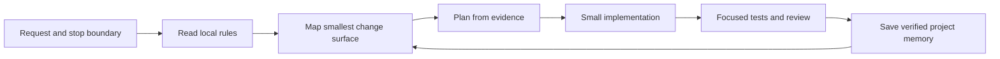

# Working with Legacy Codebases

> In a brownfield system, the first AI task is not writing code. It is earning enough evidence to change one small thing safely.


## TL;DR

- Treat a legacy repository as an **evidence problem**, not a giant prompt.
- Build a **task-specific map**: rules, execution path, test seam, risks, and the smallest safe change surface.
- Save **verified facts** and decisions in durable project memory so the next AI session does not rediscover or invent them.
- Keep the **change radius** small: one behaviour, its nearest implementation path, and focused regression coverage.
- Use gated loops: investigate → plan → change → validate → update memory.

## Quickstart (Do this now)

1. Restate the requested behaviour and name the stop boundary: what must not change.
2. Read repository instructions, AI policies, manifests, and the closest existing implementation before planning.
3. Trace one path from entry point to state change and the nearest test.
4. Write down only evidence-backed files, commands, risks, and open questions.
5. Make the smallest reversible change and add a focused test for its intended behaviour.
6. Save confirmed findings, decisions, and working commands in project memory.

## The Idea (Slightly deeper)

Legacy code is usually valuable because it encodes years of business decisions, compatibility promises, and production lessons. It is risky because those decisions may be implicit, distributed across modules, or missing from documentation. Giving an AI agent the whole repository does not solve that problem; it often makes the important evidence harder to find.

An AI-native brownfield workflow builds a **context harness** around a specific change. The harness gives the agent local rules, a narrow map of the relevant code, a durable record of verified facts, and explicit validation gates. It turns a plausible edit into a reviewable engineering change.

## A Safe Legacy-Codebase Loop



| Stage | AI should produce | Human checkpoint |
| --- | --- | --- |
| Map | Relevant files, execution path, tests, risks, and open questions | Is the change surface truly minimal? |
| Plan | Steps, assumptions, non-goals, and validation commands | Are assumptions acceptable? |
| Change | A narrow diff and a focused regression test | Does the diff stay inside the approved radius? |
| Validate | Test output, review notes, and residual risk | Is there enough proof to ship? |
| Remember | Verified facts, decisions, commands, and unresolved questions | Is the next session safer than the last? |

## Key Approaches

### 1. Map the smallest safe change surface

Do not ask for a repository summary. Ask the agent to discover the smallest collection of files that can affect the requested behaviour. Start with local instructions and policies; then inspect package boundaries, the nearest similar implementation, one execution path, and its tests.

Every map should distinguish facts from inferences. File paths and line references are evidence; guesses belong in **Open questions**. Revalidate the map when the revision changes.

### 2. Budget context instead of dumping it

The useful context set is not “everything that might matter.” It is the smallest authoritative set that lets a reviewer understand the proposed change: rules, relevant interfaces, neighbouring code, tests, and recent decisions. Expand it only when evidence points to another dependency.

### 3. Keep change radius explicit

Change radius is the scope of code and behaviour allowed to move for a task. Declare it before editing:

```text
Goal: Correct the validation message when minimum exceeds maximum.
Change radius: validation path and its nearest test module only.
Must not change: public API, unrelated validation rules, formatting, dependencies.
Proof: focused regression test plus the existing nearest test suite.
```

This boundary prevents a capable agent from turning a one-line defect into a speculative refactor.

### 4. Treat memory as a compact engineering artifact

Conversation history disappears, but verified knowledge should not. Maintain a small project-memory file with the repository revision, confirmed facts, evidence, decisions, working commands, risk notes, and open questions. Store no secrets, personal data, or unverified conclusions.

Memory is not a transcript or a replacement for source control. It is a handoff artifact that makes the next investigation faster and less error-prone.

### 5. Gate the agentic loop

For unfamiliar code, separate investigation from modification. Ask for the map first, approve the plan, then allow implementation. Require tests and a final report of changed files, evidence, assumptions, and remaining risks. Stop when repository policy requires human review or a decision exceeds the agreed change radius.

## Example Prompt

```text
Task: <describe the behaviour to correct>.
Stop boundary: Do not change <non-goals>.

First, map the smallest safe change surface. Read repository instructions and
AI policies first. Trace one execution path and the nearest tests. Cite evidence,
label inferences, and list open questions. Do not edit yet.

After the map is approved, propose a narrow plan. Implement only within the
approved change radius, add focused regression coverage, run the named checks,
and report changed files, results, assumptions, and residual risks. Finally,
update project memory with verified facts only.
```

## Core Skills Included

- [`map-legacy-codebase`](../skills/map-legacy-codebase/SKILL.md) — map the smallest safe change surface before planning or editing.
- [`save-project-memory`](../skills/save-project-memory/SKILL.md) — persist confirmed facts and handoff notes for later sessions.

## Common Pitfalls

- **Repository-scale context dumping**: it adds noise and invites unsupported assumptions.
- **Treating documentation as truth**: use it as a lead, then confirm with code and tests.
- **Implicit change radius**: agents may refactor beyond the actual need.
- **Memory as a transcript**: only durable, evidenced facts belong there.
- **Broad validation by default**: start with relevant checks; expand only when risk or policy requires it.
- **Skipping human gates**: AI output still needs policy-aware engineering review.

## Next Steps

- Use [Context, Model & Prompt](context-model-prompt.md) to curate the working set for each investigation.
- Use [Specification-Driven Development](specification-driven-development.md) to turn an approved map into a durable implementation contract.
- Use [AI PR Review Automation & Hooks](ai-pr-review-automation.md) to enforce checks after the narrow change is made.
