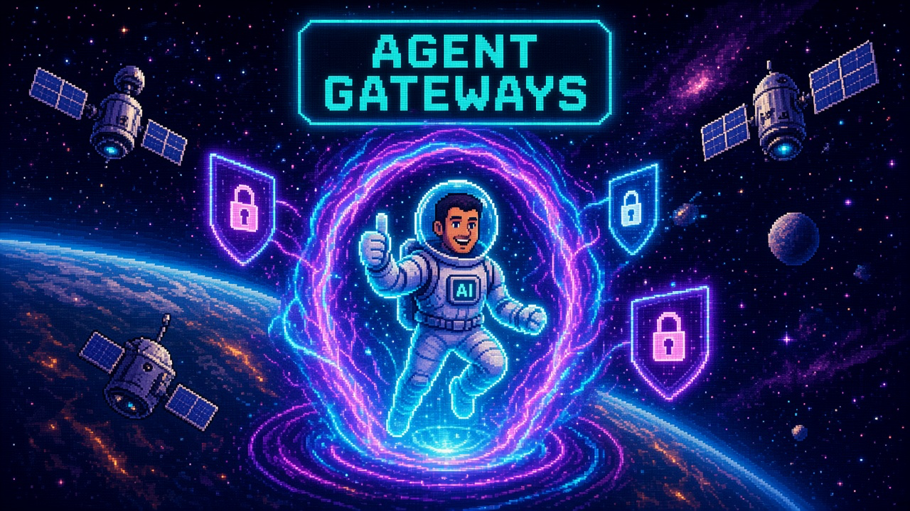
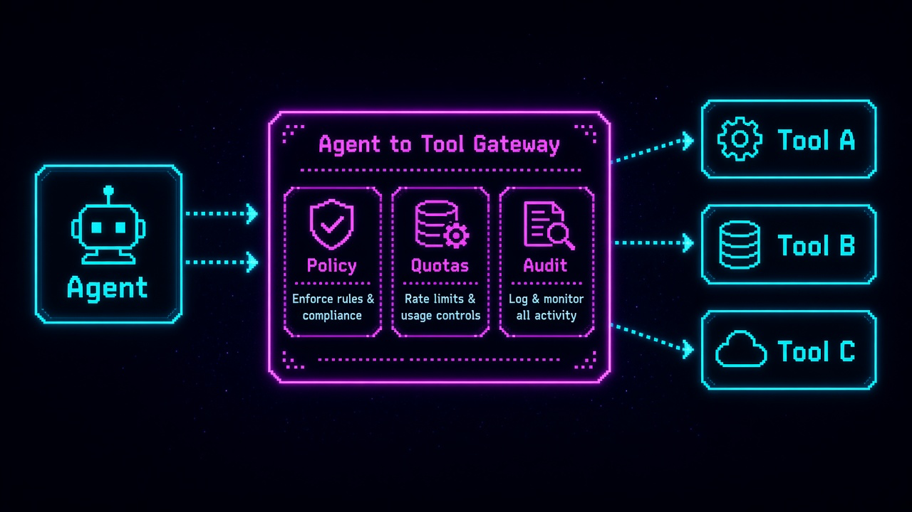

# Agent & Tool Gateways

> Put one governed gate between agents and the tools they use, so every action is authenticated, authorized, limited, and logged - no matter which agent or framework asks.

## TL;DR
- **A tool gateway** is like airport security for agent actions - every request passes one checkpoint before reaching the gate.
- **Tool allowlists** are like a restaurant menu - agents can only order what is listed, not walk into the pantry.
- **Policy and approvals** are like a manager's signature on large purchases - routine actions flow, risky ones wait for a human.
- **Audit trails** are like security camera footage - when something goes wrong, you can replay exactly who did what.

## Quickstart (Do this now)
1. **Inventory tools**: List every API, database, and MCP server agents can reach today, with read/write classification
2. **Route through one gateway**: Make agents call tools only via a proxy that you control
3. **Define per-agent allowlists**: Grant each agent the minimum tools, scopes, and argument ranges it needs
4. **Add approval for risky actions**: Require human confirmation for writes, spend, deletes, and external messages
5. **Log and meter**: Record every call with identity, arguments, result, latency, and cost

## The Idea (Slightly deeper)
Agents turn text into side effects. Without a gateway, each agent embeds credentials, calls APIs directly, and invents its own safeguards - producing inconsistent controls and an unauditable sprawl. A **tool gateway** (often an MCP gateway or API gateway extended for agents) centralizes cross-cutting concerns so tool owners and security teams enforce them once.

The gateway sits between the **agent runtime** and **tool servers**. On each call it does five things. **Identify**: verify the agent and the end user it acts for (see authentication and delegation). **Authorize**: check the tool, action, and arguments against policy, since argument-level rules matter more than tool-level ones ("refund up to $50" versus "refund"). **Constrain**: apply rate limits, budgets, timeouts, and schema validation. **Protect**: scan inputs and outputs for secrets, PII, and prompt injection in tool results. **Record**: emit traces and audit events.

It also solves **discovery and sprawl**: a registry of approved tools with owners, versions, and risk tiers, so agents see a curated catalog instead of the whole internet. Keep the gateway **thin and fast** - heavy reasoning belongs in the agent. Watch for a new single point of failure: deploy it redundantly and decide fail-closed for writes and fail-open (or degrade) for low-risk reads. A sibling **model gateway** handles LLM traffic; the two often share a platform but have different policies.

## Diagram

## Key Concepts
- **MCP Gateway / Tool Proxy**: A mediating server exposing tools to agents under central control
- **Tool Registry / Catalog**: Approved tools with owners, schemas, versions, and risk tiers
- **Argument-Level Policy**: Rules over parameters (amounts, recipients, scopes), not only tool names
- **Human-in-the-Loop Approval**: Pausing risky calls until a person confirms
- **Tool Result Sanitization**: Treating tool output as untrusted input to the model
- **Budgets & Quotas**: Per-agent, per-user limits on calls, spend, and blast radius
- **Fail-Closed vs Fail-Open**: Deciding what happens when the gateway or policy engine is unavailable

## When to Use This
- **Use when**: Multiple agents or teams share tools and credentials
- **Use when**: Tools can write data, move money, send messages, or run code
- **Use when**: You need audit evidence for who authorized which action
- **Don't use when**: One read-only tool is used by a single trusted prototype
- **Consider alternatives**: Embedded SDK-level guardrails when you have one agent and a few low-risk tools

## Real-World Examples
- **Docker MCP Gateway**: Run and govern MCP servers centrally → [docker/mcp-gateway](https://github.com/docker/mcp-gateway) (isolates tool servers in containers behind a single endpoint)
- **Envoy AI Gateway**: Open-source gateway for AI traffic → [Envoy AI Gateway](https://aigateway.envoyproxy.io/) (extends a proven proxy with AI-aware routing and policy)
- **Kong AI Gateway**: API gateway plugins for AI → [Kong AI Gateway](https://docs.konghq.com/gateway/latest/ai-gateway/) (applies familiar API management controls to LLM and tool traffic)
- **Azure API Management GenAI capabilities**: Gateway features for AI APIs → [GenAI gateway capabilities](https://learn.microsoft.com/en-us/azure/api-management/genai-gateway-capabilities) (token limits, semantic caching, and policy in an enterprise gateway)
- **LiteLLM**: Proxy with virtual keys and budgets → [LiteLLM docs](https://docs.litellm.ai/) (per-key spend control and routing, with MCP tool support)

## Common Pitfalls
- **Bypass paths**: Agents keep direct credentials, so the gateway is optional in practice
- **Tool-level only policy**: "Can call payments" without limiting amounts or recipients
- **Trusting tool output**: Injected instructions in a fetched page or ticket steer the agent
- **Over-broad tokens**: The gateway forwards one powerful credential rather than per-user scoped tokens
- **No kill switch**: You cannot disable a misbehaving tool or agent quickly

## Deep Dives & "Why it's awesome"
- **[Model Context Protocol specification](https://modelcontextprotocol.io/specification/2025-06-18)** - The protocol most tool gateways proxy and govern
- **[OWASP Top 10 for LLM Applications](https://genai.owasp.org/llm-top-10/)** - Excessive agency and insecure plugin risks a gateway helps contain
- **[Open Policy Agent](https://www.openpolicyagent.org/docs)** - Policy-as-code engine suited to argument-level rules
- **[Microsoft: API gateway pattern](https://learn.microsoft.com/en-us/azure/architecture/microservices/design/gateway)** - The architectural basis for a single controlled entry point
- **[Cloudflare AI Gateway](https://developers.cloudflare.com/ai-gateway/)** - Managed observability, limits, and caching for AI calls

## Next Steps
- **Learn more**: [AuthN & AuthZ for AI](authn-authz-for-ai.md) - Identity and delegation the gateway enforces
- **Learn more**: [AI Request Path & Gateways](ai-request-path-and-gateways.md) - The model-side gateway and overall request path
- **Dive deeper**: [Rate Limiting & Throughput](rate-limiting-and-throughput.md) - Budgets and quotas per agent and tenant
- **Dive deeper**: [Skills, MCP & RAG Capability Layers](skills-mcp-rag-capability-layers.md) - How tools fit with skills and retrieval
- **Connect**: [Guardrails](../ai-architecture-topics/guardrails.md) - Input and output controls around agent actions
- **Connect**: [AI Agents](../ai-architecture-topics/ai-agents.md) - Agent design that the gateway governs
