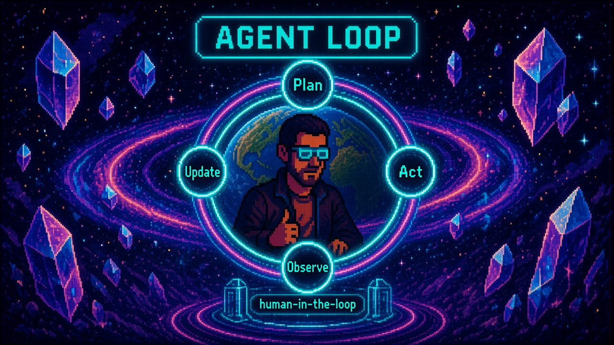
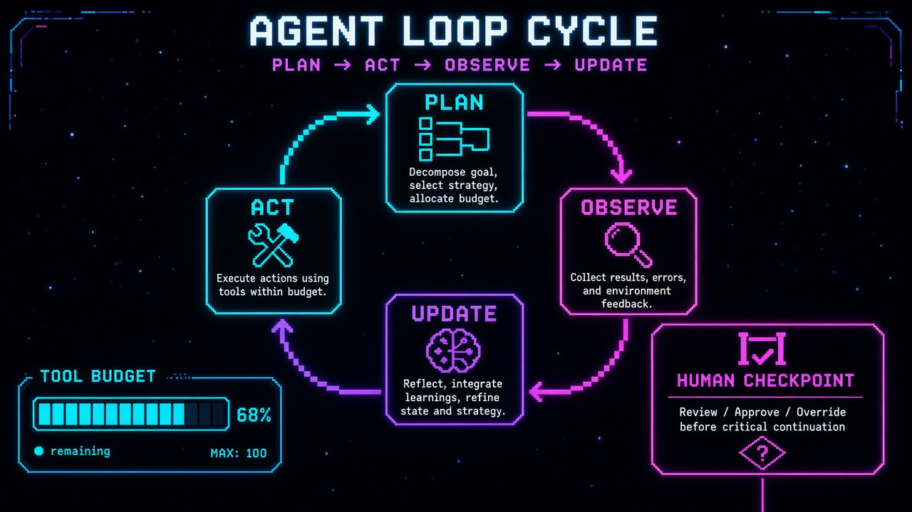

# Agent Loop & Harness

> Turn a model that can call tools into an agent that finishes real work, safely, within budget.

## TL;DR
- **The agent loop** is like a chef tasting while cooking - decide, act, taste the result, adjust, repeat.
- **The harness** is like the kitchen around the chef - tools, recipes, timers, and safety rules that turn talent into dinner service.
- **Tool calls** are like the chef's knives and stoves - the model decides, the harness executes.
- **Stop conditions** are like the oven timer - without them the loop burns money forever.

## Quickstart (Do this now)
1. **Start with a single loop**: One model, a handful of tools, a clear system prompt
2. **Define tools narrowly**: Typed inputs, clear descriptions, helpful error messages
3. **Add hard limits**: Max steps, max tokens, max wall-clock time, max spend
4. **Log every step**: Prompt, tool call, result, and decision as a trace
5. **Add human checkpoints**: Approval for destructive or irreversible actions
6. **Evaluate on real tasks**: Run a fixed task set after every prompt or tool change

## The Idea (Slightly deeper)
At its core, an agent is a loop: the model reads the context, either answers or emits a **tool call**, the harness executes the tool, appends the **observation** to the context, and the model goes again. This is the ReAct pattern (reason plus act) that most modern agent frameworks implement.

The **harness** is everything except the model: system prompt, tool registry, context assembly and compaction, permissions and sandboxing, retries, state persistence, tracing, and stop conditions. In practice, most agent quality differences between products come from the harness, not the model.

Anthropic's guidance is to start with the simplest thing: a plain LLM with retrieval and tools, then move to **workflows** (predefined paths such as prompt chaining, routing, parallelization) before reaching for fully autonomous **agents**. Add autonomy only when the task path is genuinely unpredictable.

## Diagram

## Key Concepts
- **ReAct Loop**: Interleaved reasoning, action, and observation until a stop condition is met
- **Tool Schema**: Name, description, and typed parameters the model uses to choose and call tools
- **Context Assembly**: Building each turn's prompt from system rules, history, memory, and observations
- **Compaction**: Summarizing or trimming old steps so long tasks fit the window
- **Permissions & Sandbox**: What the agent may read, write, and execute, and where
- **Checkpointing**: Saving state so runs can resume, replay, or be rolled back
- **Tracing**: A structured record of every step for debugging and evals

## When to Use This
- **Use when**: The path to the answer depends on intermediate results (coding, research, ops, support)
- **Use when**: Tasks need several tools or data sources
- **Use when**: You can verify results (tests, schemas, checks) to close the loop
- **Don't use when**: A single prompt or fixed pipeline solves the task more cheaply and predictably
- **Consider alternatives**: Deterministic workflows with LLM steps for well-understood processes

## Real-World Examples
- **Claude Code and Claude Agent SDK**: Production agent harness for coding → [Claude Agent SDK](https://docs.anthropic.com/en/docs/claude-code/sdk) (exposes the same loop, tools, permissions, and context management used by a shipping product)
- **OpenAI Agents SDK**: Lightweight loop with handoffs, guardrails, and tracing → [OpenAI Agents SDK](https://openai.github.io/openai-agents-python/) (small primitives that make the harness explicit)
- **LangGraph**: Agents as stateful graphs → [LangGraph](https://langchain-ai.github.io/langgraph/) (durable execution, human-in-the-loop, and checkpointing built in)
- **Cursor Agent**: IDE agent with tools, rules, and review → [Cursor Docs](https://docs.cursor.com/) (shows how rules, tools, and approvals shape agent behavior)

## Common Pitfalls
- **Unbounded loops**: No step or cost cap leads to runaway runs - always set limits
- **Too many tools**: Large, overlapping toolsets confuse selection - keep a small, distinct set
- **Vague tool errors**: Return actionable messages so the model can self-correct
- **Context rot**: Raw tool output piles up; truncate, summarize, or store it externally
- **No verification step**: Agents that cannot check their work drift - add tests, linters, or validators
- **Skipping observability**: You cannot fix what you cannot replay

## Deep Dives & "Why it's awesome"
- **[Building Effective Agents](https://www.anthropic.com/engineering/building-effective-agents)** - Workflows vs agents and the simplest patterns that work
- **[ReAct paper](https://arxiv.org/abs/2210.03629)** - The reasoning-plus-acting loop behind most agent frameworks
- **[Writing Effective Tools for Agents](https://www.anthropic.com/engineering/writing-tools-for-agents)** - Tool design as an interface for models, not people
- **[Effective Context Engineering](https://www.anthropic.com/engineering/effective-context-engineering-for-ai-agents)** - Keeping the loop's context small and high-signal
- **[OpenAI: A Practical Guide to Building Agents](https://cdn.openai.com/business-guides-and-resources/a-practical-guide-to-building-agents.pdf)** - Orchestration, guardrails, and when to use single vs multiple agents
- **[LangGraph Concepts](https://langchain-ai.github.io/langgraph/concepts/)** - Durable execution and human-in-the-loop patterns

## Harness Readiness Checklist
- **Limits**: Steps, tokens, time, and spend caps enforced outside the model
- **Tools**: Each has a schema, tests, timeouts, and idempotency where possible
- **Safety**: Sandboxed execution, least-privilege credentials, approval for risky actions
- **State**: Checkpoints and resumable runs
- **Evidence**: Full traces and a regression task set

## Next Steps
- **Learn more**: [Agent Memory Architecture](agent-memory-architecture.md) - What the loop reads and writes between steps
- **Learn more**: [Multi-Agent and Agent Protocols](multi-agent-and-agent-protocols.md) - When one loop becomes many
- **Go deeper**: [AI Agents](../ai-architecture-topics/ai-agents.md) - Agent fundamentals and tool use
- **Go deeper**: [Guardrails](../ai-architecture-topics/guardrails.md) - Policy and safety controls around the loop
- **Apply it**: [Agentic Systems Architecture](../ai-for-software-engineering-skills/agentic-systems-architecture.md) - Agent design for software delivery
- **Try it**: [Anthropic Agent Quickstarts](https://github.com/anthropics/anthropic-quickstarts) - Reference agent implementations to adapt
