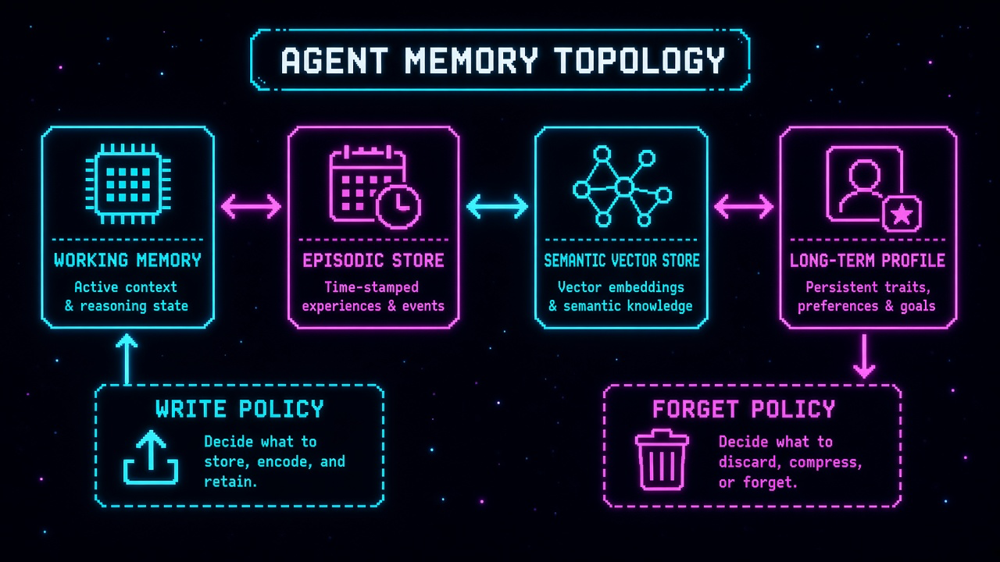

# Agent Memory Architecture

> Give your agents a memory that remembers what matters, forgets what doesn't, and never blows the context window.

## TL;DR
- **Working memory** is like a desk - small, fast, and only holds what you are using right now (the context window).
- **Episodic memory** is like a diary - a log of what happened in past sessions and tasks.
- **Semantic memory** is like an encyclopedia - durable facts about users, domains, and the world.
- **Procedural memory** is like muscle memory - learned instructions, prompts, and skills that shape how the agent acts.
- **Memory consolidation** is like sleep - the agent summarizes, merges, and prunes so tomorrow's recall is cleaner.

## Quickstart (Do this now)
1. **List what must persist**: User preferences, task state, decisions, and domain facts - nothing else
2. **Split by lifetime**: Per-turn (context), per-session (thread state), per-user (long-term store)
3. **Pick a store**: Key-value for profiles, vector store for fuzzy recall, graph or SQL for relationships
4. **Add write rules**: Decide who writes memory (agent, background job, or human) and when
5. **Add read rules**: Retrieve top-k relevant memories per turn, never dump everything into the prompt
6. **Test recall**: Replay conversations and check the agent uses (and does not leak) the right memories

## The Idea (Slightly deeper)
An LLM is stateless. Everything it "remembers" is whatever you put in the prompt. **Memory architecture** is the system that decides what gets written down, where it is stored, and what is brought back into the context window at the right moment.

Think in tiers, like an operating system: **working memory** (context window, fast but tiny), **short-term memory** (thread or session state, checkpointed per run), and **long-term memory** (external stores that survive across sessions). The agent, or a background process, moves information between tiers - the idea popularized by MemGPT's "LLM as operating system".

Long-term memory splits into **episodic** (what happened), **semantic** (what is true), and **procedural** (how to do things). Each has a different write path, schema, and retention policy. Good designs treat memory as a product surface: it needs access control, expiry, auditability, and tests - not just an embedding table.

## Diagram

## Key Concepts
- **Context Window**: The only memory the model truly sees; budget it like RAM
- **Thread State / Checkpoint**: Per-session snapshot that lets an agent pause and resume
- **Memory Write Policy**: Rules for what is saved - "hot path" (during the turn) vs "background" (after it)
- **Retrieval Policy**: Recency, relevance, and importance scoring when pulling memories back
- **Summarization & Compaction**: Compressing old turns into short notes to free tokens
- **Memory Scoping**: Isolating memory per user, tenant, agent, or project to prevent leakage
- **Forgetting**: TTLs, decay, and deletion on request (privacy and GDPR-style erasure)

## When to Use This
- **Use when**: Agents run multi-session workflows (assistants, support, coding, research)
- **Use when**: Personalization materially improves outcomes
- **Use when**: Tasks outgrow a single context window
- **Don't use when**: Each request is independent and stateless (simple Q&A, classification)
- **Consider alternatives**: Plain RAG over a static knowledge base if nothing is learned from interactions

## Real-World Examples
- **Letta (MemGPT)**: Tiered, self-editing memory for agents → [Letta Docs](https://docs.letta.com/) (turns the OS-style memory hierarchy into a production agent framework)
- **Mem0**: Memory layer for personalized AI → [Mem0 Docs](https://docs.mem0.ai/) (drop-in extraction, storage, and retrieval of user memories)
- **LangGraph Memory**: Checkpointers plus a cross-thread store → [LangGraph Memory Concepts](https://langchain-ai.github.io/langgraph/concepts/memory/) (clear separation of short-term and long-term memory with semantic, episodic, and procedural types)
- **Claude Memory Tool and Context Editing**: Client-side file-based memory → [Anthropic Memory Tool](https://docs.anthropic.com/en/docs/agents-and-tools/tool-use/memory-tool) (shows memory as simple files the agent reads and writes)

## Common Pitfalls
- **Memory hoarding**: Saving every turn creates noise that lowers retrieval quality - extract facts, not transcripts
- **Stale or contradictory facts**: Add timestamps, supersede old entries, and resolve conflicts on write
- **Cross-user leakage**: Always scope by tenant and user ID at the query layer, not in the prompt
- **Prompt injection into memory**: Untrusted content saved as "fact" poisons future runs - validate and label provenance
- **No evals**: Without recall tests, memory silently degrades; measure hit rate and answer quality
- **Over-retrieval**: Stuffing 50 memories into context hurts accuracy and cost

## Deep Dives & "Why it's awesome"
- **[MemGPT paper](https://arxiv.org/abs/2310.08560)** - The foundational idea of managing memory tiers like an operating system
- **[Generative Agents](https://arxiv.org/abs/2304.03442)** - Memory streams with recency, importance, and reflection scoring
- **[Effective Context Engineering for AI Agents](https://www.anthropic.com/engineering/effective-context-engineering-for-ai-agents)** - Practical compaction, note-taking, and just-in-time retrieval
- **[Reflexion](https://arxiv.org/abs/2303.11366)** - Agents that store verbal lessons from failures as episodic memory
- **[LangGraph Persistence](https://langchain-ai.github.io/langgraph/concepts/persistence/)** - Checkpointers and stores for durable agent state
- **[Mem0 Research](https://arxiv.org/abs/2504.19413)** - Benchmarks for scalable long-term conversational memory

## Memory Design Checklist
- **Scope**: Every record carries tenant, user, and agent identifiers
- **Provenance**: Store source, timestamp, and confidence with each memory
- **Budget**: Cap tokens injected from memory per turn
- **Retention**: Define TTL and a delete-on-request path
- **Observability**: Log which memories were retrieved and used for each answer

## Next Steps
- **Learn more**: [Agent Loop and Harness](agent-loop-and-harness.md) - Where memory reads and writes happen in each iteration
- **Learn more**: [Skills, MCP, and RAG Capability Layers](skills-mcp-rag-capability-layers.md) - How memory fits next to tools and knowledge
- **Go deeper**: [Genetic Memory](../ai-architecture-topics/genetic-memory.md) - Evolving, reusable agent knowledge
- **Go deeper**: [Vector Stores and Embeddings](../ai-architecture-topics/vector-stores-and-embeddings.md) - Pick the storage behind semantic recall
- **Apply it**: [Context, Model, Prompt](../ai-for-software-engineering-skills/context-model-prompt.md) - Context discipline for coding agents
- **Try it**: [LangGraph Memory How-To](https://langchain-ai.github.io/langgraph/how-tos/memory/) - Add long-term memory to an agent
