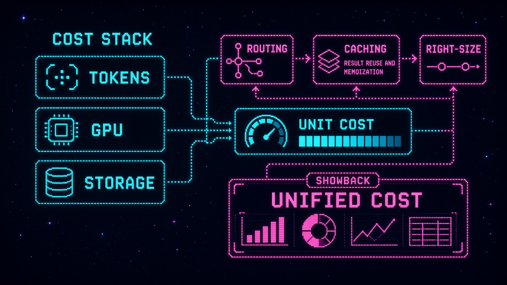

# AI Cost & Token Economics

> Know what every answer costs, and design the system so quality goes up while the bill stays flat.

## TL;DR
- **Tokens** are like taxi meters - input and output both tick, and output ticks faster.
- **Prompt caching** is like a pre-paid pass for text you keep repeating - reused prefixes cost a fraction.
- **Model routing** is like sending simple errands to a bike courier and heavy cargo to a truck.
- **Batch APIs** are like overnight shipping - slower, but significantly cheaper for non-urgent work.
- **Agents multiply cost** - every loop iteration re-sends context, so cost grows with steps, not just users.

## Quickstart (Do this now)
1. **Meter everything**: Log input, output, cached tokens, model, and feature per request
2. **Compute cost per outcome**: Cost per resolved ticket or per accepted answer, not per call
3. **Put stable content first**: Order prompts so system text and documents form a cacheable prefix
4. **Route by difficulty**: Cheap model by default, escalate on low confidence or failed checks
5. **Batch offline work**: Evals, enrichment, and summarization through batch endpoints
6. **Set budgets and alerts**: Per user, per feature, and per agent run, with hard caps

## The Idea (Slightly deeper)
LLM cost is roughly **tokens in x input price + tokens out x output price**, summed across every call a feature makes. Output tokens are typically priced several times higher than input and are generated sequentially, so they also drive latency. For agents, the dominant factor is **context re-sending**: each step includes the growing history, so a 20-step task can cost far more than 20 times a single call unless caching and compaction are used.

The levers fall into five groups. **Reduce tokens**: concise prompts, trimmed retrieval, structured output, compaction. **Reuse tokens**: prompt and semantic caching. **Right-size the model**: routing, cascades, and distillation to small models. **Shift timing**: batch and off-peak processing. **Control behavior**: step limits, early stopping, and budgets enforced outside the model.

Cost is a quality attribute, so optimize against an eval, not in isolation. A cheaper model that fails 10% more tasks may cost more once retries and human review are counted. Track **cost per successful outcome** and the **quality-cost frontier** across model options.

## Diagram

## Key Concepts
- **Input vs Output Tokens**: Billed separately; output is usually pricier and slower
- **Prompt Caching**: Discounted reads for repeated prompt prefixes
- **Semantic Caching**: Reusing answers to similar questions, with similarity thresholds
- **Model Cascade / Routing**: Try cheap first, escalate when needed
- **Batch Processing**: Asynchronous jobs at a lower price for non-interactive tasks
- **Context Compaction**: Summarizing history so agents re-send fewer tokens
- **Unit Economics**: Cost per user, per task, and per successful outcome
- **Reasoning Tokens**: Hidden thinking tokens that are billed like output

## When to Use This
- **Use when**: Usage is growing and the bill is becoming a product constraint
- **Use when**: Agents or RAG send large, repeated contexts
- **Use when**: Choosing between vendors, tiers, self-hosting, and tuning
- **Don't use when**: Optimizing before you have measured - prototypes should buy quality first
- **Consider alternatives**: Self-hosted open models when volume is high and predictable (see serving articles)

## Real-World Examples
- **Anthropic Prompt Caching**: Cached prefix reads at reduced price → [Prompt Caching Docs](https://docs.anthropic.com/en/docs/build-with-claude/prompt-caching) (explicit cache breakpoints and clear pricing mechanics)
- **OpenAI Prompt Caching and Batch**: Automatic caching and discounted async jobs → [Prompt Caching](https://platform.openai.com/docs/guides/prompt-caching) and [Batch API](https://platform.openai.com/docs/guides/batch) (low-effort savings for repeated and offline workloads)
- **RouteLLM**: Learned routing between strong and weak models → [RouteLLM](https://github.com/lm-sys/RouteLLM) (open-source framework showing large cost cuts at similar quality)
- **LiteLLM**: Gateway with spend tracking and budgets → [LiteLLM Docs](https://docs.litellm.ai/) (unified API, per-key budgets, and fallbacks across providers)

## Common Pitfalls
- **Measuring per call, not per outcome**: Retries and agent loops hide the real cost
- **Cache-busting prompts**: Timestamps or user IDs at the start of a prompt destroy cache hits
- **Bloated retrieval**: Sending 20 chunks when 4 suffice
- **Ignoring output length**: Unbounded generations and verbose reasoning inflate spend and latency
- **Cost-only optimization**: Downgrading models without a regression eval
- **No kill switch**: Runaway agent loops or abusive users with no budget cap
- **Forgetting hidden costs**: Embeddings, reranking, vector storage, tracing, and egress

## Deep Dives & "Why it's awesome"
- **[FrugalGPT](https://arxiv.org/abs/2305.05176)** - Cascades and approximation strategies that cut cost while holding accuracy
- **[RouteLLM paper](https://arxiv.org/abs/2406.18665)** - Preference-data-trained routers and measured savings
- **[Anthropic Pricing](https://www.anthropic.com/pricing)** - Reference for input, output, cache, and batch price structure
- **[OpenAI API Pricing](https://openai.com/api/pricing/)** - Compare tiers and cached-input discounts
- **[Langfuse Token and Cost Tracking](https://langfuse.com/docs/model-usage-and-cost)** - Attribute spend to traces, users, and features
- **[Anthropic Batch Processing](https://docs.anthropic.com/en/docs/build-with-claude/batch-processing)** - Asynchronous bulk workloads at reduced cost

## Cost Control Checklist
- **Visibility**: Per-feature and per-tenant cost dashboards
- **Prefix hygiene**: Stable system prompt and documents first, dynamic content last
- **Routing**: Default small model with measured escalation rules
- **Limits**: Max output tokens, max agent steps, per-run and per-user budgets
- **Review**: Monthly cost-versus-quality review against the eval suite

## Next Steps
- **Learn more**: [Eval Recipes and LLM-as-Judge](eval-recipes-and-llm-judge.md) - Prove savings do not hurt quality
- **Learn more**: [Agent Loop and Harness](agent-loop-and-harness.md) - Where loop limits and compaction live
- **Go deeper**: [Model Routing](../ai-architecture-topics/model-routing.md) - Cascades and routers in detail
- **Go deeper**: [Serving and Scaling](../ai-architecture-topics/serving-and-scaling.md) - Self-hosting economics and batching
- **Plan it**: [Estimation Techniques](../solution-architecture/estimation-techniques.md) - Forecasting AI run costs
- **Try it**: [tiktoken](https://github.com/openai/tiktoken) - Count tokens before you pay for them
