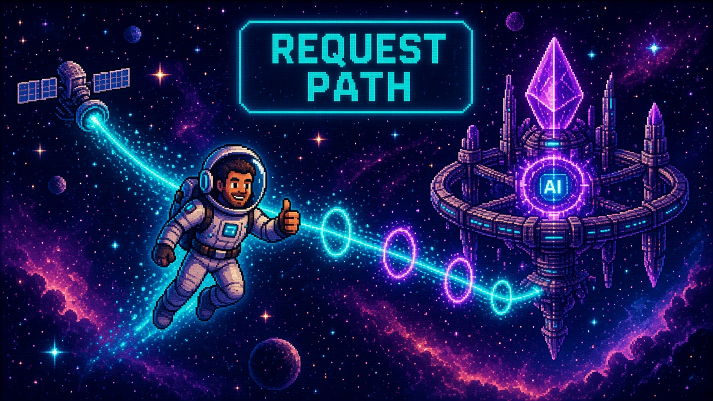
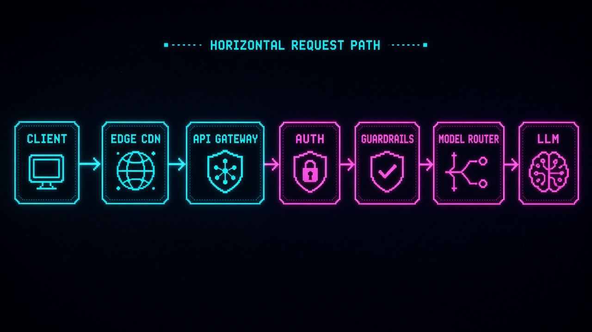

# AI Request Path & Gateways

> Follow one user request from browser to GPU and back, and put the right controls at the right hop.

## TL;DR
- **The request path** is like an airport journey - check-in, security, boarding, flight, baggage claim. Each stop has a job, and a delay at any one delays the whole trip.
- **An AI gateway** is like air traffic control - every flight (request) passes through one tower that handles routing, priority, and safety.
- **Guardrails and policy** are like security screening - inspect what goes in and what comes out before it reaches the passenger.
- **Observability** is like flight tracking - without a trace ID across hops, you cannot tell where the time or money went.

## Quickstart (Do this now)
1. **Draw your request path**: Client → CDN/edge → API gateway → app/orchestrator → retrieval/tools → AI gateway → model → response
2. **Attach a trace ID at the edge**: Propagate it through every hop, including model and tool calls
3. **Put one gateway in front of all model traffic**: Auth, quotas, routing, retries, caching, and logging in one place
4. **Budget latency per hop**: Assign milliseconds to auth, retrieval, rerank, prompt build, TTFT, and generation
5. **Log tokens, cost, model, and tenant** on every request for debugging and chargeback

## The Idea (Slightly deeper)
A typical AI request crosses many components. At the **edge**, TLS termination, WAF, and bot protection filter traffic. The **API gateway** authenticates the caller, resolves the tenant, and applies coarse rate limits. The **application or orchestrator** loads session state, runs **retrieval** (embedding, vector search, rerank), builds the prompt, and may loop through **agent tool calls**. Model traffic then goes through an **AI gateway** that picks a model and provider, applies token quotas, checks caches, and handles retries and fallbacks. Finally the **inference server** (a hosted API or self-hosted vLLM/Triton) generates tokens, which stream back through the same path, often with output guardrails.

An **AI gateway** is a specialized reverse proxy for model traffic. It gives you a **single, provider-neutral interface** (often OpenAI-compatible), so applications don't hard-code vendors. It centralizes **cross-cutting concerns**: authentication and virtual keys, per-tenant budgets, [rate limiting](rate-limiting-and-throughput.md), [caching](caching-for-ai.md), [failover](reliability-and-failure-design.md), PII redaction, prompt and response logging, and cost attribution. Without it, every team re-implements these slightly differently.

Latency adds up across the path, so **where you place components matters**. Streaming responses hide generation time but not retrieval or queueing time. Co-locate retrieval and orchestration near the model region, keep the vector store in the same network, and avoid cross-region hops in the hot path. For self-hosted inference, add **cache-aware or load-aware routing** so requests with shared prefixes land on replicas that already hold the KV cache.

Keep the gateway **thin and fast**: it is on the critical path of every request, so heavy logic (evaluation, enrichment, analytics) should be moved asynchronously via events.

## Diagram

## Key Concepts
- **API Gateway vs AI Gateway**: General edge routing and auth vs model-aware quotas, routing, and caching
- **Provider-Neutral API**: A uniform interface (often OpenAI-compatible) that hides vendor differences
- **Virtual Keys**: Gateway-issued credentials mapping to tenants, budgets, and allowed models
- **Request Tracing**: A trace ID propagated across all hops, including LLM and tool calls
- **Time-to-First-Token (TTFT)**: User-perceived latency until streaming begins
- **Cache- and Load-Aware Routing**: Sending requests to replicas based on prefix cache and queue depth
- **Control Plane vs Data Plane**: Policy configuration separate from the hot request path

## When to Use This
- **Use when**: Multiple apps, teams, or tenants share model access
- **Use when**: You use more than one provider or model family
- **Use when**: You need centralized cost tracking, audit logs, or compliance controls
- **Don't use when**: A single prototype calling one model directly
- **Consider alternatives**: Provider SDKs with built-in retries if you have one app and one provider

## Real-World Examples
- **Cloudflare AI Gateway**: Managed proxy for model APIs → [AI Gateway](https://developers.cloudflare.com/ai-gateway/) (analytics, caching, rate limiting, and fallbacks with minimal integration effort)
- **LiteLLM Proxy**: Open-source OpenAI-compatible gateway → [LiteLLM proxy](https://docs.litellm.ai/docs/simple_proxy) (100+ providers behind one API with budgets and routing)
- **Azure OpenAI gateway pattern**: API Management in front of model endpoints → [Gateway guide](https://learn.microsoft.com/en-us/azure/architecture/ai-ml/guide/azure-openai-gateway-guide) (a vendor-written reference architecture with the tradeoffs spelled out)
- **Kubernetes Gateway API Inference Extension**: Model-aware load balancing → [Inference Extension](https://gateway-api-inference-extension.sigs.k8s.io/) (routes by KV cache and queue state for self-hosted LLMs)
- **vLLM Production Stack**: Reference deployment with a router → [production-stack](https://github.com/vllm-project/production-stack) (open-source router, observability, and autoscaling for vLLM clusters)

## Common Pitfalls
- **Provider calls scattered across services**: No single place for quotas, keys, or kill switches
- **Gateway becomes a bottleneck**: Heavy synchronous processing on the hot path adds latency
- **No end-to-end trace**: You see a slow response but not whether retrieval, queueing, or the model caused it
- **Logging raw prompts without controls**: Sensitive data ends up in logs without redaction or retention rules
- **Single gateway instance**: The control point becomes a single point of failure

## Deep Dives & "Why it's awesome"
- **[Implementing multiple model backends (Azure)](https://learn.microsoft.com/en-us/azure/architecture/ai-ml/guide/azure-openai-gateway-multi-backend)** - Load balancing and failover across model deployments
- **[Cloudflare AI Gateway docs](https://developers.cloudflare.com/ai-gateway/)** - Concrete feature set for a managed gateway
- **[Portkey docs](https://portkey.ai/docs)** - Gateway with guardrails, caching, and observability integrations
- **[OpenTelemetry docs](https://opentelemetry.io/docs/)** - Vendor-neutral tracing and metrics for every hop
- **[Envoy architecture overview](https://www.envoyproxy.io/docs/envoy/latest/intro/arch_overview/intro/intro)** - The proxy underlying many gateways and service meshes
- **[OWASP Top 10 for LLM Applications](https://genai.owasp.org/llm-top-10/)** - Threats to check at the gateway and guardrail layers

## Next Steps
- **Learn more**: [Sync, Async & Streaming APIs](sync-async-streaming-apis.md) - Choose the response style for each endpoint
- **Learn more**: [Rate Limiting & Throughput](rate-limiting-and-throughput.md) - What the gateway enforces
- **Dive deeper**: [Reliability & Failure Design](reliability-and-failure-design.md) - Failover logic behind the gateway
- **Connect**: [Model Routing](../ai-architecture-topics/model-routing.md) - Pick the right model per request
- **Connect**: [Guardrails](../ai-architecture-topics/guardrails.md) - Input and output controls in the path
- **Connect**: [Technical Architecture](../solution-architecture/technical-architecture.md) - Place the gateway within the overall system
