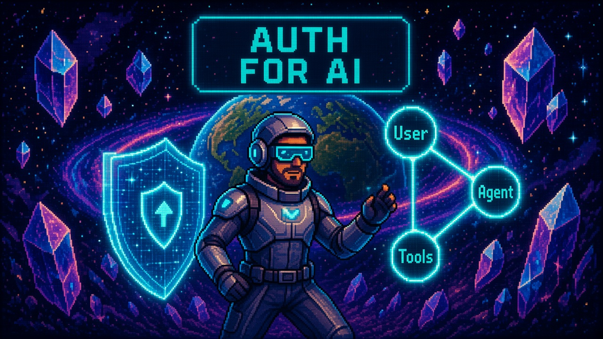
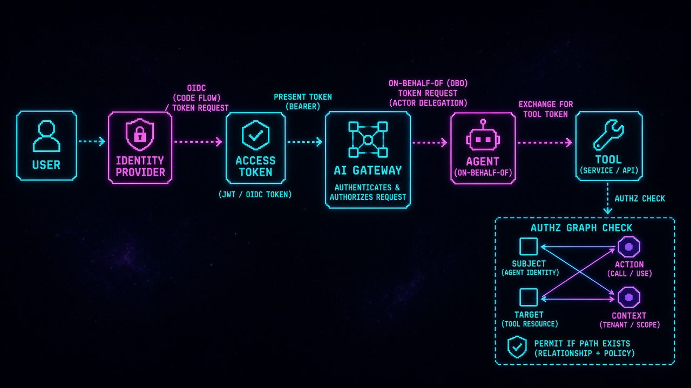

# AuthN & AuthZ for AI

> Make sure every model call, retrieval, and tool action runs as the right identity with the least privilege - so an agent can never do more than the human it acts for.

## TL;DR
- **Authentication (AuthN)** is like showing your badge at the door - it proves who or what is calling.
- **Authorization (AuthZ)** is like which rooms your badge opens - being inside the building does not mean you can enter the vault.
- **Agent identity** is like a valet key - the agent gets a limited, expiring key that acts on your behalf, not your master key.
- **Fine-grained authorization** is like per-document access stickers - retrieval returns only the pages the asker is allowed to read.

## Quickstart (Do this now)
1. **Authenticate users with OIDC**: Use your identity provider for sign-in and carry the user identity into every AI request
2. **Give agents their own identity**: Issue workload credentials, separate from the human, with an explicit owner
3. **Use delegation, not shared secrets**: Exchange the user token for a short-lived, narrowly scoped token per tool call
4. **Filter retrieval by permission**: Apply ACL checks at query time, before chunks reach the prompt
5. **Log decisions**: Record who (user + agent), what, which resource, and allow or deny for every action

## The Idea (Slightly deeper)
AI changes the security model because the **caller is not the actor**. A user asks, an LLM decides, an agent calls a tool, and the tool touches data. If the agent uses a powerful service account, any prompt injection or model mistake inherits that power - the classic **confused deputy** problem. The principle is to always carry **two identities**: the *subject* (the human or system that requested the work) and the *actor* (the agent or service performing it), and to authorize against the **intersection** of their permissions.

**Authentication** layers: users sign in with **OpenID Connect** on top of **OAuth 2.0**; services and agents authenticate with workload identities (managed identity, SPIFFE, client credentials). For tool access, **OAuth token exchange** or on-behalf-of flows produce short-lived tokens with minimal scopes. The **Model Context Protocol** authorization spec builds on OAuth so that tool servers can demand tokens bound to their own audience.

**Authorization** has to be fine-grained because AI touches unstructured data. Role-based checks are not enough when a vector search could surface any chunk. Use **relationship-based (ReBAC)** or **attribute/policy-based (ABAC)** engines to answer "can this user read this document?" and enforce it as a **pre-filter** on retrieval. For risky actions (payments, deletes, external emails) add **human approval** and **step-up authentication**. Prompts are not a security boundary: enforce policy in code outside the model.

## Diagram

## Key Concepts
- **OIDC / OAuth 2.0**: Standards for user sign-in and delegated, scoped access tokens
- **Token Exchange (RFC 8693)**: Swap one token for a narrower, audience-specific token for a downstream tool
- **Workload / Agent Identity**: Non-human identity with its own credentials, owner, and lifecycle
- **Confused Deputy**: A privileged agent tricked into using its authority for an unauthorized requester
- **ReBAC / ABAC / PBAC**: Authorization by relationships, attributes, or declarative policies
- **Permission-Aware Retrieval**: Filtering search results by the caller's access rights before generation
- **Least Privilege & Short TTL**: Minimal scopes and expiring credentials per task

## When to Use This
- **Use when**: Agents call internal APIs, databases, or SaaS tools on behalf of users
- **Use when**: RAG indexes mix documents with different audiences or classifications
- **Use when**: You must prove who triggered what for audit or compliance
- **Don't use when**: A single-user local prototype touches only your own data (still keep secrets out of prompts)
- **Consider alternatives**: Read-only, pre-approved tool sets when full delegation is too risky

## Real-World Examples
- **MCP authorization**: OAuth-based protection for tool servers → [MCP Authorization](https://modelcontextprotocol.io/specification/2025-06-18/basic/authorization) (standardizes how agents obtain tokens for tools)
- **OpenFGA**: Open-source ReBAC engine inspired by Google Zanzibar → [OpenFGA](https://openfga.dev/docs) (practical per-document permission checks for RAG filters)
- **Cedar**: Policy language and engine → [Cedar](https://www.cedarpolicy.com/) (readable, analyzable policies for agent actions)
- **Open Policy Agent**: General policy engine → [OPA docs](https://www.openpolicyagent.org/docs) (decouples authorization logic from application and agent code)
- **SPIFFE/SPIRE**: Workload identity → [SPIFFE](https://spiffe.io/docs/latest/spiffe-about/overview/) (cryptographic identity for services and agents without static secrets)

## Common Pitfalls
- **Shared service account**: One powerful key for all agent actions erases per-user accountability
- **Authorization in the prompt**: "Only show allowed data" instructions are trivially bypassed
- **Post-filtering retrieval**: Fetching everything and filtering after generation leaks via the answer
- **Long-lived tokens in context**: Credentials placed in prompts or logs are one injection away from exfiltration
- **Stale permissions in indexes**: Document ACL changes that never propagate to the vector store

## Deep Dives & "Why it's awesome"
- **[OAuth 2.0 (RFC 6749)](https://datatracker.ietf.org/doc/html/rfc6749)** - The base framework behind delegated access
- **[OAuth 2.0 Token Exchange (RFC 8693)](https://datatracker.ietf.org/doc/html/rfc8693)** - The standard for acting on behalf of a user with narrowed scope
- **[OpenID Connect Core](https://openid.net/specs/openid-connect-core-1_0.html)** - The identity layer for authenticating end users
- **[Zanzibar paper](https://research.google/pubs/zanzibar-googles-consistent-global-authorization-system/)** - Origin of relationship-based authorization at scale
- **[OWASP Top 10 for LLM Applications](https://genai.owasp.org/llm-top-10/)** - Excessive agency and sensitive disclosure risks tied to weak authorization

## Next Steps
- **Learn more**: [Agent & Tool Gateways](agent-and-tool-gateways.md) - Enforce identity and policy at a single choke point
- **Learn more**: [Multi-Tenancy for AI](multi-tenancy-for-ai.md) - Tenant isolation as the outer authorization boundary
- **Dive deeper**: [Multi-Agent & Agent Protocols](multi-agent-and-agent-protocols.md) - Identity propagation across agent-to-agent calls
- **Dive deeper**: [Skills, MCP & RAG Capability Layers](skills-mcp-rag-capability-layers.md) - Where tool and retrieval access are exposed
- **Connect**: [Safety & Security](../ai-architecture-topics/safety-and-security.md) - Threat models for prompt injection and data exfiltration
- **Connect**: [Security & Compliance](../ai-architecture-topics/security-compliance.md) - Audit and regulatory controls
