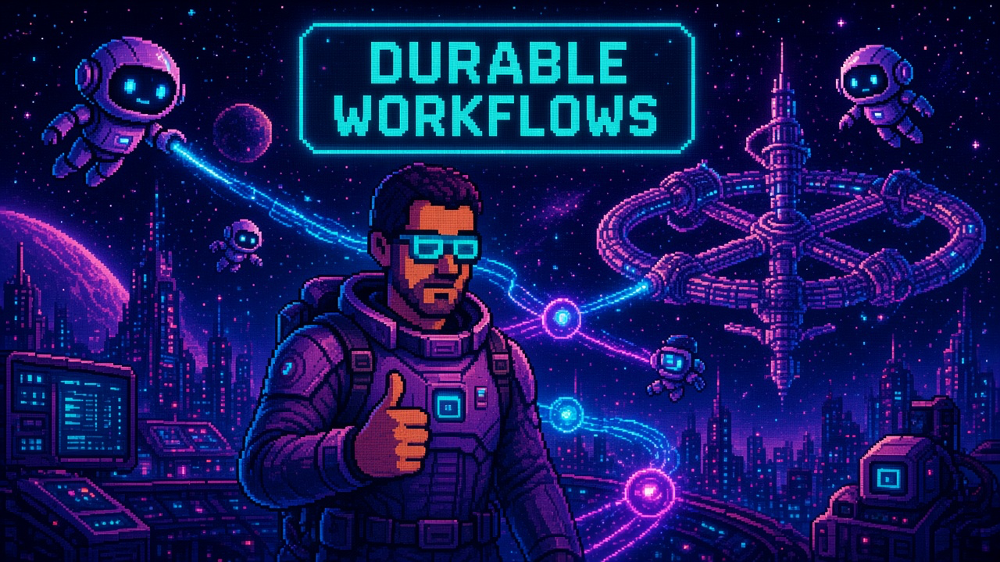
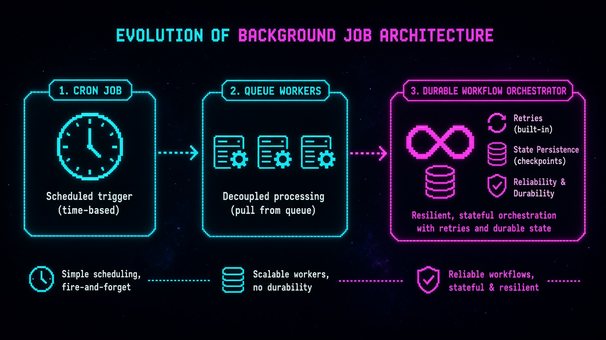

# Background Jobs & Durable Workflows

> Make long-running agents and AI pipelines survive crashes, deploys, rate limits, and week-long waits - and resume exactly where they stopped.

## TL;DR
- **Background jobs** are like handing a task to a coworker - the user doesn't wait; the work happens later in a separate process.
- **Durable workflows** are like a video game with autosave - if the server crashes, execution resumes from the last saved point instead of restarting.
- **Sagas** are like cancelling a trip step by step - if the hotel booking fails, you undo the flight booking you already made.
- **Human-in-the-loop waits** are like a document sitting in someone's inbox - the workflow pauses cheaply for hours or days until a person approves.

## Quickstart (Do this now)
1. **Move long work off the request path**: Return a job ID and process in workers (see [Sync, Async & Streaming APIs](sync-async-streaming-apis.md))
2. **Break the process into steps**: Retrieve → plan → call tool → validate → summarize; each step independently retryable
3. **Persist state after every step**: Inputs, outputs, and progress, not just final results
4. **Set per-step retry policies and timeouts**: Different for LLM calls, tool calls, and human approvals
5. **Add limits and kill switches**: Max steps, max spend, max duration, and a way to cancel a run

## The Idea (Slightly deeper)
A **background job** system - a queue plus worker pool such as Celery, Sidekiq-style runners, or cloud queues - is the simplest way to take slow work off the request path. It handles retries and scheduling, but each job is largely **stateless and short-lived**. If a worker dies in the middle of a 20-step agent run, you either restart from scratch (re-paying for tokens and repeating side effects) or hand-roll checkpoints.

**Durable execution** engines solve this. You write the workflow as code or a state machine; the engine records each step's result in an **event history**. After a crash, deploy, or scale-down, it **replays** the history to rebuild state and continues at the next unfinished step, without re-running completed ones. Retries, timeouts, timers, and signals are first-class. This is a natural fit for **agents**, which are loops of non-deterministic, slow, failure-prone calls with real-world side effects.

The key design rule: separate **orchestration** from **work**. The orchestration (workflow) code must be **deterministic** - no random numbers, wall-clock time, or direct network calls - because it is replayed. The non-deterministic parts - **LLM calls, tool calls, database writes** - live in **activities** (tasks) whose results get recorded. Combined with [idempotency keys](idempotency-retries-delivery.md), this gives effectively-once outcomes even though activities may execute more than once.

Durable workflows also enable patterns hard to build otherwise: **sagas** with compensations for multi-step actions, **fan-out/fan-in** for parallel chunk processing, **long timers** ("remind in 3 days"), and **human-in-the-loop** approvals where the workflow sleeps without holding a thread or GPU. Track every run with a **run ID, step logs, token usage, and cost** for debugging and audit. Use bounded concurrency to remain within [model rate limits](rate-limiting-and-throughput.md).

## Diagram

## Key Concepts
- **Job Queue + Workers**: Simple asynchronous execution with retries and scheduling
- **Durable Execution**: Persisted step history that lets workflows survive crashes and resume
- **Workflow vs Activity**: Deterministic orchestration logic vs side-effecting, retryable work units
- **Checkpointing**: Saving agent or pipeline state between steps for resume and time-travel debugging
- **Saga / Compensation**: Defined undo actions for partial completion
- **Signals & Human-in-the-Loop**: External events and approvals that wake a paused workflow
- **Fan-Out / Fan-In**: Run many steps in parallel and aggregate results with bounded concurrency

## When to Use This
- **Use when**: Agent runs last minutes to days or involve many tool calls
- **Use when**: Pipelines (ingest, enrich, evaluate) must be resumable and auditable
- **Use when**: Workflows need approvals, timers, or compensation for partial failures
- **Don't use when**: Sub-second request-response work where a durable history adds overhead
- **Consider alternatives**: Plain queue + workers for simple, independent, idempotent tasks

## Real-World Examples
- **Temporal**: Durable execution platform → [Temporal docs](https://docs.temporal.io/) (workflows as code with automatic retries, timers, and signals; widely adopted for long-running agent processes)
- **AWS Step Functions**: Managed state machines → [Step Functions](https://docs.aws.amazon.com/step-functions/latest/dg/welcome.html) (visual orchestration with built-in retries and service integrations, including Bedrock)
- **Azure Durable Functions**: Serverless durable orchestration → [Durable Functions overview](https://learn.microsoft.com/en-us/azure/azure-functions/durable/durable-functions-overview) (code-first orchestrations with fan-out/fan-in and human interaction patterns)
- **Restate**: Lightweight durable execution → [Restate docs](https://docs.restate.dev/) (durable handlers and workflows with a simple deployment model)
- **Inngest**: Event-driven durable functions → [Inngest docs](https://www.inngest.com/docs) (step-based functions with retries, throttling, and concurrency controls for AI workflows)
- **LangGraph**: Graph-based agent runtime with checkpoints → [LangGraph](https://www.langchain.com/langgraph) (persistent agent state, interrupts, and resumable runs)
- **Apache Airflow**: Scheduled batch orchestration → [Airflow docs](https://airflow.apache.org/docs/apache-airflow/stable/index.html) (mature DAG scheduler for evaluation and re-embedding pipelines)

## Common Pitfalls
- **Non-deterministic orchestration code**: Calling an LLM or reading the clock inside workflow logic breaks replay
- **Unbounded history**: A very long agent loop creates giant histories; use continue-as-new or sub-workflows
- **Side effects without idempotency**: Activities that run twice still duplicate emails or payments
- **No spend or step limits**: A looping agent runs for days and burns budget
- **Hidden state outside the workflow**: In-memory caches or local files vanish when workers restart

## Deep Dives & "Why it's awesome"
- **[Temporal workflows concepts](https://docs.temporal.io/workflows)** - Determinism, replay, and event history explained clearly
- **[Temporal activities](https://docs.temporal.io/activities)** - How side effects, retries, and timeouts are modeled
- **[Saga pattern (Azure)](https://learn.microsoft.com/en-us/azure/architecture/patterns/saga)** - Compensating transactions across services
- **[Building effective agents (Anthropic)](https://www.anthropic.com/engineering/building-effective-agents)** - Workflows vs agents and when each is appropriate
- **[OpenAI background mode](https://platform.openai.com/docs/guides/background)** - Provider-side long-running responses you can poll or cancel
- **[Prefect docs](https://docs.prefect.io/)** - Python-first orchestration with retries and observability for data and AI pipelines

## Next Steps
- **Learn more**: [Event-Driven AI Pipelines](event-driven-ai-pipelines.md) - Combine events with workflow orchestration
- **Learn more**: [Reliability & Failure Design](reliability-and-failure-design.md) - Timeouts and breakers inside each activity
- **Dive deeper**: [Multi-Tenancy for AI](multi-tenancy-for-ai.md) - Per-tenant queues, quotas, and fair scheduling for jobs
- **Connect**: [Orchestration Frameworks](../ai-architecture-topics/orchestration-frameworks.md) - Compare agent and workflow frameworks
- **Connect**: [AI Agents](../ai-architecture-topics/ai-agents.md) - Agent design for long-running, tool-using systems
- **Connect**: [Architecture Decision Records](../solution-architecture/architecture-decision-records.md) - Document your choice of orchestration engine
