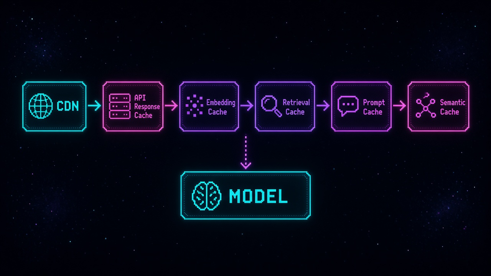

# Caching for AI

> Cut latency and token spend by reusing work at every layer - from GPU attention state to final answers - without serving wrong or leaked results.

## TL;DR
- **Prompt caching** is like bookmarking the first chapters of a book you keep re-reading - the model skips re-processing the long shared prefix.
- **Exact response caching** is like a FAQ board - identical questions get the stored answer instantly.
- **Semantic caching** is like a librarian who recognizes "how do I reset my password" and "forgot my password" as the same question - powerful, but she can sometimes be wrong.
- **Embedding and retrieval caches** are like keeping frequently used reference books on your desk instead of walking to the archive each time.

## Quickstart (Do this now)
1. **Measure repetition**: Log prompt prefixes, query hashes, and retrieved chunks to see what actually repeats
2. **Put stable content first**: System prompt, tool definitions, and documents go at the start so provider prompt caching hits
3. **Add an exact-match cache**: Key on a hash of model + parameters + normalized prompt + tenant, with a TTL
4. **Cache embeddings and retrieval results**: Key by content hash and index version
5. **Add invalidation hooks**: Purge on prompt version change, document update, permission change, or model upgrade

## The Idea (Slightly deeper)
AI requests are expensive: long prompts, GPU time, and per-token billing. Caching is the highest-leverage optimization, but it works best as **layers**, each with different hit rates, risks, and owners.

**Layer 1 - Model-level caches.** Inference engines keep a **KV cache** of attention state, and **prefix caching** reuses it when requests share a prompt prefix. Hosted APIs expose this as **prompt caching**, discounting repeated prefix tokens and lowering time-to-first-token. Your job is to structure prompts so the static part comes first and the dynamic part last. **Layer 2 - Response caches.** An exact-match cache returns a stored answer for identical requests. A **semantic cache** embeds the query and returns an answer for a sufficiently similar past query. Gains are large for FAQ-style workloads, but a similarity threshold that is too loose returns wrong answers, and a cache not scoped by tenant can **leak data**.

**Layer 3 - Data caches.** Cache embeddings (deterministic given model + text), retrieval results, reranker scores, and tool outputs such as API lookups. Use **cache-aside** with explicit TTLs, and include index or model versions in keys so upgrades invalidate naturally.

Caching creates classic problems: **stale data**, **stampedes** when a hot key expires and many requests recompute it, and **correctness risk** for non-deterministic generations. Only cache responses where reuse is acceptable (temperature 0, no personalization, no time-sensitive facts), and always scope keys by **tenant, user permissions, prompt version, and model version**.

## Diagram

## Key Concepts
- **KV Cache / Prefix Cache**: Reusing computed attention state for a shared prompt prefix inside the inference engine
- **Provider Prompt Caching**: API-level discount and speedup for repeated prompt prefixes
- **Exact Cache**: Hash-keyed lookup of full request → response
- **Semantic Cache**: Vector similarity lookup with a tuned threshold
- **Cache-Aside**: Application checks cache, falls back to source, then populates the cache
- **TTL & Versioned Keys**: Expiry plus version tags (model, prompt, index) for safe invalidation
- **Single-Flight / Request Coalescing**: Allow only one recompute per hot key while others wait

## When to Use This
- **Use when**: Many requests share long system prompts, tool definitions, or documents
- **Use when**: Users repeat similar questions (support bots, internal help, search)
- **Use when**: Embedding or retrieval costs are significant at your scale
- **Don't use when**: Responses depend on private per-user state, real-time data, or high-creativity sampling
- **Consider alternatives**: Pre-computation or batch jobs for content that changes on a schedule

## Real-World Examples
- **OpenAI prompt caching**: Automatic prefix reuse → [Prompt caching](https://platform.openai.com/docs/guides/prompt-caching) (documents the prefix rules, so you can design prompts that actually hit the cache)
- **Anthropic prompt caching**: Explicit cache breakpoints → [Prompt caching](https://docs.anthropic.com/en/docs/build-with-claude/prompt-caching) (fine-grained control over what is cached, with clear pricing and TTL behavior)
- **vLLM**: Open-source engine with PagedAttention → [vLLM docs](https://docs.vllm.ai/) (efficient KV cache management and prefix reuse for self-hosted inference)
- **LMCache**: KV cache sharing across engines → [LMCache](https://github.com/LMCache/LMCache) (extends KV reuse beyond GPU memory to CPU and shared storage)
- **Cloudflare AI Gateway caching**: Edge response cache → [Caching](https://developers.cloudflare.com/ai-gateway/configuration/caching/) (drop-in exact-match caching in front of any provider)
- **RedisVL / Redis**: Vector-backed semantic cache building blocks → [redis-vl-python](https://github.com/redis/redis-vl-python) (open-source library for semantic caching on a familiar datastore)

## Common Pitfalls
- **Dynamic content at the start of the prompt**: Timestamps or user IDs up front destroy prefix cache hits
- **Cross-tenant cache hits**: Missing tenant ID in the key leaks answers between customers
- **Loose semantic thresholds**: "Cancel my order" matching "Track my order" returns the wrong action
- **No invalidation plan**: Prompts, documents, or permissions change but cached answers live on
- **Cache stampede**: Hot key expires and hundreds of identical requests hit the model at once

## Deep Dives & "Why it's awesome"
- **[Efficient Memory Management for LLM Serving (PagedAttention)](https://arxiv.org/abs/2309.06180)** - The paper behind vLLM's KV cache efficiency
- **[Amazon Bedrock prompt caching](https://docs.aws.amazon.com/bedrock/latest/userguide/prompt-caching.html)** - Prompt caching across multiple model families on AWS
- **[Azure API Management semantic caching](https://learn.microsoft.com/en-us/azure/api-management/azure-openai-semantic-cache-lookup-policy)** - Gateway-level semantic cache policy for Azure OpenAI
- **[GPTCache](https://github.com/zilliztech/GPTCache)** - Open-source semantic cache that illustrates the design tradeoffs
- **[Cache-Aside pattern (Azure)](https://learn.microsoft.com/en-us/azure/architecture/patterns/cache-aside)** - The default pattern for data caches, with consistency caveats
- **[Redis eviction policies](https://redis.io/docs/latest/develop/reference/eviction/)** - Choose how your cache behaves when memory fills up

## Next Steps
- **Learn more**: [Rate Limiting & Throughput](rate-limiting-and-throughput.md) - Cached tokens often count differently against quotas
- **Learn more**: [Multi-Tenancy for AI](multi-tenancy-for-ai.md) - Scope every cache by tenant and permissions
- **Dive deeper**: [AI Request Path & Gateways](ai-request-path-and-gateways.md) - Where each cache layer sits in the path
- **Connect**: [Serving & Scaling](../ai-architecture-topics/serving-and-scaling.md) - Inference servers, batching, and GPU efficiency
- **Connect**: [Advanced RAG](../ai-architecture-topics/advanced-rag.md) - Retrieval and rerank caching in RAG pipelines
