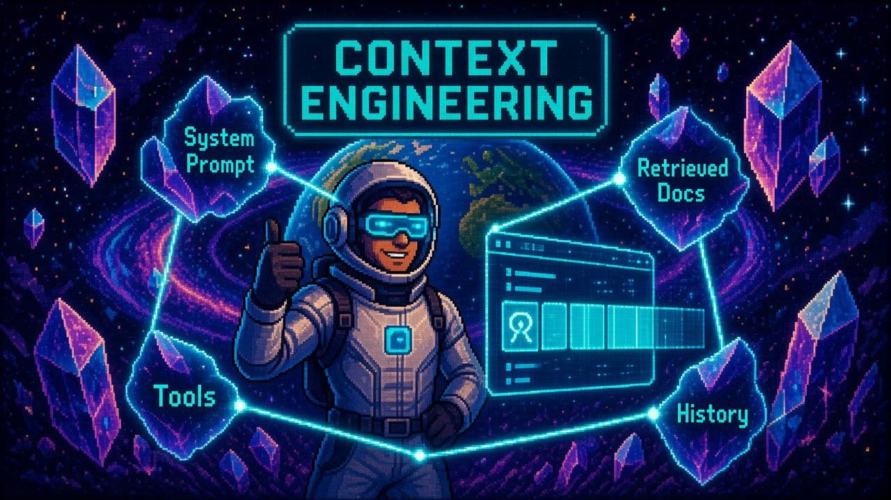
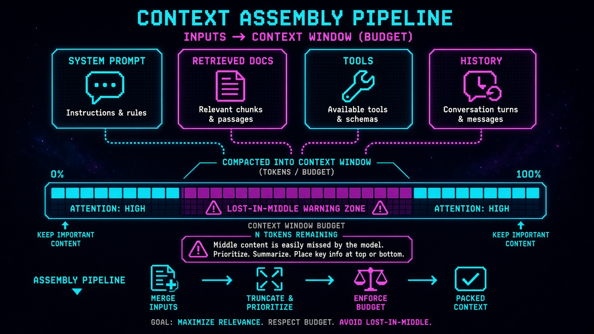

# Context Engineering as Architecture

> Design what the model sees on every call as deliberately as you design a database schema - because context is your scarcest, most expensive, and most influential resource.

## TL;DR
- **The context window** is like a desk with limited space - pile on too much and the important paper gets lost.
- **Context budgeting** is like a household budget - every token has a cost, so you decide up front what deserves the spend.
- **Retrieval and tools** are like a filing cabinet and phone - fetch exactly what you need when you need it instead of carrying the whole archive.
- **Compaction and isolation** are like meeting notes and delegating to a colleague - keep the summary, hand off the messy detail.

## Quickstart (Do this now)
1. **Inventory your context**: Log what fills each prompt - instructions, tools, history, retrieved chunks, tool outputs - with token counts
2. **Set a budget per slot**: Allocate token limits (for example system 5%, tools 10%, memory 10%, retrieval 40%, history 25%, headroom 10%)
3. **Order for caching and attention**: Static content first; critical instructions near the start and end; volatile items last
4. **Trim and compact**: Truncate tool outputs, summarize old turns, and drop low-relevance chunks
5. **Evaluate by slice**: Test quality while varying context size and content to find where it degrades

## The Idea (Slightly deeper)
Prompt engineering is wording; **context engineering** is system design: deciding **what information reaches the model, in what form, at what moment**. It matters because longer context is not free or flawless. Cost and latency scale with tokens, KV memory grows with length, and quality can drop through **context rot** - models use information less reliably as inputs lengthen, and the "lost in the middle" effect weakens recall of mid-prompt content. More context can *hurt* through distraction, conflicting facts, or poisoned content.

Think of the window as a **managed budget with four strategies**. **Write**: persist information outside the window (scratchpads, notes, memory stores) so it need not stay in context. **Select**: retrieve only what is relevant just in time - RAG, tool lookups, memory search, skill loading on demand. **Compress**: summarize, truncate, deduplicate, and clear stale tool results (compaction). **Isolate**: give sub-agents their own clean contexts for sub-tasks and return only distilled results, or sandbox bulky tool output outside the prompt.

Architecturally this yields a **context assembly layer**: a component that gathers candidates from memory, retrieval, tools, and user input, scores and ranks them, packs them into a budget, and logs exactly what was sent. That layer is testable, observable, and versioned like any other service. It also forms a **security boundary**: untrusted content (web pages, emails, tool outputs) enters context and can carry injected instructions, so label sources, limit privileges, and keep trusted instructions separate.

## Diagram

## Key Concepts
- **Context Budget**: Token allocation across instructions, tools, memory, retrieval, and history
- **Context Rot / Lost in the Middle**: Quality loss as context grows or when key facts sit mid-prompt
- **Just-in-Time Retrieval**: Loading data via search or tools when needed rather than upfront
- **Compaction**: Summarizing or clearing old context to keep a long task running
- **Context Isolation**: Sub-agents or sandboxes keeping noisy work out of the main window
- **Context Assembly Layer**: Component that selects, ranks, packs, and logs the final prompt
- **Provenance Labels**: Marking where each piece of context came from and how far to trust it

## When to Use This
- **Use when**: Agents run long tasks, accumulate tool outputs, or exceed comfortable window sizes
- **Use when**: RAG answers degrade as you add more retrieved chunks
- **Use when**: Token spend or latency is driven by oversized prompts
- **Don't use when**: A short, single-turn prompt already meets quality and cost goals
- **Consider alternatives**: Fine-tuning or distillation when the same large context is repeated on every call

## Real-World Examples
- **Anthropic context engineering**: Guidance for agents → [Effective context engineering for AI agents](https://www.anthropic.com/engineering/effective-context-engineering-for-ai-agents) (describes compaction, note-taking, and sub-agent isolation in practice)
- **LangChain context engineering**: Write, select, compress, isolate → [Context engineering for agents](https://blog.langchain.com/context-engineering-for-agents/) (a clear taxonomy of strategies with implementation patterns)
- **Chroma research on context rot**: Long-input degradation → [Context Rot](https://research.trychroma.com/context-rot) (empirical evidence that performance varies as input grows)
- **Anthropic prompt caching**: Pay once for stable context → [Prompt caching](https://docs.anthropic.com/en/docs/build-with-claude/prompt-caching) (makes a well-ordered, stable prefix cheaper to reuse)
- **Model Context Protocol**: Standard access to tools and data → [MCP](https://modelcontextprotocol.io/) (a clean way to fetch context just in time)

## Common Pitfalls
- **Stuffing the window**: Dumping everything "just in case" raises cost and lowers accuracy
- **Raw tool output in history**: Large JSON or HTML responses crowd out reasoning
- **Lossy summaries**: Compaction drops a critical constraint or decision with no way to recover it
- **No visibility**: Teams cannot see what the model actually received, so failures stay unexplained
- **Trusting retrieved text**: Injected instructions in documents or pages steer the agent

## Deep Dives & "Why it's awesome"
- **[Lost in the Middle](https://arxiv.org/abs/2307.03172)** - Shows how position in context changes retrieval accuracy
- **[RULER: What's the Real Context Size of Your Long-Context Models?](https://arxiv.org/abs/2404.06654)** - Benchmark showing claimed context lengths exceed effective use
- **[Anthropic: Building Effective Agents](https://www.anthropic.com/engineering/building-effective-agents)** - Simple patterns for managing what agents see and do
- **[Retrieval-Augmented Generation (original paper)](https://arxiv.org/abs/2005.11401)** - The foundation for fetching knowledge into context on demand
- **[OWASP Top 10 for LLM Applications](https://genai.owasp.org/llm-top-10/)** - Prompt injection and data exposure risks in assembled context

## Next Steps
- **Learn more**: [Agent Memory Architecture](agent-memory-architecture.md) - Persisting information outside the window
- **Learn more**: [Skills, MCP & RAG Capability Layers](skills-mcp-rag-capability-layers.md) - Loading capability and knowledge on demand
- **Dive deeper**: [KV Cache & Memory Cost](kv-cache-and-memory-cost.md) - The hardware price of each context token
- **Dive deeper**: [Prompt & Semantic Caching](prompt-and-semantic-caching.md) - Ordering context so stable parts are reused
- **Connect**: [Advanced RAG](../ai-architecture-topics/advanced-rag.md) - Retrieval, reranking, and chunk selection
- **Connect**: [Evaluation & Observability](../ai-architecture-topics/evaluation-and-observability.md) - Measuring how context changes affect quality
