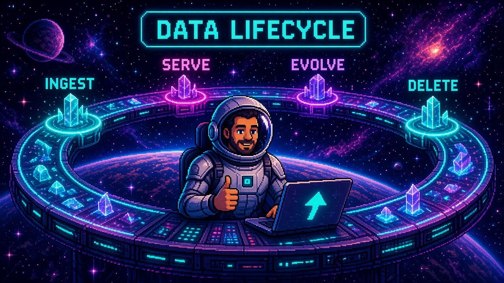
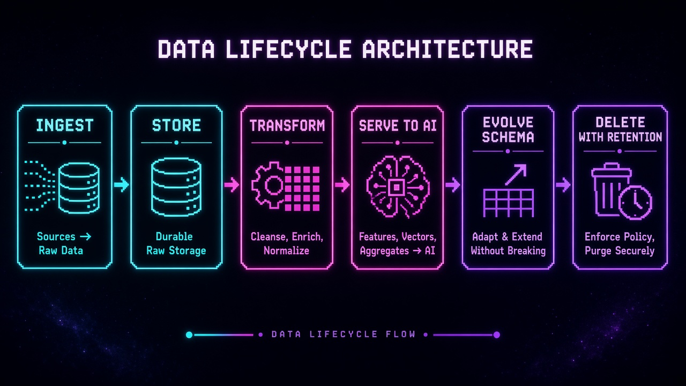

# Data Movement & Lifecycle

> Treat data as something that flows through stages - ingest, serve, evolve, delete - so your AI answers stay fresh, traceable, and removable on demand.

## TL;DR
- **Ingest** is like receiving groceries - you check, label, and shelve them before anyone cooks with them.
- **Serve** is like a pantry organized for quick reach - the same food is stored differently for search, analytics, and training.
- **Evolve** is like rotating stock and updating recipes - documents, schemas, and embedding models change and indexes must follow.
- **Delete** is like a product recall - you must find every copy of an item, including the ones in caches and backups.

## Quickstart (Do this now)
1. **Inventory data copies**: List every place a document lives - source, lake, chunks, embeddings, caches, logs, fine-tuning sets
2. **Assign stable IDs**: Give each source record an ID and version that every derived artifact carries
3. **Build incremental sync**: Use change data capture or content hashes so only changed items are reprocessed
4. **Record lineage**: Store the model, chunker, and pipeline versions used to create each index entry
5. **Test a deletion**: Delete one record and prove it vanished from search, caches, and exports

## The Idea (Slightly deeper)
AI systems multiply data. One source document becomes raw files, parsed text, **chunks**, **embeddings**, summaries, cached answers, evaluation sets, and sometimes training data. Each copy has its own freshness, access rules, and cost. The lifecycle view asks four questions at every stage: *where does it come from, who may see it, how does it change, and how does it die?*

**Ingest** is where quality is decided: parsing, deduplication, PII detection, classification, and tenant tagging. Prefer an **immutable raw zone** plus reproducible processing, so you can rebuild indexes when you change the chunker or embedding model. **Serve** means choosing the right store per access pattern - a vector index for semantic retrieval, a relational or search store for filters, object storage for raw files, a feature store or lakehouse for analytics.

**Evolve** covers three kinds of change: **content drift** (documents updated), **schema drift** (new fields or formats), and **model drift** (a new embedding model invalidates every vector). Use **versioned indexes with blue-green swaps** instead of in-place mutation. **Delete** is the hardest: privacy requests, retention limits, and revoked consent must propagate through derived data. This works only if lineage links every derivative back to its source, and if **tombstones** flow through the same pipeline as inserts. Data that went into a fine-tuned model cannot be easily removed, so decide up front what may enter training.

## Diagram

## Key Concepts
- **Change Data Capture (CDC)**: Streaming source changes so downstream indexes update incrementally
- **Lineage**: Traceable link from every chunk, vector, and answer back to its source and pipeline version
- **Medallion / Zoned Storage**: Raw, cleaned, and curated layers with different guarantees
- **Index Versioning**: Building a new index alongside the old one and swapping when validated
- **Tombstone Propagation**: Delete markers that remove derived artifacts, not just the source row
- **Retention Policy**: Rules for how long each class of data is kept, including logs and prompts
- **Re-embedding**: Recomputing vectors when the embedding model or chunking strategy changes

## When to Use This
- **Use when**: RAG or agents depend on documents that change daily or weekly
- **Use when**: Regulations require erasure, retention limits, or audit of data use
- **Use when**: You expect to swap embedding models, chunkers, or vector stores
- **Don't use when**: You are indexing a small, static corpus once for a demo
- **Consider alternatives**: Query federated sources live via tools when copying data is not permitted

## Real-World Examples
- **Apache Iceberg**: Table format with snapshots and row-level deletes → [Iceberg docs](https://iceberg.apache.org/docs/latest/) (time travel and deletes make lake data auditable and removable)
- **Delta Lake**: ACID tables with change feeds → [Delta Lake docs](https://docs.delta.io/) (powers incremental pipelines that feed downstream indexes)
- **OpenLineage**: Open standard for lineage metadata → [OpenLineage](https://openlineage.io/docs/) (connects pipeline runs to datasets for traceability)
- **LangChain indexing API**: Record manager for sync and cleanup → [Indexing guide](https://python.langchain.com/docs/how_to/indexing/) (avoids duplicate vectors and removes stale documents on re-ingestion)
- **pgvector**: Vectors beside relational data → [pgvector](https://github.com/pgvector/pgvector) (lets deletes and updates ride the same transaction as source records)

## Common Pitfalls
- **Delete only the source**: Embeddings, caches, and logs keep serving the "deleted" content
- **Mixed embedding versions**: Old and new vectors in one index silently degrade retrieval
- **No raw zone**: You cannot rebuild after a bug in parsing or chunking
- **Lost permissions at ingest**: ACLs and tenant tags are dropped during chunking
- **Unbounded prompt logs**: Conversation logs hold sensitive data forever with no retention policy

## Deep Dives & "Why it's awesome"
- **[GDPR Article 17: Right to erasure](https://gdpr-info.eu/art-17-gdpr/)** - The legal driver for end-to-end deletion design
- **[Debezium documentation](https://debezium.io/documentation/)** - Open-source CDC for streaming database changes into pipelines
- **[Apache Kafka documentation](https://kafka.apache.org/documentation/)** - Log-based backbone for moving and replaying data
- **[Databricks Medallion Architecture](https://www.databricks.com/glossary/medallion-architecture)** - Layered data quality model for lakehouse pipelines
- **[Designing Data-Intensive Applications](https://dataintensive.net/)** - Foundational book on derived data, replication, and evolution

## Next Steps
- **Learn more**: [Event-Driven AI Pipelines](event-driven-ai-pipelines.md) - Streaming ingestion and reprocessing triggers
- **Learn more**: [Background Jobs & Durable Workflows](background-jobs-and-durable-workflows.md) - Reliable batch re-embedding and cleanup jobs
- **Dive deeper**: [Caching for AI](caching-for-ai.md) - Invalidating caches when data changes
- **Dive deeper**: [Multi-Region & HA](multi-region-and-ha.md) - Replication and residency for stored data
- **Connect**: [Data Lakes & Marts](../ai-architecture-topics/data-lakes-and-marts.md) - Storage layers for AI-ready data
- **Connect**: [Vector Stores & Embeddings](../ai-architecture-topics/vector-stores-and-embeddings.md) - Index design and re-embedding strategies
