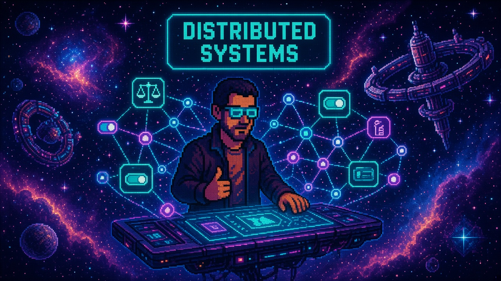
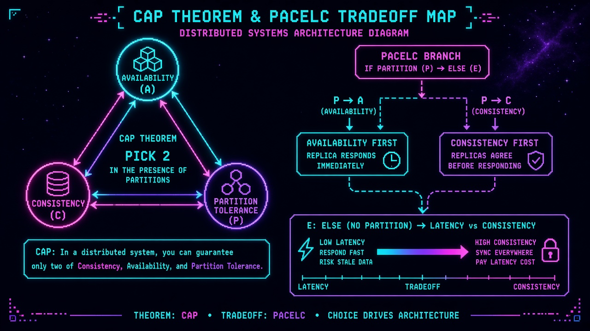

# Distributed Systems Foundations

> Understand the handful of laws that govern every networked system, so your AI product stays correct and available when machines, networks, and model providers misbehave.

## TL;DR
- **Partial failure** is like a relay race where one runner trips - the race continues, but you no longer know who has the baton. Any call to a model, tool, or vector store can fail while the rest of your system keeps running.
- **CAP theorem** is like a call between two offices when the phone line drops - each office must either keep answering (and risk saying different things) or stop answering until the line is back.
- **PACELC** extends CAP: even with no outage, you still trade **latency** against **consistency** on every read and write.
- **Consistency models** are like newspaper editions - strong consistency means everyone reads the same edition, eventual consistency means some readers see yesterday's paper for a while.

## Quickstart (Do this now)
1. **List your stateful components**: Session store, vector index, feature store, prompt registry, billing counters, agent memory
2. **Label each one CP or AP**: Decide whether it should refuse requests or serve stale data during a network partition
3. **Mark every network hop**: Gateway → orchestrator → model → tool → database; assume each can time out, fail, or succeed silently
4. **Pick a consistency level per data type**: Strong for billing and permissions, eventual for embeddings and caches
5. **Write down the failure answer**: For each hop, record what the user sees if it is slow, down, or returns garbage

## The Idea (Slightly deeper)
A **distributed system** is any system where components communicate over a network. An AI product is distributed from day one: your app talks to a hosted LLM, a vector database, a tool API, and a queue. The defining property is **partial failure** - some parts fail while others work, and you often cannot tell the difference between "slow" and "dead". This is why a timed-out LLM call may still have run, charged you, and triggered a tool side effect.

The **CAP theorem** says that when a network partition happens, a replicated data store must choose between **consistency** (every read sees the latest write) and **availability** (every request gets an answer). Partitions are not optional in real networks, so the real choice is CP vs AP. **PACELC** adds the everyday case: **if** Partition, choose A or C; **Else**, choose Latency or Consistency. A globally replicated vector index that answers from the nearest replica is fast but may serve stale chunks.

For AI systems the right answer differs per component. **Tenant permissions and billing** should be strongly consistent - a revoked document must never be retrieved. **Embeddings, semantic caches, and retrieval indexes** can be eventually consistent, because a few seconds of staleness rarely changes an answer. **Agent state** sits in between: it needs read-your-writes consistency within a single run so the agent does not forget what it just did.

Finally, **time and ordering** are hard. Clocks drift, messages arrive out of order, and retries duplicate work. Design for **at-least-once delivery**, use logical ordering (sequence numbers, versions) instead of wall-clock time, and make operations safe to repeat.

## Diagram

## Key Concepts
- **Partial Failure**: Some components fail while others keep working; failure is often ambiguous (timeout ≠ not executed)
- **CAP Theorem**: During a partition you choose consistency or availability, not both
- **PACELC**: Adds the no-partition tradeoff between latency and consistency
- **Strong vs Eventual Consistency**: Immediate agreement across replicas vs convergence over time
- **Read-Your-Writes**: A client always sees its own recent updates - critical for agent memory and chat history
- **Quorum**: Requiring a majority of replicas to agree, trading latency for stronger guarantees
- **Fallacies of Distributed Computing**: The network is not reliable, latency is not zero, bandwidth is not infinite

## When to Use This
- **Use when**: Your AI product spans multiple services, regions, or providers
- **Use when**: You store state that users rely on (memory, permissions, balances, documents)
- **Use when**: Designing multi-region inference or replicated vector search
- **Don't use when**: A single-process prototype with one user and local files
- **Consider alternatives**: A managed single-region database with strong consistency by default if scale is modest

## Real-World Examples
- **Amazon Dynamo**: Foundational AP key-value design with tunable quorums → [Dynamo paper](https://www.allthingsdistributed.com/2007/10/amazons_dynamo.html) (the origin of "eventually consistent by default" thinking that shaped modern NoSQL stores)
- **Google Spanner**: Globally consistent database using synchronized clocks → [Spanner paper](https://research.google/pubs/spanner-googles-globally-distributed-database-2/) (shows how far you can push strong consistency when you accept latency cost)
- **Amazon DynamoDB**: Lets you choose eventual or strong reads per request → [Read consistency](https://docs.aws.amazon.com/amazondynamodb/latest/developerguide/HowItWorks.ReadConsistency.html) (a practical example of per-operation consistency, ideal for session and agent state)
- **Azure Cosmos DB**: Five documented consistency levels → [Consistency levels](https://learn.microsoft.com/en-us/azure/cosmos-db/consistency-levels) (a menu of tradeoffs you can map directly to chat history, memory, and metadata)

## Common Pitfalls
- **Treating timeouts as failures**: The LLM or tool may have executed; pair retries with idempotency (see [Idempotency, Retries & Delivery](idempotency-retries-delivery.md))
- **One consistency level for everything**: Over-paying for strong consistency on caches, or under-protecting permissions
- **Stale ACLs in retrieval**: Replicated index that lags behind access-control changes leaks data across tenants
- **Trusting wall-clock ordering**: Use versions or sequence numbers for agent steps and events
- **Ignoring split-brain in agents**: Two workers continuing the same agent run both mutate state

## Deep Dives & "Why it's awesome"
- **[CAP Twelve Years Later](https://www.infoq.com/articles/cap-twelve-years-later-how-the-rules-have-changed/)** - The author's own correction of common CAP misunderstandings
- **[Consistency and PACELC (Abadi)](https://www.cs.umd.edu/~abadi/papers/abadi-pacelc.pdf)** - The paper that introduced the latency-consistency tradeoff
- **[Jepsen Consistency Models](https://jepsen.io/consistency)** - A clear map of every consistency model and what it guarantees
- **[Fallacies of Distributed Computing](https://en.wikipedia.org/wiki/Fallacies_of_distributed_computing)** - Eight wrong assumptions that cause most production incidents
- **[Designing Data-Intensive Applications](https://dataintensive.net/)** - The standard book on replication, partitioning, and consistency
- **[Azure Cloud Design Patterns](https://learn.microsoft.com/en-us/azure/architecture/patterns/)** - Catalog of patterns for building reliable distributed systems

## Next Steps
- **Learn more**: [Idempotency, Retries & Delivery](idempotency-retries-delivery.md) - Make partial failure safe to recover from
- **Learn more**: [Reliability & Failure Design](reliability-and-failure-design.md) - Timeouts, breakers, and fallbacks
- **Dive deeper**: [Event-Driven AI Pipelines](event-driven-ai-pipelines.md) - Ordering and delivery semantics in brokers
- **Connect**: [Vector Stores & Embeddings](../ai-architecture-topics/vector-stores-and-embeddings.md) - Consistency tradeoffs in retrieval indexes
- **Connect**: [Quality Attributes](../solution-architecture/quality-attributes.md) - Turn availability and consistency into measurable requirements
