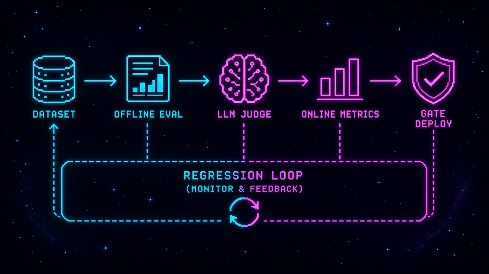

# Eval Recipes & LLM-as-Judge

> Turn "it seems better" into numbers you can trust, so every prompt, model, or tool change ships with evidence.

## TL;DR
- **Evals** are like unit tests for AI behavior - they tell you when a change broke something.
- **Golden sets** are like an answer key - curated examples with known good outcomes.
- **Code-based checks** are like a spell checker - cheap, deterministic, and always the first choice.
- **LLM-as-judge** is like a teaching assistant grading essays - scalable, but it needs calibration against a human grader.
- **Error analysis** is like reading failed exams - the fastest way to learn what to test next.

## Quickstart (Do this now)
1. **Collect 30-100 real traces**: Production logs, support tickets, or hand-written realistic cases
2. **Read them and label failures**: Note failure modes in plain language before choosing metrics
3. **Write cheap checks first**: Schema validity, regex, tool-call correctness, unit tests, exact match
4. **Add an LLM judge for fuzzy criteria**: One binary criterion per judge, with a clear rubric
5. **Calibrate the judge**: Compare to human labels, measure agreement, and iterate on the prompt
6. **Run in CI**: Block merges on regressions and track scores over time

## The Idea (Slightly deeper)
AI outputs are non-deterministic and open-ended, so classic assertions are not enough. A practical eval stack has layers: **deterministic checks** (format, tool use, tests passing), **reference-based metrics** (exact match, retrieval recall, similarity), and **model-graded evals** where an **LLM judge** scores outputs against a rubric.

**LLM-as-judge** works best when the criterion is narrow and binary ("does the answer cite a provided source?"), the judge sees the needed context, and its verdicts are validated against human labels. Known biases include position bias, verbosity bias, and self-preference (favoring its own family's outputs), so randomize order, use pairwise comparison with swaps, and prefer a different model family as judge when possible.

For agents and RAG, evaluate components and the whole: retrieval quality (recall, precision), faithfulness to context, tool-selection accuracy, trajectory efficiency, and end-to-end task success. Offline evals gate releases; **online evals** and feedback on production traces feed the next dataset.

## Diagram

## Key Concepts
- **Golden Dataset**: Versioned cases with inputs, expected behavior, and metadata
- **Code Graders**: Deterministic assertions that run fast and cost nothing
- **LLM Judge**: A model prompted with a rubric to grade outputs
- **Pairwise vs Pointwise**: Compare two outputs head-to-head, or score one against a rubric
- **Judge Calibration**: Measuring agreement (e.g., precision, recall, Cohen's kappa) against human labels
- **Faithfulness / Groundedness**: Whether claims are supported by retrieved context
- **Trajectory Eval**: Scoring the sequence of agent steps, not only the final answer
- **Online Eval / Sampling**: Scoring a slice of live traffic for drift and regressions

## When to Use This
- **Use when**: Any prompt, model, retrieval, or tool change could alter behavior
- **Use when**: You must compare models, vendors, or architectures objectively
- **Use when**: Quality criteria are subjective and need scalable grading
- **Don't use when**: A one-off prototype will never be iterated - manual spot checks suffice
- **Consider alternatives**: Human review panels for high-stakes or rapidly changing criteria

## Real-World Examples
- **OpenAI Evals**: Dataset-driven evals and graders → [OpenAI Evals Guide](https://platform.openai.com/docs/guides/evals) (integrates graders and datasets with the prompt iteration loop)
- **Ragas**: Metrics for RAG pipelines → [Ragas Docs](https://docs.ragas.io/) (faithfulness, context precision, and answer relevance out of the box)
- **promptfoo**: Config-driven eval and red-team CLI → [promptfoo](https://www.promptfoo.dev/docs/intro/) (easy to run locally and in CI across models)
- **Inspect (UK AISI)**: Open-source eval framework → [Inspect](https://inspect.aisi.org.uk/) (rigorous agent and capability evals with sandboxing)

## Common Pitfalls
- **Starting with generic metrics**: "Helpfulness 1-5" hides real failures - derive criteria from error analysis
- **Uncalibrated judges**: Trusting a judge prompt without checking against human labels
- **Likert-scale noise**: Prefer pass/fail over 1-10 scores for stability
- **Judge leakage and self-preference**: Do not grade a model's output with the same model without checks
- **Stale datasets**: Add new production failures every cycle
- **Overfitting to the eval**: Keep a hidden holdout set
- **Ignoring cost and variance**: Run multiple samples and report confidence intervals

## Deep Dives & "Why it's awesome"
- **[Judging LLM-as-a-Judge (MT-Bench)](https://arxiv.org/abs/2306.05685)** - Agreement with humans and documented judge biases
- **[G-Eval](https://arxiv.org/abs/2303.16634)** - Rubric-based, chain-of-thought grading for generated text
- **[Your AI Product Needs Evals](https://hamel.dev/blog/posts/evals/)** - Practical, error-analysis-first eval methodology
- **[LangSmith Evaluation Concepts](https://docs.smith.langchain.com/evaluation)** - Offline and online evals for traces and datasets
- **[Anthropic: Define Success Criteria and Build Evals](https://docs.anthropic.com/en/docs/test-and-evaluate/develop-tests)** - Task-specific, automatable eval design
- **[Ragas Metrics](https://docs.ragas.io/en/stable/concepts/metrics/)** - Reference for RAG-specific measurements

## Eval Rollout Checklist
- **Dataset**: Versioned, representative, with a hidden holdout
- **Graders**: Code checks first, LLM judges for the rest
- **Calibration**: Judge agreement with humans documented
- **Automation**: Evals run on every change in CI
- **Feedback loop**: Production failures flow back into the dataset weekly

## Next Steps
- **Learn more**: [Model Customization Decision](model-customization-decision.md) - Evals decide whether tuning is justified
- **Learn more**: [AI Cost and Token Economics](ai-cost-and-token-economics.md) - Track cost alongside quality
- **Go deeper**: [Evaluation and Observability](../ai-architecture-topics/evaluation-and-observability.md) - Production monitoring for AI systems
- **Go deeper**: [Red Teaming](../ai-architecture-topics/red-teaming.md) - Adversarial evals for safety
- **Apply it**: [AI PR Review Automation](../ai-for-software-engineering-skills/ai-pr-review-automation.md) - Evaluating AI reviewers
- **Try it**: [promptfoo Getting Started](https://www.promptfoo.dev/docs/getting-started/) - Run your first eval in minutes
