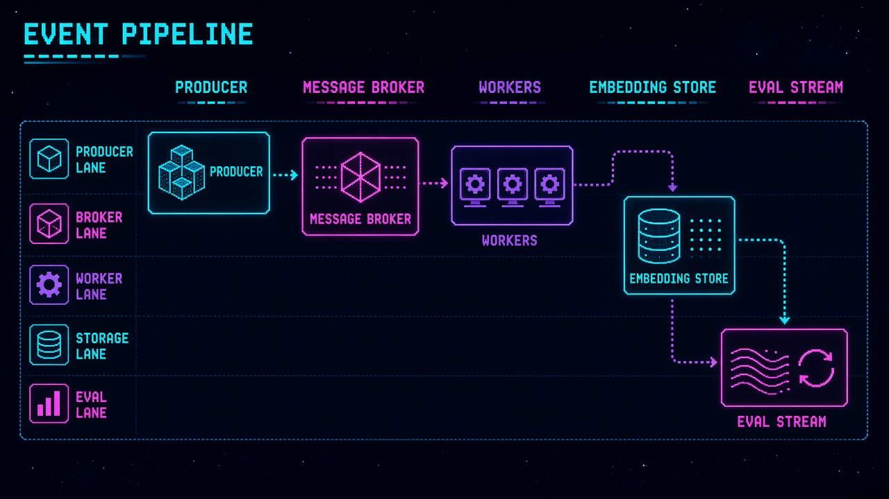

# Event-Driven AI Pipelines

> Decouple producers from AI consumers with events, so ingestion, embedding, enrichment, and inference scale and fail independently.

## TL;DR
- **Events** are like notes on a bulletin board - someone posts "new document uploaded", and whoever cares picks it up.
- **Queues vs logs** are like a to-do tray vs a security-camera tape - a queue hands each task to one worker, a log keeps history that many readers can replay.
- **Streaming vs batch** is like a running tap vs filling buckets - process continuously for freshness, or in large scheduled chunks for cost.
- **Dead-letter queues** are like the "problem mail" shelf - poison messages go aside so the rest keep flowing.

## Quickstart (Do this now)
1. **Name your events**: `document.uploaded`, `chunk.embedded`, `answer.generated`, `feedback.received` with versioned schemas
2. **Pick a broker**: Queue (SQS, RabbitMQ) for tasks, log (Kafka, Pub/Sub, Event Hubs) for replayable streams
3. **Make consumers idempotent**: Messages will be delivered more than once
4. **Add a dead-letter queue and retry policy**: Bounded retries, then park and alert
5. **Choose streaming or batch per stage**: Real-time for chat memory updates, batch for nightly re-embedding or evaluation

## The Idea (Slightly deeper)
In an **event-driven architecture**, components communicate by publishing and consuming events through a **broker** rather than calling each other directly. This decouples teams and scaling: the upload service doesn't wait for OCR, chunking, embedding, and indexing - it publishes `document.uploaded` and moves on. Each stage is an independent consumer group that can scale, fail, retry, and be replaced without touching others.

AI workloads suit this model because model calls are **slow, rate-limited, and expensive**. A **queue** between producer and model consumers provides **load leveling**: a burst of 10,000 documents becomes a steady flow matching your embedding quota. A **log-based broker** like Kafka also lets you **replay** history - re-embed the corpus with a new model, backfill a new feature, or rebuild a vector index - by resetting consumer offsets.

**Streaming vs batch** is a freshness/cost/complexity trade-off. Streaming (Kafka Streams, Flink) keeps indexes and features seconds-fresh and enables reactive agents, but needs always-on infrastructure and careful state handling. Batch (scheduled jobs, Spark, Ray Data, provider batch APIs) is cheaper per token, simpler to reason about, and ideal for backfills, evaluation, and offline enrichment. Many teams combine them: a streaming path for new data and a batch path for reprocessing - often called a **lambda/kappa-style** setup.

Event systems bring their own hazards: **ordering** (only guaranteed within a partition), **duplicates**, **schema evolution**, **poison messages**, and **consumer lag**. Use **partition keys** (tenant or document ID) for ordering, the **outbox pattern** so state changes and events don't diverge, **schema registries** and versioned events, and monitor **lag** as a first-class health signal. For large payloads, use the **claim-check** pattern: put the document in object storage, and send only a reference in the event.

## Diagram

## Key Concepts
- **Broker**: Middleware (queue or log) that stores and routes events between services
- **Consumer Group & Partition**: Unit of parallelism and ordering in log-based systems
- **Dead-Letter Queue (DLQ)**: Destination for messages that fail repeatedly
- **Consumer Lag**: How far consumers are behind the newest events; a key scaling and health signal
- **Claim-Check Pattern**: Store large payloads externally, pass references in events
- **Replay / Reprocessing**: Re-reading historical events to rebuild indexes or apply new models
- **Schema Registry / Event Versioning**: Controlled evolution of event formats

## When to Use This
- **Use when**: Ingestion and enrichment pipelines feed RAG indexes or feature stores
- **Use when**: Many services react to the same event (indexing, analytics, notifications, evaluation)
- **Use when**: Model quotas require smoothing bursty workloads
- **Don't use when**: A simple request-response flow with one consumer and strict immediate results
- **Consider alternatives**: [Durable workflows](background-jobs-and-durable-workflows.md) when you need a clear, stateful multi-step process with retries and timers rather than loosely coupled reactions

## Real-World Examples
- **Apache Kafka**: Distributed log for streaming → [Kafka documentation](https://kafka.apache.org/documentation/) (partitions, consumer groups, and replay power large-scale data pipelines)
- **Apache Flink**: Stateful stream processing → [Flink docs](https://nightlies.apache.org/flink/flink-docs-stable/) (event-time processing and exactly-once state for real-time features and enrichment)
- **Amazon SQS + DLQ**: Managed queues with redrive → [Dead-letter queues](https://docs.aws.amazon.com/AWSSimpleQueueService/latest/SQSDeveloperGuide/sqs-dead-letter-queues.html) (simple, durable task queues for embedding and enrichment workers)
- **Amazon EventBridge**: Event bus with routing rules → [EventBridge](https://docs.aws.amazon.com/eventbridge/latest/userguide/eb-what-is.html) (serverless fan-out of domain events to many targets)
- **Google Pub/Sub**: Managed messaging with exactly-once option → [Pub/Sub exactly-once](https://cloud.google.com/pubsub/docs/exactly-once-delivery) (clear semantics for deduplicating at the broker)
- **Ray Data**: Distributed batch inference → [Ray Data](https://docs.ray.io/en/latest/data/data.html) (scales embedding and LLM batch processing across GPU clusters)

## Common Pitfalls
- **Non-idempotent consumers**: Redelivery creates duplicate chunks or double charges
- **No DLQ or alerting**: One poison document blocks a partition silently
- **Ordering assumptions across partitions**: Updates and deletes apply out of order, leaving stale vectors
- **Huge payloads in events**: Brokers slow down; use claim-check references
- **Ignoring lag**: Embeddings fall hours behind and users retrieve outdated knowledge

## Deep Dives & "Why it's awesome"
- **[What do you mean by "Event-Driven"? (Martin Fowler)](https://martinfowler.com/articles/201701-event-driven.html)** - Clarifies the four distinct meanings of the term
- **[Kafka delivery semantics](https://kafka.apache.org/documentation/#semantics)** - Exactly what Kafka does and does not guarantee
- **[Claim-Check pattern (Azure)](https://learn.microsoft.com/en-us/azure/architecture/patterns/claim-check)** - Handling large payloads in messaging systems
- **[Competing Consumers pattern (Azure)](https://learn.microsoft.com/en-us/azure/architecture/patterns/competing-consumers)** - Scale workers on a shared queue
- **[Transactional Outbox](https://microservices.io/patterns/data/transactional-outbox.html)** - Keep database state and published events consistent
- **[CloudEvents](https://cloudevents.io/)** - Common event envelope specification for interoperability

## Next Steps
- **Learn more**: [Background Jobs & Durable Workflows](background-jobs-and-durable-workflows.md) - Orchestrate steps rather than react to them
- **Learn more**: [Idempotency, Retries & Delivery](idempotency-retries-delivery.md) - Make consumers safe under redelivery
- **Dive deeper**: [Rate Limiting & Throughput](rate-limiting-and-throughput.md) - Match consumer concurrency to model quotas
- **Connect**: [Advanced RAG](../ai-architecture-topics/advanced-rag.md) - Ingestion pipelines that feed retrieval
- **Connect**: [AI Workflow Automation](../ai-architecture-topics/ai-workflow-automation.md) - Event triggers for automated AI flows
- **Connect**: [Architectural Patterns & Styles](../solution-architecture/architectural-patterns-styles.md) - Event-driven among other styles
