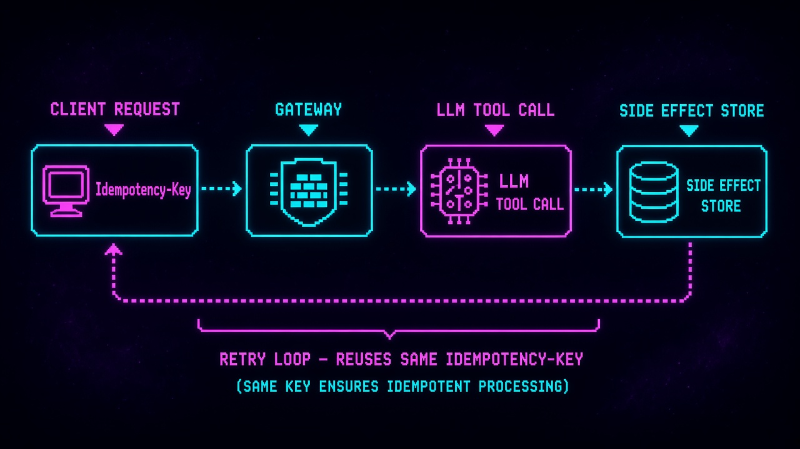

# Idempotency, Retries & Delivery

> Retry LLM calls and agent tools aggressively without double-charging, double-sending, or double-acting.

## TL;DR
- **Idempotency** is like an elevator button - pressing it five times still calls one elevator. An idempotent operation gives the same result no matter how often you repeat it.
- **Retries with backoff and jitter** are like re-dialing a busy phone line - wait a bit longer each time, and not at the same moment as everyone else.
- **Idempotency keys** are like a receipt number - the server remembers it and returns the original result instead of repeating the work.
- **Delivery guarantees** are like postal options - at-most-once may lose letters, at-least-once may deliver duplicates, and "exactly-once" is really at-least-once plus deduplication.

## Quickstart (Do this now)
1. **Classify your calls**: Read-only (safe), idempotent writes (safe with keys), non-idempotent side effects (dangerous)
2. **Generate a key per logical operation**: Derive it from the run ID + step number, not from a random value per attempt
3. **Store results by key**: Save the response or outcome so a repeated request returns it without re-executing
4. **Retry only transient errors**: 429, 503, and network timeouts - never 400-class validation errors
5. **Use exponential backoff with jitter** and a hard cap on attempts and total elapsed time

## The Idea (Slightly deeper)
Because networks fail ambiguously (see [Distributed Systems Foundations](distributed-systems-foundations.md)), the caller often cannot know whether a request ran. The only safe response is to **retry** - and the only way retries are safe is if the operation is **idempotent**. HTTP already encodes this: GET, PUT, and DELETE are defined as idempotent; POST is not, so APIs add **idempotency keys** to make POST safe.

AI systems have three layers of retries. The **LLM call** itself is mostly safe to retry - the cost is duplicated tokens, not corrupted state. The **tool call** is where danger lives: "send email", "create ticket", "charge card", "run SQL" must be guarded by a key or checked for prior execution. The **agent step or workflow** layer needs checkpoints so a resumed run skips completed steps instead of replaying them.

**Backoff with jitter** prevents a thundering herd. If a provider returns 429 or 503 and every client retries at the same instant, you amplify the outage. Randomizing delays spreads load, and honoring `Retry-After` headers aligns you with the provider's own rate limiter. Cap total retries - unbounded retries across layers multiply (3 × 3 × 3 = 27 calls) and create **retry storms**.

For messaging, **delivery semantics** define what the broker promises. At-least-once is the practical default; your consumers must therefore be **idempotent**, usually via a dedupe table keyed by message ID or by writing results with upserts. Combine with the **outbox pattern** so the database update and the event publish cannot diverge.

## Diagram

## Key Concepts
- **Idempotency Key**: A client-supplied unique ID that lets the server detect and replay duplicate requests
- **Exponential Backoff + Jitter**: Increasing randomized delays between retries to avoid synchronized spikes
- **Retry Budget**: A cap on retries as a fraction of traffic so retries cannot overwhelm a struggling dependency
- **At-Least-Once / At-Most-Once / Effectively-Once**: Delivery guarantees and the deduplication needed to approximate exactly-once
- **Dedupe Store**: A table or cache of processed message or request IDs with a TTL
- **Transactional Outbox**: Write the event and the state change in one transaction, publish asynchronously
- **Saga / Compensation**: Undo actions of earlier steps when a later step fails permanently

## When to Use This
- **Use when**: Agents call tools with side effects (email, payments, tickets, deployments)
- **Use when**: You call hosted LLM APIs that return 429 or 5xx under load
- **Use when**: Consuming events from queues or streams that redeliver
- **Don't use when**: Pure read-only, stateless calls where a failed request can simply be shown as an error
- **Consider alternatives**: Durable workflow engines (see [Background Jobs & Durable Workflows](background-jobs-and-durable-workflows.md)) when you would otherwise hand-roll checkpoints

## Real-World Examples
- **Stripe idempotent requests**: The reference design for idempotency keys → [Stripe idempotency](https://docs.stripe.com/api/idempotent_requests) (clear semantics for key reuse, expiry, and mismatched parameters)
- **AWS Builders' Library**: Safe retries in production → [Timeouts, retries, and backoff with jitter](https://aws.amazon.com/builders-library/timeouts-retries-and-backoff-with-jitter/) (explains why jitter and caps matter, with real operational data)
- **Anthropic API errors**: Documented retryable error types → [Errors](https://docs.anthropic.com/en/api/errors) (shows which statuses to retry and which to surface to users)
- **OpenAI rate limits**: Guidance for 429 handling → [Rate limits](https://platform.openai.com/docs/guides/rate-limits) (recommends exponential backoff and shows how limits relate to retries)
- **Amazon SQS**: At-least-once queues with FIFO dedup → [SQS FIFO](https://docs.aws.amazon.com/AWSSimpleQueueService/latest/SQSDeveloperGuide/FIFO-queues-exactly-once-processing.html) (built-in deduplication IDs for effectively-once processing)

## Common Pitfalls
- **Random key per attempt**: A key generated inside the retry loop defeats the purpose; generate it once per logical operation
- **Retrying non-idempotent tools blindly**: An agent that retries "send invoice" sends two invoices
- **Nested retries**: SDK, gateway, orchestrator, and agent all retrying multiplies load during incidents
- **Ignoring `Retry-After`**: Hammering a rate-limited endpoint extends your own outage
- **No TTL on dedupe store**: It grows forever, or expires before late retries arrive

## Deep Dives & "Why it's awesome"
- **[Making retries safe with idempotent APIs](https://aws.amazon.com/builders-library/making-retries-safe-with-idempotent-APIs/)** - Practical design of idempotent endpoints from large-scale operations
- **[Idempotency-Key HTTP header (IETF draft)](https://datatracker.ietf.org/doc/draft-ietf-httpapi-idempotency-key-header/)** - Standardization effort for the pattern Stripe popularized
- **[Retry pattern (Azure)](https://learn.microsoft.com/en-us/azure/architecture/patterns/retry)** - When to retry, how, and what to avoid
- **[Transactional Outbox](https://microservices.io/patterns/data/transactional-outbox.html)** - Reliable event publishing without distributed transactions
- **[Kafka delivery semantics](https://kafka.apache.org/documentation/#semantics)** - Exactly what at-least-once and transactional writes guarantee
- **[Saga pattern (Azure)](https://learn.microsoft.com/en-us/azure/architecture/patterns/saga)** - Compensating actions for multi-step processes, directly applicable to agent plans

## Next Steps
- **Learn more**: [Reliability & Failure Design](reliability-and-failure-design.md) - Combine retries with timeouts and circuit breakers
- **Learn more**: [Rate Limiting & Throughput](rate-limiting-and-throughput.md) - Understand the 429s you are retrying
- **Dive deeper**: [Background Jobs & Durable Workflows](background-jobs-and-durable-workflows.md) - Checkpointed, resumable agent runs
- **Connect**: [AI Agents](../ai-architecture-topics/ai-agents.md) - Tool design for agents that act in the real world
- **Connect**: [Guardrails](../ai-architecture-topics/guardrails.md) - Approval gates for risky tool actions
