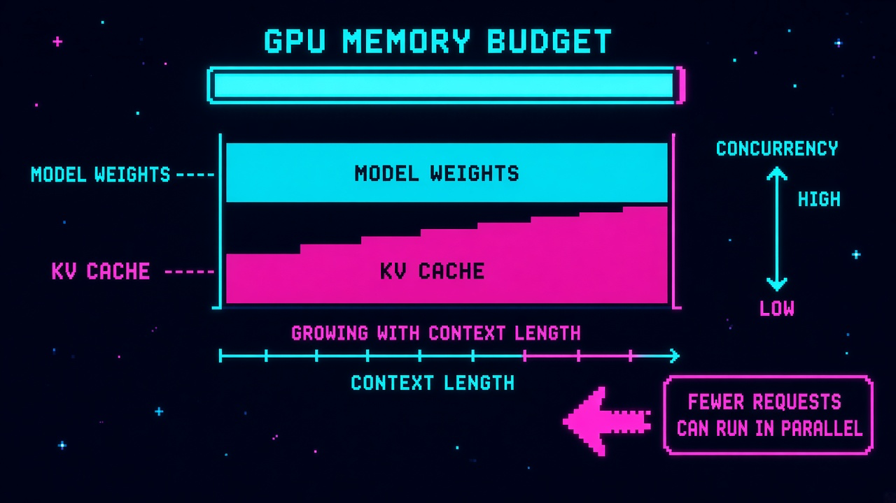

# KV Cache & Memory Cost

> Understand the KV cache as a capacity constraint: it decides how many users, how much context, and how many dollars per token your GPUs can really serve.

## TL;DR
- **The KV cache** is like a waiter's notepad for each table - the longer the conversation, the more notes they hold, and every table needs its own pad.
- **Model weights** are like the restaurant's recipe book - fixed in size and shared by everyone.
- **Context length x concurrency** is like tables x courses - double either and the notepad pile doubles.
- **Paging and quantization** are like filing notes in small shared folders and writing them in shorthand - the same information in less space.

## Quickstart (Do this now)
1. **Compute per-token KV size**: 2 x layers x KV heads x head dimension x bytes per value (see the formula below)
2. **Estimate concurrency**: (GPU memory - weights - activations) / (KV bytes per token x average tokens per request)
3. **Measure real lengths**: Track input and output token distributions; plan for p95, not the average
4. **Pick levers**: Grouped-query attention models, KV quantization, prefix sharing, shorter context, or offload tiers
5. **Alert on KV utilization**: Watch cache usage, evictions, and preemptions in your serving engine

## The Idea (Slightly deeper)
During generation, a transformer stores the **keys and values** of every previous token at every layer so it does not recompute them. This **KV cache** grows linearly with sequence length and with the number of concurrent sequences:

`KV bytes per token = 2 x layers x KV heads x head dim x bytes per element`

For a 70B-class model with grouped-query attention in 16-bit precision, this is on the order of hundreds of kilobytes per token - so one 32K-token conversation can consume gigabytes, and a hundred of them exhausts an 80 GB GPU even after weights fit. Hence the practical rule: **weights set whether you can host the model; KV cache sets how many users you can serve.** Long contexts, agent loops that re-send big histories, and RAG with large retrieved payloads all push this limit.

Architects have four lever families. **Reduce size per token**: models using multi-query or grouped-query attention, latent attention, or sliding windows; **KV quantization** to 8- or 4-bit. **Manage memory better**: **PagedAttention** allocates cache in blocks, eliminating fragmentation so more sequences fit. **Reuse**: prefix caching shares KV across requests with a common start. **Tier it**: offload cold KV to CPU memory, local SSD, or a shared store, and move it between prefill and decode machines in **disaggregated serving**. Each lever has tradeoffs: quantization may reduce quality, offload adds latency, and eviction forces recomputation (a latency spike). Treat **KV capacity as a first-class SLO input** alongside tokens per second.

## Diagram

## Key Concepts
- **KV Cache**: Stored attention keys and values for all previous tokens, per sequence
- **Prefill vs Decode**: Compute-heavy prompt processing versus memory-bandwidth-bound token generation
- **GQA / MQA / MLA**: Attention designs that shrink the number of KV heads or compress them
- **PagedAttention**: Block-based KV allocation that removes fragmentation and enables sharing
- **KV Quantization**: Storing cached values at lower precision to fit more tokens
- **Offloading & Tiering**: Moving KV between GPU, CPU, disk, or remote stores
- **Preemption / Eviction**: Dropping or swapping sequences when memory runs out

## When to Use This
- **Use when**: Sizing GPUs for long-context chat, RAG, coding agents, or many concurrent sessions
- **Use when**: Throughput stalls while GPU compute looks idle (a memory-bound symptom)
- **Use when**: Comparing models - KV footprint can differ several-fold at the same parameter count
- **Don't use when**: You only call a hosted API, where the provider manages KV and you pay in tokens
- **Consider alternatives**: Summarize or retrieve context instead of carrying everything in the window

## Real-World Examples
- **vLLM PagedAttention**: Block-managed KV cache → [vLLM docs](https://docs.vllm.ai/) (high utilization and prefix sharing for open-weight serving)
- **LMCache**: KV reuse across engines and tiers → [LMCache](https://github.com/LMCache/LMCache) (offload and share KV beyond a single GPU's memory)
- **Mooncake**: KV-centric disaggregated serving → [Mooncake paper](https://arxiv.org/abs/2407.00079) (production architecture built around KV cache movement for long-context service)
- **DeepSeek-V2 MLA**: Compressed latent attention → [DeepSeek-V2](https://arxiv.org/abs/2405.04434) (shows model design cutting KV footprint dramatically)
- **TensorRT-LLM KV cache**: Paged and quantized cache → [TensorRT-LLM](https://github.com/NVIDIA/TensorRT-LLM) (production GPU engine with configurable KV memory and reuse)

## Common Pitfalls
- **Sizing only for weights**: The model loads, then concurrency collapses under real contexts
- **Planning on average length**: p95 prompts and long outputs trigger preemption storms
- **Ignoring agent history growth**: Loops re-send ever-larger contexts, multiplying KV per task
- **Aggressive KV quantization without evals**: Subtle quality loss on long-context and reasoning tasks
- **Offload without latency tests**: Fetching cold KV from slow tiers can cost more than recomputing

## Deep Dives & "Why it's awesome"
- **[Efficient Memory Management for LLM Serving (PagedAttention)](https://arxiv.org/abs/2309.06180)** - The foundational paper on KV memory waste and paging
- **[GQA: Training Generalized Multi-Query Transformers](https://arxiv.org/abs/2305.13245)** - How fewer KV heads cut memory with little quality loss
- **[KIVI: KV cache quantization](https://arxiv.org/abs/2402.02750)** - Tuning-free 2-bit KV quantization results and tradeoffs
- **[Efficient Streaming Language Models (StreamingLLM)](https://arxiv.org/abs/2309.17453)** - Bounding cache growth for very long streams
- **[NVIDIA: Mastering LLM inference optimization](https://developer.nvidia.com/blog/mastering-llm-techniques-inference-optimization/)** - Practical walkthrough of KV cache, batching, and attention variants

## Next Steps
- **Learn more**: [Prompt & Semantic Caching](prompt-and-semantic-caching.md) - Reusing KV state across requests
- **Learn more**: [LLM Efficiency Techniques](llm-efficiency-techniques.md) - Quantization, batching, and routing alongside KV tuning
- **Dive deeper**: [Speculative Decoding & Serving Engines](speculative-decoding-and-serving-engines.md) - Engine choices that manage KV differently
- **Dive deeper**: [Context Engineering as Architecture](context-engineering-as-architecture.md) - Spending tokens, and therefore KV, deliberately
- **Connect**: [Inference Infrastructure](../ai-architecture-topics/inference-infrastructure.md) - Accelerators, memory, and hardware choices
- **Connect**: [Serving & Scaling](../ai-architecture-topics/serving-and-scaling.md) - Production serving fundamentals
