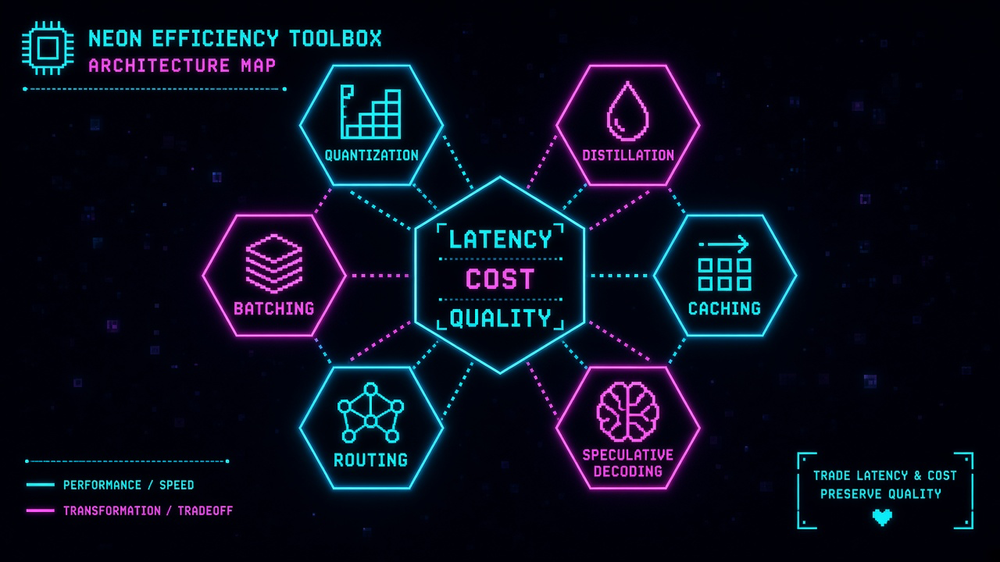

# LLM Efficiency Techniques

> Pick the cheapest lever that meets your quality bar - from smarter requests to smaller models to faster decoding - instead of simply buying more GPUs.

## TL;DR
- **Quantization** is like compressing a photo - the file shrinks a lot and most people cannot see the difference, until you compress too hard.
- **Distillation** is like a master chef teaching an apprentice a specific menu - the apprentice is cheaper and fast, but only good at that menu.
- **Batching** is like a bus versus a taxi - carrying many riders per trip lowers the cost per rider.
- **Routing** is like triage in a clinic - simple cases go to the nurse, hard cases to the specialist.
- **Speculative decoding** is like a fast assistant drafting a sentence that the expert only needs to approve.

## Quickstart (Do this now)
1. **Set the bar first**: Build an eval set and define minimum quality, p95 latency, and cost per task
2. **Remove waste**: Trim prompts, cap output length, and cache prefixes and repeated answers
3. **Batch what is not urgent**: Move offline work to batch APIs or continuous batching on your own engine
4. **Route by difficulty**: Send easy requests to a small model and escalate only when needed
5. **Then optimize the model**: Try quantization, then distillation or fine-tuning, validating each step against evals

## The Idea (Slightly deeper)
LLM cost is roughly **tokens x price per token**, and latency is **prefill time + tokens x decode time**. Efficiency techniques attack one of four things: **fewer tokens**, **cheaper tokens**, **faster tokens**, or **better use of hardware**. Ordering matters - start with the techniques that change no model behavior and finish with those that do.

**No-regret moves.** Prompt trimming, output limits, **prompt/prefix caching**, and response caching reduce work without altering quality. **Continuous batching** (iteration-level scheduling) keeps GPUs saturated by adding and removing requests mid-flight; for non-interactive work, **provider batch APIs** offer discounted asynchronous processing.

**Small-model strategies.** **Routing and cascades** use a cheap model first, escalating on low confidence or complexity - research like FrugalGPT and RouteLLM shows large savings at similar quality. **Distillation** trains a smaller student on a larger teacher's outputs for a narrow task. **Quantization** (8-bit, 4-bit via AWQ, GPTQ, or FP8) shrinks memory and boosts throughput, usually with small accuracy loss that must be verified on *your* tasks.

**Decoding tricks.** **Speculative decoding** drafts several tokens with a small model and verifies them in one pass of the large model, preserving output distribution while cutting latency. Gains vary with workload and batch size.

Every technique shifts a tradeoff: quantization trades precision for memory, distillation trades generality for cost, routing adds a decision point that can misroute, caching trades freshness for speed. Measure each **in isolation and combined**, because savings do not simply multiply and quality regressions compound.

## Diagram

## Key Concepts
- **Quantization**: Lower-precision weights, activations, or KV cache (INT8, INT4, FP8)
- **Distillation**: Training a small student model to imitate a larger teacher
- **Continuous Batching**: Scheduling at token level so new requests join running batches
- **Model Routing / Cascades**: Choosing or escalating models by difficulty, cost, or confidence
- **Prefix & Response Caching**: Reusing computation or answers across requests
- **Speculative Decoding**: Draft-and-verify to generate multiple tokens per large-model step
- **Pareto Frontier**: The best achievable quality-cost-latency combinations to choose from

## When to Use This
- **Use when**: Inference spend or latency is a top product or margin constraint
- **Use when**: Traffic is high enough that a few percent savings pay for engineering effort
- **Use when**: You self-host open-weight models and control the serving stack
- **Don't use when**: Volume is low and engineering time costs more than the API bill
- **Consider alternatives**: Switching to a smaller hosted model before building optimization infrastructure

## Real-World Examples
- **vLLM**: Continuous batching and quantization support → [vLLM docs](https://docs.vllm.ai/) (open-source engine combining many efficiency levers)
- **AWQ**: Activation-aware weight quantization → [AWQ paper](https://arxiv.org/abs/2306.00978) (4-bit weights with strong quality retention)
- **RouteLLM**: Learned routers between strong and weak models → [RouteLLM](https://arxiv.org/abs/2406.18665) (reports large cost cuts while keeping most quality)
- **OpenAI Batch API**: Discounted asynchronous jobs → [Batch guide](https://platform.openai.com/docs/guides/batch) (cheap path for evals, enrichment, and backfills)
- **Anthropic Message Batches**: Asynchronous bulk processing → [Batch processing](https://docs.anthropic.com/en/docs/build-with-claude/batch-processing) (same idea with clear pricing and turnaround terms)
- **Hugging Face quantization docs**: Methods compared → [Quantization overview](https://huggingface.co/docs/transformers/main/en/quantization/overview) (practical catalog of GPTQ, AWQ, bitsandbytes, and more)

## Common Pitfalls
- **Optimizing without evals**: Cheaper outputs quietly fail on edge cases you did not measure
- **Quantizing blindly**: Reasoning, code, and long-context tasks can degrade more than benchmarks suggest
- **Router without fallback**: Misrouted hard queries get weak answers with no escalation
- **Distilling a moving target**: The teacher changes, but the student is never refreshed
- **Stacking everything at once**: You cannot tell which change caused a regression

## Deep Dives & "Why it's awesome"
- **[Distilling the Knowledge in a Neural Network](https://arxiv.org/abs/1503.02531)** - The original distillation idea
- **[FrugalGPT](https://arxiv.org/abs/2305.05176)** - Cascades, prompt adaptation, and caching to cut LLM cost
- **[GPTQ](https://arxiv.org/abs/2210.17323)** - Post-training quantization for large language models
- **[FlashAttention](https://arxiv.org/abs/2205.14135)** - IO-aware attention that speeds training and inference
- **[Orca: Continuous batching](https://www.usenix.org/conference/osdi22/presentation/yu)** - The iteration-level scheduling behind modern servers

## Next Steps
- **Learn more**: [AI Cost & Token Economics](ai-cost-and-token-economics.md) - Turn savings into unit economics
- **Learn more**: [Model Customization Decision](model-customization-decision.md) - When distillation or fine-tuning beats prompting
- **Dive deeper**: [Speculative Decoding & Serving Engines](speculative-decoding-and-serving-engines.md) - Draft/verify and engine selection
- **Dive deeper**: [KV Cache & Memory Cost](kv-cache-and-memory-cost.md) - Memory limits behind batching gains
- **Connect**: [Model Routing](../ai-architecture-topics/model-routing.md) - Routing strategies in depth
- **Connect**: [Inference Infrastructure](../ai-architecture-topics/inference-infrastructure.md) - Hardware and quantization choices
