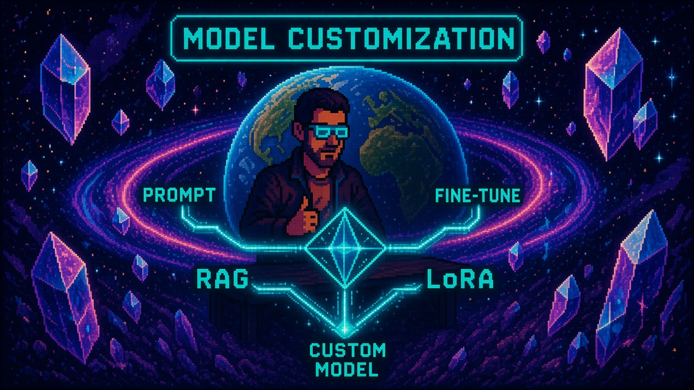
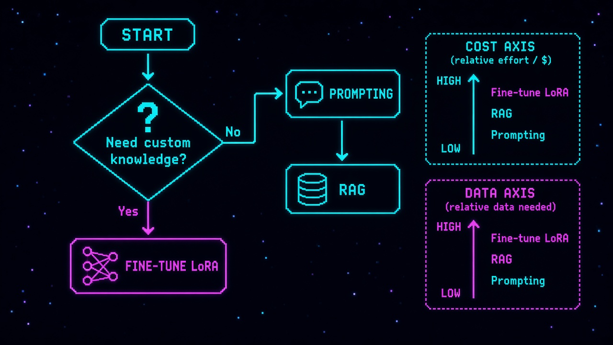

# Model Customization Decision

> Pick the cheapest customization that meets your quality bar - and know when to escalate.

## TL;DR
- **Prompting** is like giving a new hire written instructions - fast, free, and often enough.
- **RAG** is like handing them the company handbook - they look up facts instead of memorizing them.
- **Fine-tuning** is like sending them to training - it changes habits, tone, and format, not what's in the handbook.
- **Distillation** is like having an expert coach a junior - a small cheap model learns to imitate a big one on your task.
- **Preference tuning** is like performance reviews - teaching the model which of two answers you prefer.

## Quickstart (Do this now)
1. **Write an eval first**: 50-200 realistic cases with clear pass/fail criteria
2. **Baseline with prompting**: Best prompt, few-shot examples, structured output
3. **Add RAG if facts are missing**: Private, fresh, or large knowledge belongs in retrieval
4. **Try a better or different model**: Often cheaper than any training effort
5. **Fine-tune only on a proven gap**: Consistent format, tone, or narrow task that prompts cannot hold
6. **Compare cost per good answer**: Include training, hosting, and maintenance, not just per-token price

## The Idea (Slightly deeper)
Customization is a ladder, and each rung costs more in data, time, and maintenance. **Prompting and context engineering** shape behavior at request time. **RAG** supplies knowledge at request time. **Fine-tuning** (full, or parameter-efficient such as LoRA and QLoRA) changes the weights to bake in behavior: style, output structure, domain vocabulary, tool-calling patterns. **Preference optimization** (DPO, RLHF-style methods) aligns outputs to ranked human or AI preferences. **Distillation** trains a smaller student on outputs of a larger teacher to cut latency and cost.

The central distinction: **RAG adds knowledge, fine-tuning adds behavior.** Fine-tuning is a poor way to inject fast-changing facts, and RAG cannot reliably teach a model a new output style or reasoning habit. Many production systems combine them: a fine-tuned small model for the format and tone, retrieval for facts, and a frontier model as fallback.

Treat the decision as an architecture decision: record the options, evidence, and the trigger that would make you revisit it (a new base model often erases a fine-tuning advantage).

## Diagram

## Key Concepts
- **Prompt / Few-Shot**: Instructions and examples placed in the context
- **RAG**: Retrieval of external knowledge injected at inference time
- **SFT (Supervised Fine-Tuning)**: Training on input-output pairs to teach behavior
- **LoRA / QLoRA**: Parameter-efficient methods that train small adapters, often on quantized bases
- **DPO / Preference Tuning**: Optimizing toward preferred over rejected answers
- **Distillation**: Training a smaller model from a larger model's outputs
- **Catastrophic Forgetting**: Losing general ability when over-tuning on a narrow set
- **Data Flywheel**: Production traces curated into the next round of eval and training data

## When to Use This
- **Use when**: Prompting plus RAG plateau below your quality bar on a measured eval
- **Use when**: You need a consistent format or tone at lower latency and cost (small tuned model)
- **Use when**: High volume makes distilling a frontier model's behavior economical
- **Don't use when**: The gap is missing or changing knowledge - use RAG
- **Consider alternatives**: Upgrading the base model, routing, or better tools before any training

## Real-World Examples
- **OpenAI Fine-Tuning**: Managed SFT, DPO, and reinforcement options → [OpenAI Fine-Tuning Guide](https://platform.openai.com/docs/guides/fine-tuning) (clear guidance on when tuning pays off and how to evaluate it)
- **Hugging Face PEFT and TRL**: Open-source LoRA and preference training → [PEFT](https://huggingface.co/docs/peft) and [TRL](https://huggingface.co/docs/trl) (the standard toolchain for adapter-based tuning)
- **Amazon Bedrock Custom Models**: Managed customization and distillation → [Bedrock Customization](https://docs.aws.amazon.com/bedrock/latest/userguide/custom-models.html) (enterprise workflow with governance on AWS)
- **Google Vertex AI Tuning**: Managed tuning for Gemini → [Vertex AI Model Tuning](https://cloud.google.com/vertex-ai/generative-ai/docs/models/tune-models) (supervised tuning integrated with evaluation tools)

## Common Pitfalls
- **Tuning before measuring**: Without an eval you cannot tell if tuning helped or hurt
- **Fine-tuning for facts**: Knowledge goes stale and hallucination persists - use retrieval
- **Low-quality data**: A few hundred clean examples beat thousands of noisy ones
- **Eval contamination**: Training examples leaking into the test set inflate results
- **Ignoring maintenance**: Each base-model upgrade may require retraining and re-evaluation
- **Privacy blind spots**: Training data can be memorized - scrub PII and secrets
- **Skipping the baseline**: Compare against the best-prompted frontier model, not a weak one

## Deep Dives & "Why it's awesome"
- **[LoRA paper](https://arxiv.org/abs/2106.09685)** - The low-rank adapter idea that made tuning affordable
- **[QLoRA paper](https://arxiv.org/abs/2305.14314)** - Fine-tuning large models on a single GPU via 4-bit quantization
- **[DPO paper](https://arxiv.org/abs/2305.18290)** - Preference tuning without a separate reward model
- **[OpenAI Model Optimization Guide](https://platform.openai.com/docs/guides/model-optimization)** - A practical loop of evals, prompting, and fine-tuning
- **[RAG paper](https://arxiv.org/abs/2005.11401)** - The knowledge-injection alternative to tuning
- **[Distilling the Knowledge in a Neural Network](https://arxiv.org/abs/1503.02531)** - The foundational distillation paper

## Decision Checklist
- **Eval exists**: Held-out set with pass criteria and baseline scores
- **Gap type**: Knowledge, behavior, cost, or latency - named explicitly
- **Cheapest fix tried**: Prompt, model swap, RAG, routing
- **Data ready**: Clean, deduplicated, consented, split into train and test
- **Exit plan**: Rollback path and a trigger to re-evaluate when base models change

## Next Steps
- **Learn more**: [Eval Recipes and LLM-as-Judge](eval-recipes-and-llm-judge.md) - Build the eval that justifies the decision
- **Learn more**: [AI Cost and Token Economics](ai-cost-and-token-economics.md) - Compare cost per good answer
- **Go deeper**: [Model Routing](../ai-architecture-topics/model-routing.md) - Send easy traffic to small tuned models
- **Go deeper**: [Inference Infrastructure](../ai-architecture-topics/inference-infrastructure.md) - Hosting adapters and quantized models
- **Document it**: [Architecture Decision Records](../solution-architecture/architecture-decision-records.md) - Capture the customization choice
- **Try it**: [Hugging Face LLM Course](https://huggingface.co/learn/llm-course) - Hands-on fine-tuning basics
