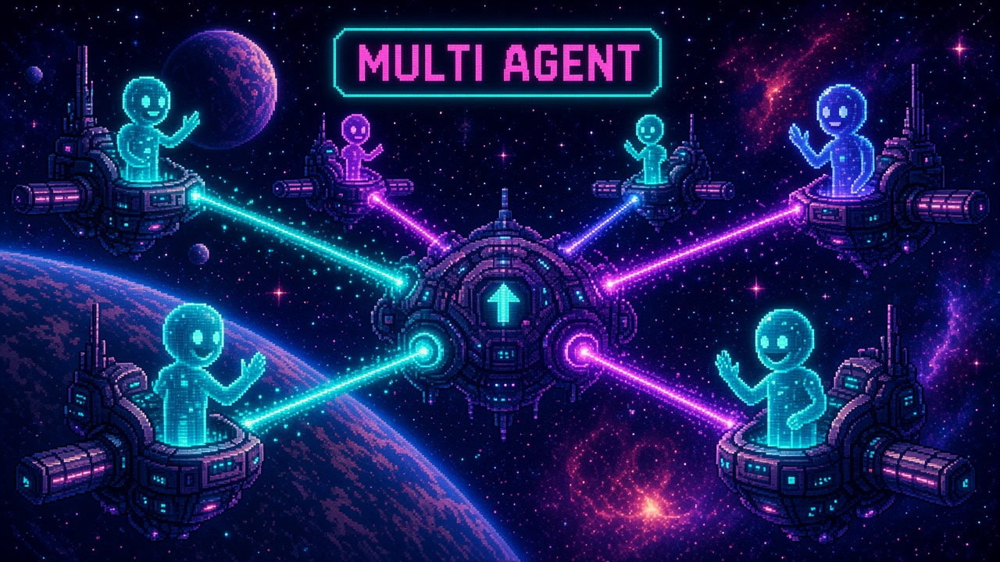
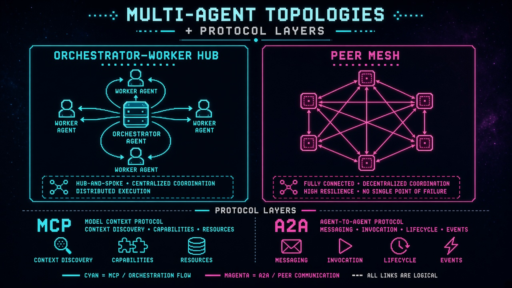

# Multi-Agent & Agent Protocols

> Split complex work across specialist agents that cooperate through clear contracts instead of chaos.

## TL;DR
- **Multi-agent systems** are like a project team - a lead plans, specialists execute, a reviewer checks.
- **Orchestrator-worker** is like a general contractor hiring electricians and plumbers for one house.
- **MCP** is like a universal power socket - any agent can plug into any tool or data source.
- **A2A** is like a phone line between companies - agents from different vendors can talk to each other and delegate tasks.
- **Handoffs** are like passing a baton - one agent transfers control and context to another.

## Quickstart (Do this now)
1. **Prove a single agent fails first**: Only split when one agent hits context, tool, or quality limits
2. **Define roles**: Give each agent one job, one toolset, and one output format
3. **Pick a topology**: Orchestrator-worker, pipeline, router with handoffs, or peer debate
4. **Standardize interfaces**: Use MCP for tools and data, A2A for agent-to-agent delegation
5. **Share state deliberately**: Pass summaries and artifacts, not whole transcripts
6. **Trace across agents**: One trace ID spanning every agent and tool call

## The Idea (Slightly deeper)
A **multi-agent system** uses several LLM-driven agents, each with its own prompt, tools, and context, coordinated toward a shared goal. The benefits are real: parallelism, separation of concerns, smaller focused contexts, and independent evaluation. The costs are real too: more tokens, more failure modes, and harder debugging.

Common topologies are **orchestrator-worker** (a lead agent decomposes work and delegates), **router/handoff** (a triage agent routes to specialists), **pipeline** (planner, executor, reviewer), and **evaluator-optimizer** (one agent drafts, another critiques). Anthropic's research system showed parallel subagents can beat a single agent on breadth-heavy tasks, at a significantly higher token cost.

**Protocols** keep this from becoming bespoke glue. The **Model Context Protocol (MCP)** standardizes how an agent connects to tools, resources, and prompts. The **Agent2Agent protocol (A2A)** standardizes how independent agents discover each other (Agent Cards), exchange messages, and manage long-running tasks across vendors and frameworks.

## Diagram

## Key Concepts
- **Orchestrator / Worker**: Lead agent plans and delegates; workers do scoped subtasks
- **Handoff**: Explicit transfer of control and context between agents
- **Agent Card**: A machine-readable description of an agent's skills and endpoint (A2A)
- **Task Lifecycle**: Submitted, working, input-required, completed - for long-running delegated work
- **MCP Client / Server**: Host app connects to servers that expose tools, resources, and prompts
- **Shared vs Private Context**: What each agent sees; isolation reduces noise and leakage
- **Consensus / Critique**: Using a second agent to verify or challenge outputs

## When to Use This
- **Use when**: Work parallelizes well (research, multi-file changes, data gathering)
- **Use when**: Roles need different tools, permissions, or models
- **Use when**: Agents are owned by different teams or vendors and must interoperate
- **Don't use when**: One agent with good tools already succeeds - extra agents add cost and noise
- **Consider alternatives**: Deterministic workflows or a single agent with subroutines

## Real-World Examples
- **Anthropic Multi-Agent Research**: Lead agent plus parallel subagents → [How we built our multi-agent research system](https://www.anthropic.com/engineering/multi-agent-research-system) (candid lessons on prompts, token cost, and evaluation)
- **MCP**: Open standard for tools and context → [Model Context Protocol](https://modelcontextprotocol.io/) (a growing ecosystem of servers and clients across vendors)
- **A2A**: Open agent interoperability protocol → [A2A Protocol](https://a2a-protocol.org/) (vendor-neutral delegation between agents, under Linux Foundation governance)
- **AutoGen and CrewAI**: Multi-agent frameworks → [AutoGen](https://microsoft.github.io/autogen/) and [CrewAI](https://docs.crewai.com/) (ready-made role, team, and conversation patterns)

## Common Pitfalls
- **Agent sprawl**: Splitting by org chart instead of by real need - start with one agent
- **Telephone game**: Information degrades across handoffs; pass structured artifacts
- **Runaway cost**: Parallel agents multiply tokens - budget per run and per agent
- **Ambiguous ownership**: Two agents editing the same resource without locks or contracts
- **Unsafe delegation**: Remote agents and MCP servers are untrusted input - authenticate and constrain
- **Evaluating only end results**: Also score each agent's contribution and handoff quality

## Deep Dives & "Why it's awesome"
- **[Building Effective Agents](https://www.anthropic.com/engineering/building-effective-agents)** - Orchestrator-worker and evaluator-optimizer patterns explained
- **[MCP Specification](https://modelcontextprotocol.io/specification)** - Transport, authorization, and capability negotiation details
- **[A2A GitHub Repository](https://github.com/a2aproject/A2A)** - Specification, SDKs, and samples for agent interoperability
- **[OpenAI Agents SDK: Handoffs](https://openai.github.io/openai-agents-python/handoffs/)** - A concise model for routing between specialists
- **[LangGraph Multi-Agent Concepts](https://langchain-ai.github.io/langgraph/concepts/multi_agent/)** - Network, supervisor, and hierarchical topologies
- **[AutoGen Paper](https://arxiv.org/abs/2308.08155)** - Conversation-driven multi-agent programming

## Multi-Agent Design Checklist
- **Justification**: Documented evidence that a single agent is insufficient
- **Contracts**: Typed inputs and outputs for each agent
- **Budgets**: Token, step, and time caps per agent and per run
- **Security**: Auth, least privilege, and input validation at every boundary
- **Tracing**: End-to-end trace across agents, tools, and protocols

## Next Steps
- **Learn more**: [Agent Loop and Harness](agent-loop-and-harness.md) - The single-agent foundation to master first
- **Learn more**: [Skills, MCP, RAG Capability Layers](skills-mcp-rag-capability-layers.md) - Where MCP sits in the capability stack
- **Go deeper**: [Orchestration Frameworks](../ai-architecture-topics/orchestration-frameworks.md) - Compare coordination frameworks
- **Go deeper**: [Model Context Protocol](../ai-for-software-engineering-skills/model-context-protocol.md) - MCP for engineering workflows
- **Apply it**: [Multi-Agent Coding Workflows](../ai-for-software-engineering-skills/multi-agent-coding-workflows.md) - Parallel agents for software delivery
- **Try it**: [MCP Quickstart](https://modelcontextprotocol.io/quickstart/server) - Build your first MCP server
