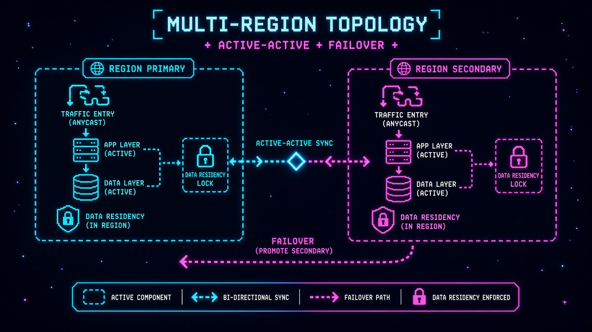

# Multi-Region & High Availability for AI

> Keep AI features online and compliant across regions even when GPUs are scarce, a provider region degrades, or data is not allowed to leave its home jurisdiction.

## TL;DR
- **GPU scarcity** is like a popular restaurant with a handful of tables - you cannot just "add another server" on demand, so you need reservations, backups, and a waiting-list strategy.
- **Data residency** is like customs rules for luggage - some data must never cross the border, so the request must be served by a kitchen on the right side of it.
- **Failover** is like a backup generator - it only helps if you tested it before the blackout and it can carry the real load.
- **Active-active vs active-passive** is like two open stores versus one open store plus one locked spare - the first is faster and costlier, the second is cheaper but slower to recover.

## Quickstart (Do this now)
1. **Classify workloads**: Mark each AI feature as latency-critical, residency-bound, or batch/deferrable
2. **Map data to regions**: Define which tenants, prompts, embeddings, and logs must stay in which jurisdiction
3. **Add a second model path**: Configure at least one alternate region or provider for every critical model
4. **Route by policy, not hope**: Put region selection, health checks, and fallback order in your gateway
5. **Run a failover drill**: Black-hole a region in staging and measure recovery time and quality degradation

## The Idea (Slightly deeper)
Traditional multi-region design assumes compute is elastic. **AI breaks that assumption**: accelerators are quota-limited, regionally uneven, and slow to provision. A region failover can fail simply because the target region has no spare GPU capacity or no quota for your model. High availability for AI is therefore a **capacity planning problem first** and a networking problem second.

Three forces pull in different directions. **Capacity** pushes you toward wherever GPUs exist (including cross-region inference profiles and multiple providers). **Residency and sovereignty** push you to keep prompts, retrieved documents, embeddings, and logs inside a boundary. **Latency** pushes you toward the user. A good design makes this explicit: a **routing layer** evaluates tenant policy first (where may this request run?), then health and capacity (where can it run now?), then latency and cost (where should it run?).

Plan **degradation tiers** rather than binary failover: full model in home region, then the same model in a compliant secondary region, then a smaller or cheaper model, then cached or retrieval-only answers, then a graceful "feature unavailable" message. Stateful pieces need their own plan: **vector indexes, session state, and caches** must be replicated or rebuildable, and replication must itself respect residency rules.

## Diagram

## Key Concepts
- **Capacity Reservation**: Provisioned throughput or reserved GPUs that guarantee tokens per minute in a region
- **Data Residency / Sovereignty**: Legal or contractual limits on where data is stored and processed
- **Geo-Aware Routing**: Selecting a region from tenant policy, health, and latency before dispatching
- **Cross-Region Inference**: Provider feature that spreads requests over regions to absorb spikes
- **RTO / RPO**: Recovery time and data-loss objectives, including for indexes and conversation state
- **Graceful Degradation Ladder**: Ordered fallbacks from best model to cached or non-AI behavior
- **Static Stability**: Failover that needs no control-plane action or new capacity at the moment of failure

## When to Use This
- **Use when**: AI is on a revenue-critical or customer-facing path with availability targets above 99.9%
- **Use when**: Customers in the EU, healthcare, finance, or public sector require in-region processing
- **Use when**: You rely on scarce GPU families or hit regional quota ceilings
- **Don't use when**: The feature is internal, tolerant of hours of downtime, or easily retried later
- **Consider alternatives**: Queue and defer batch workloads to whichever region has spare capacity

## Real-World Examples
- **Amazon Bedrock cross-region inference**: Inference profiles route across regions → [Cross-region inference](https://docs.aws.amazon.com/bedrock/latest/userguide/cross-region-inference.html) (absorbs traffic bursts while keeping a defined geography)
- **Azure OpenAI provisioned throughput**: Reserved model capacity → [Provisioned throughput](https://learn.microsoft.com/en-us/azure/ai-services/openai/concepts/provisioned-throughput) (predictable latency instead of competing for shared capacity)
- **Vertex AI data residency**: Region-bound processing controls → [Data residency](https://cloud.google.com/vertex-ai/generative-ai/docs/learn/data-residency) (shows how a hyperscaler documents where inference and storage happen)
- **Cloudflare AI Gateway**: Provider fallback and retries → [AI Gateway](https://developers.cloudflare.com/ai-gateway/) (a drop-in place to implement model and provider failover)
- **LiteLLM router**: Multi-deployment routing with cooldowns → [LiteLLM routing](https://docs.litellm.ai/docs/routing) (open-source pattern for load balancing and fallback across regions and vendors)

## Common Pitfalls
- **Failover without capacity**: The secondary region has no quota or GPUs when you need it
- **Residency leaks through side channels**: Logs, traces, caches, and embeddings cross borders even if inference does not
- **Untested failover**: Runbooks that were never exercised fail at the worst moment
- **Quality cliff**: A fallback model silently changes behavior and breaks prompts, tool calls, or evals
- **Split-brain state**: Session memory and vector indexes drift between regions after partial failure

## Deep Dives & "Why it's awesome"
- **[AWS Well-Architected Reliability Pillar](https://docs.aws.amazon.com/wellarchitected/latest/reliability-pillar/welcome.html)** - Failure management, DR strategies, and static stability fundamentals
- **[Google SRE: Addressing Cascading Failures](https://sre.google/sre-book/addressing-cascading-failures/)** - Why failover traffic can topple the region that receives it
- **[Azure Architecture Center: Multi-region](https://learn.microsoft.com/en-us/azure/architecture/reference-architectures/containers/aks-multi-region/aks-multi-cluster)** - Concrete multi-region cluster patterns applicable to model serving
- **[GDPR Chapter 5: Transfers](https://gdpr-info.eu/chapter-5/)** - The legal basis behind most residency requirements
- **[Kubernetes Topology Aware Routing](https://kubernetes.io/docs/concepts/services-networking/topology-aware-routing/)** - Keep traffic local to a zone or region when serving self-hosted models

## Next Steps
- **Learn more**: [Reliability & Failure Design](reliability-and-failure-design.md) - Timeouts, retries, circuit breakers, and degradation for AI calls
- **Learn more**: [AI Request Path & Gateways](ai-request-path-and-gateways.md) - Where region and provider routing is enforced
- **Dive deeper**: [Data Movement & Lifecycle](data-movement-and-lifecycle.md) - Replication, retention, and deletion across regions
- **Dive deeper**: [Multi-Tenancy for AI](multi-tenancy-for-ai.md) - Per-tenant residency and capacity isolation
- **Connect**: [Multi-Cloud](../ai-architecture-topics/multi-cloud.md) - Spreading AI workloads across providers
- **Connect**: [Quality Attributes](../solution-architecture/quality-attributes.md) - Turning availability and compliance goals into measurable targets
