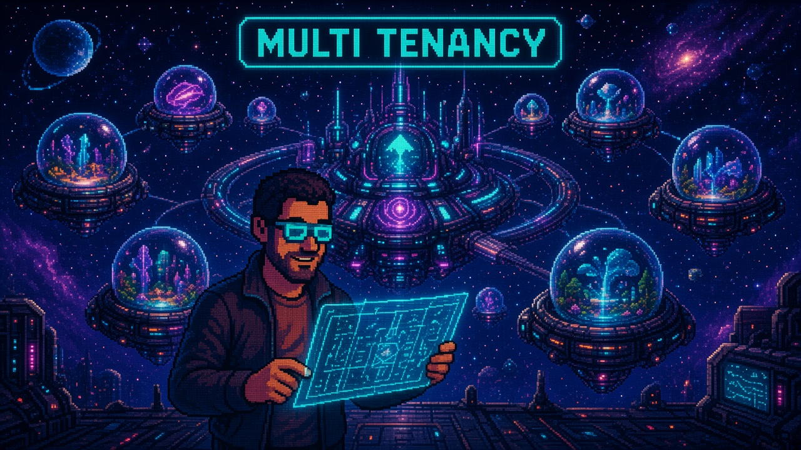
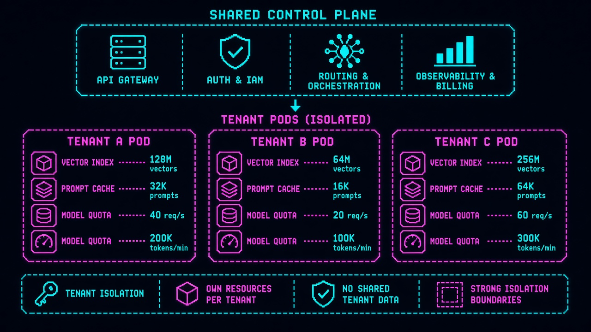

# Multi-Tenancy for AI

> Serve many customers from one AI platform without leaking their data, blowing one tenant's budget on another's traffic, or letting one team slow everyone down.

## TL;DR
- **Multi-tenancy** is like an apartment building - residents share the plumbing and structure, but each unit has its own locked door.
- **Tenant isolation** is like those locks - data, vectors, memory, and caches must never be reachable by another tenant, even by mistake.
- **Noisy neighbors** are like a loud party upstairs - one tenant's heavy usage must not degrade everyone else's latency or quotas.
- **Cost attribution** is like separate utility meters - you must know which tenant used which tokens and GPU time.

## Quickstart (Do this now)
1. **Propagate a tenant ID everywhere**: Request context, logs, traces, queues, cache keys, vector filters, and tool credentials
2. **Choose an isolation model per layer**: Pool (shared, filtered), bridge (shared infra, separate namespaces), or silo (dedicated)
3. **Enforce isolation in the data layer**: Row-level security, per-tenant namespaces or collections, not just app-level `if` statements
4. **Apply per-tenant quotas and budgets**: Token limits, concurrency caps, and spend alerts by plan tier
5. **Test isolation adversarially**: Cross-tenant retrieval, prompt injection asking for "other customers' data", and cache poisoning tests

## The Idea (Slightly deeper)
In a **multi-tenant** AI product, many customers (tenants) share the same application, models, and infrastructure. This is economical, but AI adds new leak paths beyond a normal SaaS app. Data can cross tenant boundaries through the **vector index** (missing metadata filter), the **semantic or response cache** (shared key), **conversation memory**, **fine-tuned or custom models**, **tool credentials** (agent acting with a shared service account), **logs and traces** containing prompts, and **prompt injection** that persuades an agent to fetch another tenant's data.

Three common **isolation models** apply at each layer. **Pool**: all tenants share resources, separated by a tenant ID filter - cheapest, highest leak risk if filters are wrong. **Bridge**: shared infrastructure with logical separation such as per-tenant namespaces, collections, or schemas. **Silo**: dedicated databases, indexes, or even model deployments - strongest isolation, highest cost, often required for regulated or large customers. Most platforms mix them by **tenant tier**: pooled for free and standard plans, siloed for enterprise.

**Enforce isolation outside the model.** Never rely on the prompt ("only answer from this customer's data"). Apply tenant filters in the retrieval layer using **server-side, non-overridable** parameters derived from authenticated identity, use **database row-level security**, and give agents **scoped, per-tenant tool credentials** (short-lived tokens, not shared keys). Treat model output as untrusted and check it against permissions before it reaches tools.

**Fairness and cost** matter as much as security. Apply [per-tenant rate limits](rate-limiting-and-throughput.md), concurrency bulkheads, and weighted fair queuing so a heavy tenant can't starve others. Tag every request with tenant, model, tokens, and latency for **chargeback and showback**, and let enterprise tenants bring their own keys (BYOK/BYOM) or dedicated capacity when they need guarantees.

## Diagram

## Key Concepts
- **Pool / Bridge / Silo**: Shared-with-filters, shared-with-namespaces, and dedicated-per-tenant isolation models
- **Tenant Context Propagation**: Carrying authenticated tenant identity through every hop
- **Row-Level Security (RLS)**: Database-enforced filtering that application bugs cannot bypass
- **Namespace / Collection per Tenant**: Vector store partitioning for isolation and per-tenant deletion
- **Noisy Neighbor**: One tenant's load degrading others' performance
- **Per-Tenant Quotas & Budgets**: Token, request, concurrency, and spend limits by plan
- **Tenant-Scoped Credentials**: Short-lived tokens that limit what an agent can access on a tenant's behalf

## When to Use This
- **Use when**: One AI product serves multiple customers, teams, or business units
- **Use when**: You index customer documents, store memory, or call tools on a customer's behalf
- **Use when**: Contracts or regulations require data separation, residency, or deletion guarantees
- **Don't use when**: Single-customer internal tools where there is one trust domain
- **Consider alternatives**: Fully siloed deployments per customer when isolation requirements outweigh cost efficiency

## Real-World Examples
- **Azure multitenant guidance**: Architecture approaches for shared platforms → [Multitenancy overview](https://learn.microsoft.com/en-us/azure/architecture/guide/multitenant/overview) (thorough treatment of tenancy models, tradeoffs, and tenant lifecycle)
- **Azure OpenAI in multitenant solutions**: Quotas and isolation for model access → [Multitenancy and Azure OpenAI](https://learn.microsoft.com/en-us/azure/architecture/guide/multitenant/service/openai) (practical advice on shared vs dedicated deployments and quota partitioning)
- **AWS SaaS Lens**: Well-Architected guidance for SaaS → [SaaS Lens](https://docs.aws.amazon.com/wellarchitected/latest/saas-lens/saas-lens.html) (covers tenant isolation, noisy neighbors, and metering)
- **Pinecone multitenancy**: Namespace-per-tenant indexes → [Implement multitenancy](https://docs.pinecone.io/guides/index-data/implement-multitenancy) (a straightforward pattern for isolation and fast tenant deletion)
- **Qdrant multitenancy**: Payload-based partitioning → [Multiple partitions](https://qdrant.tech/documentation/guides/multiple-partitions/) (explains when to use tenant payload filters vs separate collections)
- **PostgreSQL Row Security Policies**: Database-enforced isolation → [Row security](https://www.postgresql.org/docs/current/ddl-rowsecurity.html) (a strong baseline for pgvector-based RAG)

## Common Pitfalls
- **Tenant filter only in application code**: One missed query exposes all tenants' documents
- **Shared semantic cache without tenant scoping**: Tenant A's private answer served to Tenant B (see [Caching for AI](caching-for-ai.md))
- **Agents using a shared service account**: Prompt injection can reach any tenant's resources
- **Prompts and responses in shared logs**: Support engineers or other tenants can see sensitive content
- **Pooled queues and GPU pools**: A bulk-import tenant delays everyone else's interactive requests

## Deep Dives & "Why it's awesome"
- **[Noisy Neighbor antipattern (Azure)](https://learn.microsoft.com/en-us/azure/architecture/antipatterns/noisy-neighbor/noisy-neighbor)** - Detection and mitigation strategies for shared-resource contention
- **[OWASP Top 10 for LLM Applications](https://genai.owasp.org/llm-top-10/)** - Sensitive information disclosure, excessive agency, and prompt injection risks
- **[pgvector](https://github.com/pgvector/pgvector)** - Vector search inside Postgres, enabling RLS-based tenant isolation
- **[Architecting multitenant solutions on Azure](https://learn.microsoft.com/en-us/azure/architecture/guide/multitenant/overview)** - Lifecycle, billing, and deployment stamps for tenants
- **[LiteLLM virtual keys](https://docs.litellm.ai/docs/proxy/virtual_keys)** - Per-team budgets and model access for shared LLM gateways
- **[Bulkhead pattern (Azure)](https://learn.microsoft.com/en-us/azure/architecture/patterns/bulkhead)** - Partition resources to contain one tenant's failures

## Next Steps
- **Learn more**: [Rate Limiting & Throughput](rate-limiting-and-throughput.md) - Per-tenant quotas and fair scheduling
- **Learn more**: [AI Request Path & Gateways](ai-request-path-and-gateways.md) - Resolve and enforce tenant context at the gateway
- **Dive deeper**: [Distributed Systems Foundations](distributed-systems-foundations.md) - Consistency for permissions and revocation
- **Connect**: [Security & Compliance](../ai-architecture-topics/security-compliance.md) - Compliance requirements for customer data
- **Connect**: [Vector Stores & Embeddings](../ai-architecture-topics/vector-stores-and-embeddings.md) - Index design for tenant partitioning
- **Connect**: [Quality Attributes](../solution-architecture/quality-attributes.md) - Isolation, security, and cost as architectural drivers
