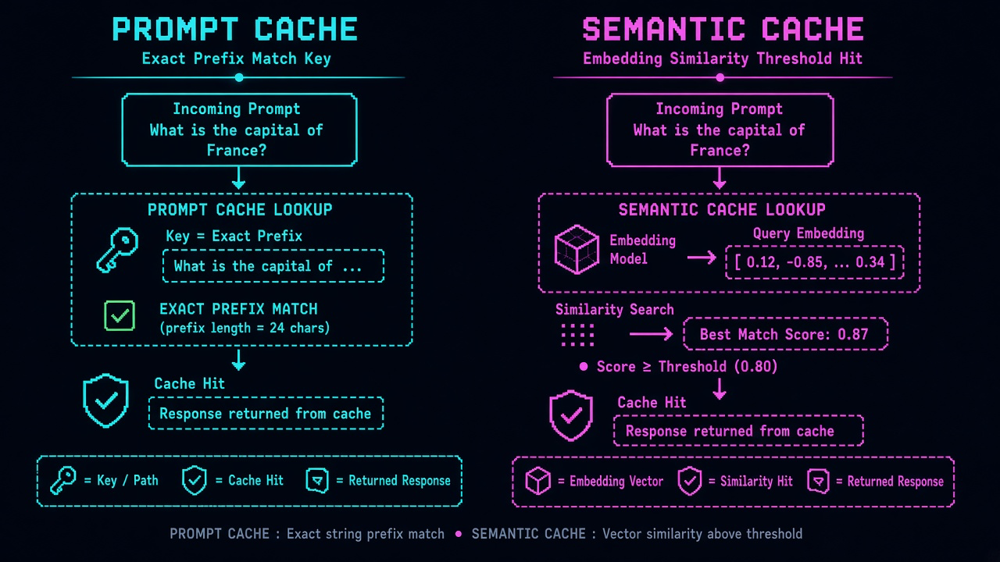

# Prompt & Semantic Caching

> Choose the right cache for the job: prefix caches make long prompts cheaper and faster without changing answers, while semantic caches skip the model entirely at the risk of being wrong.

## TL;DR
- **Prefix (prompt) caching** is like keeping the first chapters of a book already read - the model only reads the new pages, and the story is unchanged.
- **Semantic caching** is like a librarian who says "that is basically the same question" and hands over a saved answer - fast and cheap, but she can misjudge.
- **Exact caching** is like a lookup of identical forms - safe, but only matches word-for-word repeats.
- **Cache scope** is like separate lockers per customer - a shared locker means someone else's answer lands in your hands.

## Quickstart (Do this now)
1. **Reorder prompts**: Put system instructions, tool definitions, and reference documents first; user-specific content last
2. **Turn on provider prompt caching**: Add cache breakpoints (or rely on automatic prefix caching) and watch cached-token metrics
3. **Measure repetition**: Sample real traffic to estimate exact-repeat and near-duplicate rates before building anything
4. **Prototype a semantic cache**: Embed queries, tune a similarity threshold on labeled pairs, and shadow-test before serving
5. **Scope and expire**: Key by tenant, permissions, model, and prompt version, with TTLs and purge hooks

## The Idea (Slightly deeper)
Both caches save money, but they save **different things** and carry **different risks**.

A **prefix cache** reuses the model's internal **KV state** for tokens it has already processed. It requires an **exact token-level match of a leading prefix**, so the answer is the *same* as without the cache - only prefill cost and time-to-first-token fall. It is nearly free of correctness risk, which is why you should adopt it first. Its design lever is prompt layout: stable content first, volatile content (timestamps, user IDs, retrieved snippets) last. Hit rates also depend on cache lifetime, minimum prefix length, and routing - requests must land on a replica or provider that holds the cached state.

A **semantic cache** sits in front of the model. It embeds the incoming query, searches for a close past query, and if similarity exceeds a **threshold** returns the stored response with **zero generation cost**. It shines for repetitive, low-stakes, context-free questions (support FAQs, documentation help). But "close" is not "same": negation, numbers, and entities flip meaning while embeddings stay near. Mitigate with high thresholds, a **verification step** (cross-encoder or small LLM check), entity/number guards, category allowlists, and careful scoping. Never serve cached answers where personalization, permissions, or freshness matter.

Rule of thumb: **prefix cache everywhere, exact cache where deterministic, semantic cache only where measured and bounded.**

## Diagram

## Key Concepts
- **Prefix Match**: Reuse is valid only for an identical leading token sequence
- **Cache Breakpoint**: Explicit marker for where a provider should cache the prompt
- **Cached-Token Pricing**: Discounted rate and different quota treatment for reused input tokens
- **Similarity Threshold**: Cutoff trading hit rate against wrong-answer risk
- **Verification Step**: Second check confirming a cached answer fits the new query
- **Scope Key**: Tenant, permission set, language, model, and prompt version in the cache key
- **Hit Rate vs Precision**: Optimize for correct hits, not just any hits

## When to Use This
- **Use when**: Long, shared system prompts, tools, or documents precede short user questions (prefix)
- **Use when**: Traffic has many repeated or near-duplicate, non-personalized questions (semantic)
- **Use when**: Time-to-first-token or input-token spend is your main cost driver
- **Don't use when**: Answers depend on user-specific data, permissions, or real-time facts (semantic)
- **Consider alternatives**: Pre-generated answers or search for strictly static FAQ content

## Real-World Examples
- **Anthropic prompt caching**: Explicit cache breakpoints → [Prompt caching](https://docs.anthropic.com/en/docs/build-with-claude/prompt-caching) (clear rules for TTL, pricing, and what invalidates the cache)
- **OpenAI prompt caching**: Automatic prefix reuse → [Prompt caching](https://platform.openai.com/docs/guides/prompt-caching) (shows how prompt structure drives hit rates)
- **Gemini context caching**: Reusable large contexts → [Context caching](https://ai.google.dev/gemini-api/docs/caching) (cache big documents once and query them repeatedly)
- **SGLang RadixAttention**: Tree-based prefix reuse → [SGLang](https://github.com/sgl-project/sglang) (open-source engine that shares prefixes across many requests)
- **GPTCache**: Open-source semantic cache → [GPTCache](https://github.com/zilliztech/GPTCache) (modular embedding, store, and evaluation components)
- **RedisVL semantic cache**: Vector-backed cache on Redis → [redis-vl-python](https://github.com/redis/redis-vl-python) (production-friendly datastore for similarity lookups)

## Common Pitfalls
- **Volatile prefix**: A timestamp or request ID at the top yields a 0% prefix hit rate
- **One threshold for all intents**: Safe for FAQs, dangerous for transactional questions
- **Cross-tenant sharing**: Semantic hits return another customer's data
- **Caching bad answers**: A poor or outdated response gets reused thousands of times
- **Ignoring routing**: Self-hosted replicas without cache-aware routing dilute prefix hits

## Deep Dives & "Why it's awesome"
- **[Efficient Memory Management for LLM Serving (PagedAttention)](https://arxiv.org/abs/2309.06180)** - Memory design that makes KV prefix sharing practical
- **[SGLang / RadixAttention paper](https://arxiv.org/abs/2312.07104)** - Automatic KV reuse across structured LLM programs
- **[vLLM Automatic Prefix Caching](https://docs.vllm.ai/en/latest/features/automatic_prefix_caching.html)** - How self-hosted engines detect and reuse shared prefixes
- **[Amazon Bedrock prompt caching](https://docs.aws.amazon.com/bedrock/latest/userguide/prompt-caching.html)** - Cache support across hosted model families
- **[Azure APIM semantic cache policy](https://learn.microsoft.com/en-us/azure/api-management/azure-openai-semantic-cache-lookup-policy)** - Gateway-level semantic caching with score thresholds

## Next Steps
- **Learn more**: [Caching for AI](caching-for-ai.md) - The full layered view including embedding and retrieval caches
- **Learn more**: [KV Cache & Memory Cost](kv-cache-and-memory-cost.md) - The GPU memory behind prefix caching
- **Dive deeper**: [AI Cost & Token Economics](ai-cost-and-token-economics.md) - Quantify savings from cached tokens
- **Dive deeper**: [Multi-Tenancy for AI](multi-tenancy-for-ai.md) - Cache isolation across customers
- **Connect**: [Serving & Scaling](../ai-architecture-topics/serving-and-scaling.md) - Inference servers and batching
- **Connect**: [Vector Stores & Embeddings](../ai-architecture-topics/vector-stores-and-embeddings.md) - Similarity search underpinning semantic caches
