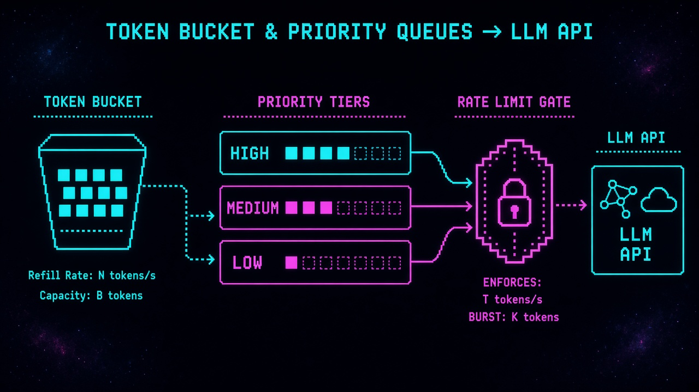

# Rate Limiting & Throughput

> Protect your models, your budget, and your other customers by limiting and shaping traffic in tokens, not just requests.

## TL;DR
- **Rate limiting** is like a nightclub bouncer - only so many people enter per minute, so the room never gets dangerously full.
- **Token buckets** are like a jar that refills with coins at a steady pace - you can spend a burst, but then you wait for the refill.
- **Token-based quotas** are like charging by the weight of luggage instead of the number of bags - one huge prompt costs more than ten tiny ones.
- **Concurrency limits** are like checkout lanes - it doesn't matter how fast people arrive, only how many can be served at once.

## Quickstart (Do this now)
1. **Measure in tokens**: Track input + output tokens per request, per user, per tenant, per minute
2. **Choose limits at three levels**: Per user (fairness), per tenant (contract), global (provider or GPU capacity)
3. **Use a token bucket**: Allows short bursts while enforcing a long-run average
4. **Limit concurrency too**: Cap in-flight requests per model replica and per tenant
5. **Return helpful errors**: HTTP 429 with `Retry-After` and remaining-quota headers

## The Idea (Slightly deeper)
Traditional rate limiting counts **requests per second (QPS)**. For LLMs, that is a poor proxy: a 50-token prompt and a 100,000-token prompt are both "one request" but differ in cost and GPU time by orders of magnitude. Providers therefore limit **requests per minute (RPM)** and **tokens per minute (TPM)** together, and your own limits should too. Because output length isn't known upfront, estimate using `max_tokens`, reserve that amount, then **reconcile** with actual usage after completion.

The standard algorithms are **token bucket** (refill at a fixed rate, allow bursts up to bucket size), **leaky bucket** (smooth output rate), and **sliding window** (accurate counts, more memory). Distributed limits need a shared store - commonly Redis with atomic scripts - or a gateway that enforces quotas centrally. Local, per-instance counters are fast but let total traffic exceed the limit as you scale out.

**Throughput** is the other half. Inference engines use **continuous batching**, so more concurrent requests increase total tokens/second but also raise latency per request. There is a knee in the curve: beyond saturation, latency explodes. Set concurrency limits near that knee, use **queues with bounded depth**, and apply **priority classes** so interactive traffic beats batch jobs. When you are over capacity, **shed** or **queue** deliberately rather than letting timeouts do it for you.

Finally, quotas are a **product and cost control**. Budget caps per tenant, plan tiers, and spend alerts prevent a runaway agent loop from creating a surprise bill. Expose usage to customers so limits feel predictable rather than arbitrary.

## Diagram

## Key Concepts
- **RPM / TPM**: Requests per minute and tokens per minute - the two limits most LLM providers enforce
- **Token Bucket**: Burst-friendly algorithm with a refill rate and capacity
- **Sliding Window**: Counting events in a moving time window for precise limits
- **Concurrency Limit**: Maximum in-flight requests, protecting GPU memory and latency
- **Priority Queues & Fair Scheduling**: Preventing one tenant or job class from starving others
- **Quota Reconciliation**: Reserve estimated tokens upfront, adjust to actual usage after completion
- **Budget Caps**: Hard or soft monetary limits per tenant, key, or agent run

## When to Use This
- **Use when**: You serve multiple users or tenants from shared model capacity
- **Use when**: You call providers with RPM/TPM limits and need to stay under them
- **Use when**: Agents or batch jobs can generate unbounded calls
- **Don't use when**: A single-user local tool where limits only get in the way
- **Consider alternatives**: Provisioned throughput or dedicated capacity if limits keep blocking legitimate traffic

## Real-World Examples
- **OpenAI rate limits**: RPM, TPM, and usage tiers → [Rate limits](https://platform.openai.com/docs/guides/rate-limits) (documents headers and tiers, making client-side limiting practical)
- **Anthropic rate limits**: Token bucket limits per model → [Rate limits](https://docs.anthropic.com/en/api/rate-limits) (explicitly describes token-bucket behavior and input/output token limits)
- **Azure API Management token limits**: Gateway-enforced TPM → [azure-openai-token-limit policy](https://learn.microsoft.com/en-us/azure/api-management/azure-openai-token-limit-policy) (per-key or per-tenant token quotas without touching app code)
- **Amazon Bedrock quotas**: Account and model quotas → [Bedrock quotas](https://docs.aws.amazon.com/bedrock/latest/userguide/quotas.html) (shows how TPM and RPM quotas apply and can be raised)
- **LiteLLM virtual keys**: Per-key budgets and limits → [Virtual keys](https://docs.litellm.ai/docs/proxy/virtual_keys) (spend tracking and rate limits per team or user in an open-source proxy)
- **Envoy global rate limiting**: Distributed limits at the proxy → [Global rate limiting](https://www.envoyproxy.io/docs/envoy/latest/intro/arch_overview/other_features/global_rate_limiting) (shared limit service for consistent enforcement)

## Common Pitfalls
- **Counting only requests**: A few huge prompts exhaust capacity while QPS looks fine
- **Per-instance counters**: Scale-out multiplies your effective limit
- **No output-token reservation**: Long generations overshoot the quota after the fact
- **Retrying 429s immediately**: Clients amplify the overload (see [Idempotency, Retries & Delivery](idempotency-retries-delivery.md))
- **One global limit for everyone**: A single heavy tenant causes 429s for all

## Deep Dives & "Why it's awesome"
- **[Scaling your API with rate limiters (Stripe)](https://stripe.com/blog/rate-limiters)** - Four limiter types, including load shedders, from a production API
- **[Rate Limiting pattern (Azure)](https://learn.microsoft.com/en-us/azure/architecture/patterns/rate-limiting-pattern)** - Design guidance for throttling and quota strategies
- **[Token bucket](https://en.wikipedia.org/wiki/Token_bucket)** - Algorithm background and variations
- **[Redis rate limiting](https://redis.io/glossary/rate-limiting/)** - Common distributed implementations on Redis
- **[Azure OpenAI gateway guide](https://learn.microsoft.com/en-us/azure/architecture/ai-ml/guide/azure-openai-gateway-guide)** - Architecture for quotas and chargeback in front of model endpoints
- **[Queue-Based Load Leveling](https://learn.microsoft.com/en-us/azure/architecture/patterns/queue-based-load-leveling)** - Smooth bursts into steady model consumption

## Next Steps
- **Learn more**: [AI Request Path & Gateways](ai-request-path-and-gateways.md) - Enforce quotas where all traffic converges
- **Learn more**: [Multi-Tenancy for AI](multi-tenancy-for-ai.md) - Fair-share quotas and noisy-neighbor protection
- **Dive deeper**: [Event-Driven AI Pipelines](event-driven-ai-pipelines.md) - Queues as a throughput buffer
- **Connect**: [Inference Infrastructure](../ai-architecture-topics/inference-infrastructure.md) - Capacity planning for GPUs and accelerators
- **Connect**: [Estimation Techniques](../solution-architecture/estimation-techniques.md) - Size capacity and cost from token volumes
