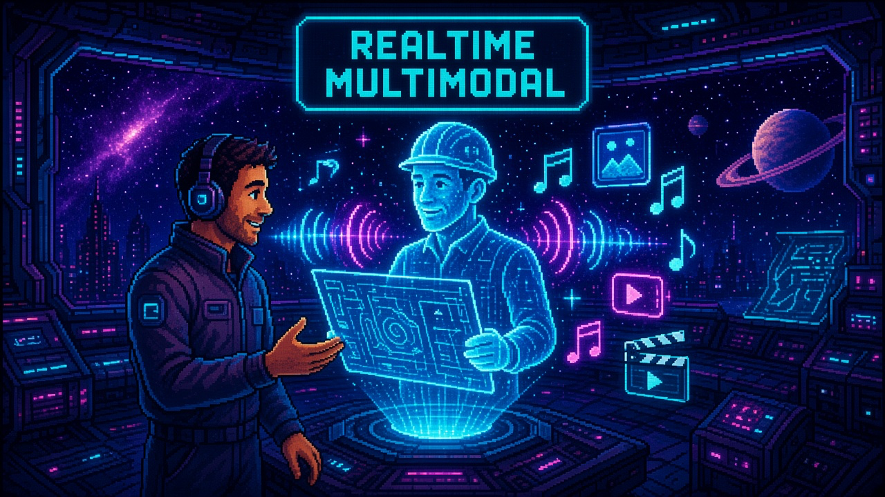
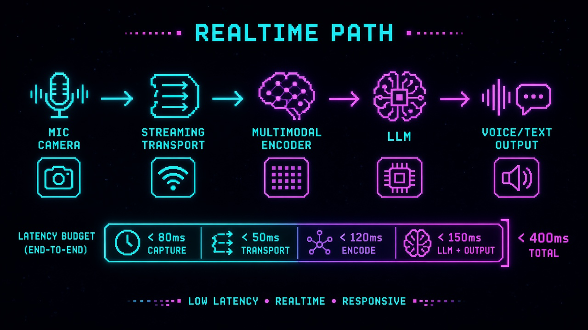

# Realtime & Multimodal AI Architecture

> Build AI that listens, sees, and answers in the time it takes a human to pause, without glitches or runaway cost.

## TL;DR
- **Streaming** is like a live radio broadcast - words arrive as they are produced instead of after the whole show.
- **Voice pipelines** are like a relay race - speech-to-text, LLM, then text-to-speech, each handing off to the next.
- **Speech-to-speech models** are like a bilingual friend who thinks and talks directly - fewer hops, lower latency.
- **Turn detection** is like knowing when it's your turn to speak - cut in too early and it's rude, too late and it's awkward.
- **Multimodal inputs** (images, audio, video) are like giving the model eyes and ears, with a bigger token bill.

## Quickstart (Do this now)
1. **Set a latency budget**: For voice, aim for roughly 500-800 ms from user stop-speaking to first audio out
2. **Stream everything**: Stream tokens from the LLM and audio from the speech synthesizer
3. **Pick a transport**: WebRTC for browsers and mobile audio, WebSocket for server-to-server streams
4. **Choose pipeline or native**: Cascaded STT-LLM-TTS for control, or a realtime speech-to-speech model for speed
5. **Handle interruptions**: Support barge-in, cancel generation, and flush audio buffers
6. **Plan degradation**: Fall back to text, a smaller model, or a cached response when latency spikes

## The Idea (Slightly deeper)
Realtime AI is a **latency-first** architecture. Each hop adds delay: network, voice activity detection, transcription, model time-to-first-token, synthesis, and playback. The classic **cascaded pipeline** (STT, LLM, TTS) gives you swappable components, text-level guardrails, and tool use at the cost of accumulated latency. **Native audio models** accept and produce speech directly, preserving tone and cutting hops, but offer less transparency and different tooling.

Transport matters. **WebRTC** handles jitter, packet loss, and echo cancellation for client audio; **WebSockets** suit server-side streaming and tool events. A **voice agent** adds turn detection, interruption handling, and tool calls that must not block the audio stream: speak a short filler, call the tool asynchronously, then continue.

**Multimodal** systems add vision and documents. Images and video frames are converted to tokens, so cost and latency scale with resolution and frame rate. Common tactics: downscale, sample keyframes, run lightweight detectors at the edge, and send only relevant regions or frames to the large model. Safety applies per modality: transcripts for logging, consent for recording, and PII redaction in audio and images.

## Diagram

## Key Concepts
- **Time to First Token / First Audio**: The user-perceived latency metrics that matter most
- **VAD & Turn Detection**: Deciding when the user has started and finished speaking
- **Barge-In**: Letting users interrupt the assistant mid-sentence
- **Cascaded vs Speech-to-Speech**: Modular STT-LLM-TTS vs a single audio-native model
- **WebRTC / WebSocket**: Low-latency media transport vs general bidirectional streaming
- **Frame Sampling**: Selecting video frames to control tokens and cost
- **Edge Inference**: Running small models near the user for detection, VAD, or on-device privacy
- **Jitter Buffer**: Smoothing network variation in streamed audio

## When to Use This
- **Use when**: Interaction is conversational (voice agents, live translation, copilots, support lines)
- **Use when**: Inputs are inherently visual or audio (documents, cameras, meetings, field work)
- **Use when**: Perceived speed decides adoption
- **Don't use when**: Asynchronous text workflows meet the need - batch is cheaper and simpler
- **Consider alternatives**: Push-to-talk or turn-based UX when reliability beats naturalness

## Real-World Examples
- **OpenAI Realtime API**: Low-latency speech-to-speech over WebRTC and WebSocket → [Realtime Guide](https://platform.openai.com/docs/guides/realtime) (native audio, interruption handling, and function calling in one API)
- **Gemini Live API**: Streaming audio, video, and text sessions → [Live API](https://ai.google.dev/gemini-api/docs/live) (multimodal bidirectional streaming with tool use)
- **LiveKit Agents**: Open-source framework for realtime voice and video agents → [LiveKit Agents](https://docs.livekit.io/agents/) (WebRTC infrastructure plus pluggable STT, LLM, and TTS)
- **Pipecat**: Open-source pipeline for voice and multimodal agents → [Pipecat Docs](https://docs.pipecat.ai/) (composable frames and processors for cascaded designs)

## Common Pitfalls
- **Batch thinking**: Waiting for full responses before speaking destroys the experience
- **Blocking tool calls**: Silent seconds while an API runs - narrate or acknowledge first
- **Ignoring interruptions**: Assistants that talk over users feel broken
- **Echo and noise**: Missing echo cancellation causes the agent to hear itself
- **Unbounded media cost**: High-resolution frames at high frame rates multiply tokens
- **Weak observability**: Log timings per stage, plus transcripts, to find the slow hop
- **Compliance gaps**: Recording and biometric voice data need consent and retention rules

## Deep Dives & "Why it's awesome"
- **[OpenAI Voice Agents Guide](https://platform.openai.com/docs/guides/voice-agents)** - Compare speech-to-speech and chained architectures
- **[Gemini API Audio Understanding](https://ai.google.dev/gemini-api/docs/audio)** - Native audio input for transcription and analysis
- **[Gemini Image Understanding](https://ai.google.dev/gemini-api/docs/image-understanding)** - Vision inputs, limits, and token behavior
- **[OpenAI Images and Vision](https://platform.openai.com/docs/guides/images-vision)** - Image detail levels and cost trade-offs
- **[WebRTC](https://webrtc.org/)** - The standard for real-time browser media transport
- **[MDN WebSocket API](https://developer.mozilla.org/en-US/docs/Web/API/WebSockets_API)** - Fundamentals for bidirectional streaming

## Realtime Latency Checklist
- **Budget**: Time target allocated per stage (network, STT, LLM, TTS)
- **Streaming**: Tokens and audio streamed end to end
- **Interrupts**: Barge-in cancels generation and audio playback
- **Fallbacks**: Text mode, smaller model, or cached phrases on degradation
- **Telemetry**: Per-stage latency, interruption rate, and word error rate tracked

## Next Steps
- **Learn more**: [Agent Loop and Harness](agent-loop-and-harness.md) - Tool calls inside a live conversation
- **Learn more**: [AI Cost and Token Economics](ai-cost-and-token-economics.md) - Audio and image tokens in the budget
- **Go deeper**: [Serving and Scaling](../ai-architecture-topics/serving-and-scaling.md) - Streaming inference and autoscaling
- **Go deeper**: [On-Device vs VM](../ai-architecture-topics/on-device-vs-vm.md) - Edge versus cloud inference for latency and privacy
- **Plan it**: [Quality Attributes](../solution-architecture/quality-attributes.md) - Turn latency and availability into requirements
- **Try it**: [LiveKit Agents Quickstart](https://docs.livekit.io/agents/start/voice-ai/) - Ship a voice agent prototype
