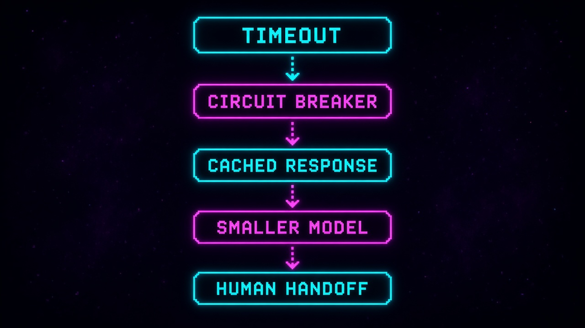

# Reliability & Failure Design

> Keep your AI product useful when models are slow, providers go down, and tools misbehave - by designing for failure instead of hoping it won't happen.

## TL;DR
- **Timeouts** are like an egg timer - you decide in advance how long you'll wait instead of standing at the stove forever.
- **Circuit breakers** are like household fuse boxes - when a dependency keeps failing, the breaker trips to protect everything else, then tests the line before reconnecting.
- **Bulkheads** are like watertight compartments on a ship - one flooded compartment doesn't sink the vessel.
- **Fallbacks** are like a backup generator - a smaller model, cached answer, or "try again later" message beats a blank screen.

## Quickstart (Do this now)
1. **Set a deadline per request**: Propagate one overall time budget (for example 30 seconds) down through every hop
2. **Set per-call timeouts below the deadline**: Separate connect, time-to-first-token, and total generation timeouts
3. **Add a circuit breaker per provider and tool**: Open after N failures or high error rate; probe in half-open state
4. **Define a fallback ladder**: Primary model → secondary provider → smaller model → cached or templated answer
5. **Isolate workloads**: Separate pools for interactive chat, batch jobs, and each tenant tier

## The Idea (Slightly deeper)
Reliability in AI systems is mostly about **bounded waiting** and **bounded blast radius**. LLM calls are slow and variable - a single request can take 200 ms or 90 seconds - so every call needs a **timeout**, and the sum of timeouts across retries must fit in a **deadline** the user actually tolerates. For streaming, use a **time-to-first-token** timeout and an **inter-token idle** timeout, because a connection that hangs mid-stream is worse than one that fails fast.

A **circuit breaker** wraps a dependency and counts failures. Closed means calls flow; open means calls are rejected immediately without touching the struggling service; half-open lets a few probes through to test recovery. This turns a slow, cascading failure into a fast, contained one. Pair it with **retries and jitter** (see [Idempotency, Retries & Delivery](idempotency-retries-delivery.md)) - retries handle blips, breakers handle sustained outages.

**Bulkheads** partition resources - thread pools, connection pools, GPU replicas, token quotas - so a noisy workload cannot starve the rest. A runaway agent loop or a huge batch embedding job should not take down live chat. **Load shedding** goes further: when saturated, reject low-priority work early (with 429 or 503) so high-priority requests still finish on time.

**Graceful degradation** is the payoff. Define what "reduced but useful" looks like: route to a cheaper model, skip reranking, drop optional tools, return retrieved snippets without synthesis, or serve a cached answer with a freshness note. Avoid fallbacks that are rarely exercised - they hide bugs until the worst moment, so test them with chaos drills and regular traffic percentages.

## Diagram

## Key Concepts
- **Deadline Propagation**: One overall time budget passed down the call chain so inner calls never outlive the user's patience
- **Time-to-First-Token (TTFT) Timeout**: Fail fast if the model has not started responding
- **Circuit Breaker**: Closed / open / half-open state machine that stops calling a failing dependency
- **Bulkhead**: Resource isolation per workload, tenant, or dependency
- **Load Shedding**: Deliberately rejecting excess or low-priority work to protect latency of the rest
- **Graceful Degradation**: Serving a reduced but useful result when a component fails
- **Health Checks & Failover**: Detecting bad replicas or regions and routing around them

## When to Use This
- **Use when**: You depend on external LLM providers, tool APIs, or vector databases
- **Use when**: Agents loop or chain many calls where one failure can cascade
- **Use when**: You have SLOs for latency or availability
- **Don't use when**: Internal experiments where failure simply means re-running a notebook
- **Consider alternatives**: A managed AI gateway with built-in fallbacks (see [AI Request Path & Gateways](ai-request-path-and-gateways.md)) rather than implementing everything in each service

## Real-World Examples
- **AWS Builders' Library**: Operating at scale → [Avoiding fallback in distributed systems](https://aws.amazon.com/builders-library/avoiding-fallback-in-distributed-systems/) (a critical view of fallbacks that rarely run, with advice on keeping them honest)
- **Google SRE**: Cascading failure playbook → [Addressing cascading failures](https://sre.google/sre-book/addressing-cascading-failures/) (explains how overload spreads and how load shedding and deadlines stop it)
- **Envoy circuit breaking**: Proxy-level protection → [Circuit breaking](https://www.envoyproxy.io/docs/envoy/latest/intro/arch_overview/upstream/circuit_breaking) (infrastructure-level limits without changing application code)
- **LiteLLM routing & fallbacks**: Multi-provider LLM reliability → [Routing and fallbacks](https://docs.litellm.ai/docs/routing) (retries, cooldowns, and fallback model lists for LLM APIs)
- **Amazon Bedrock cross-region inference**: Capacity resilience → [Cross-region inference](https://docs.aws.amazon.com/bedrock/latest/userguide/cross-region-inference.html) (automatically routes to other regions during traffic spikes)

## Common Pitfalls
- **No timeout on LLM calls**: SDK defaults can be minutes long and pin your workers
- **Timeouts longer than the caller's**: The upstream gave up while you keep burning tokens
- **Fallback to an untested path**: The backup model has different prompt formats, context limits, or tool support
- **Shared pool for all traffic**: Batch evaluations starve interactive users
- **Agent loops without limits**: Cap steps, tokens, wall-clock time, and spend per run

## Deep Dives & "Why it's awesome"
- **[Circuit Breaker (Martin Fowler)](https://martinfowler.com/bliki/CircuitBreaker.html)** - The classic short explanation of the state machine
- **[Using load shedding to avoid overload](https://aws.amazon.com/builders-library/using-load-shedding-to-avoid-overload/)** - Real techniques from Amazon for staying fast under pressure
- **[Handling Overload (Google SRE)](https://sre.google/sre-book/handling-overload/)** - Per-client quotas, criticality, and graceful degradation
- **[Bulkhead pattern (Azure)](https://learn.microsoft.com/en-us/azure/architecture/patterns/bulkhead)** - How to partition resources to contain failures
- **[Circuit Breaker pattern (Azure)](https://learn.microsoft.com/en-us/azure/architecture/patterns/circuit-breaker)** - Implementation guidance and when not to use it
- **[OpenAI production best practices](https://platform.openai.com/docs/guides/production-best-practices)** - Provider guidance on scaling, latency, and error handling

## Next Steps
- **Learn more**: [Caching for AI](caching-for-ai.md) - Serve stale-but-useful answers during incidents
- **Learn more**: [Rate Limiting & Throughput](rate-limiting-and-throughput.md) - Shed load before it becomes failure
- **Dive deeper**: [AI Request Path & Gateways](ai-request-path-and-gateways.md) - Centralize timeouts, breakers, and failover
- **Connect**: [Model Routing](../ai-architecture-topics/model-routing.md) - Choose fallback models by cost, latency, and capability
- **Connect**: [Multi-LLM](../ai-architecture-topics/multi-llm.md) - Provider diversity as a reliability strategy
