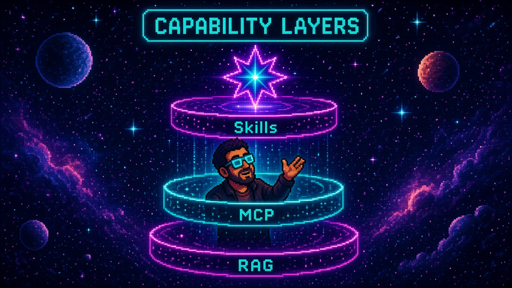
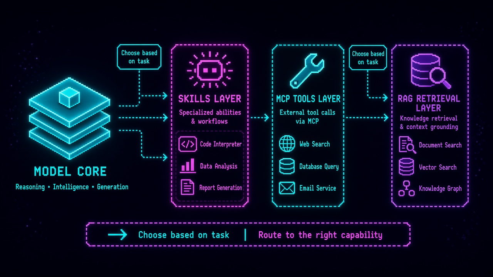

# Skills, MCP & RAG Capability Layers

> Pick the right layer - knowledge, tools, or procedures - so your AI gains capabilities without drowning in context.

## TL;DR
- **RAG** is like a library card - the model looks up facts it was never trained on.
- **MCP tools** are like a workshop - the model can do things (query a database, open a ticket) through standard plugs.
- **Skills** are like recipe cards - packaged instructions and scripts the agent loads only when the task calls for them.
- **Rules / system prompts** are like house rules - always-on guidance that applies to every task.
- **Progressive disclosure** is like a table of contents - show names first, load full details only when needed.

## Quickstart (Do this now)
1. **Classify the gap**: Missing knowledge (RAG), missing action (tool/MCP), or missing procedure (skill/rule)?
2. **Start small**: Always-on rules for must-follow policy; everything else on demand
3. **Add RAG for facts**: Index docs, tickets, or code; retrieve top-k per query
4. **Add MCP for actions**: Connect existing MCP servers before writing custom integrations
5. **Package repeatable work as skills**: A folder with instructions, examples, and scripts
6. **Measure context cost**: Count tokens consumed by tool definitions and loaded instructions

## The Idea (Slightly deeper)
Modern AI systems extend a base model through layered capabilities, each with a different cost profile. **System prompts and rules** are always loaded: cheap to reason about, expensive in tokens if bloated. **RAG** injects retrieved knowledge at query time, solving freshness and private data. **Tools via MCP** give the model verbs - read, write, call - behind a standard protocol. **Skills** package procedural expertise (instructions plus scripts and resources) and use **progressive disclosure**: only a short name and description sit in context until the agent decides the skill is relevant.

The key architectural question is *where does this capability live and when does it enter context?* Always-on, retrieved per query, loaded per task, or invoked as an action. Mixing these deliberately keeps prompts small, behavior consistent, and costs predictable.

A useful rule of thumb: **facts go in RAG, actions go in tools, workflows go in skills, invariants go in rules**. Fine-tuning (see [Model Customization Decision](model-customization-decision.md)) is for style and behavior that none of these layers can reliably deliver.

## Diagram

## Key Concepts
- **Retrieval-Augmented Generation (RAG)**: Fetching relevant documents and adding them to the prompt
- **MCP Server**: A service exposing tools, resources, and prompts over the Model Context Protocol
- **Tool Definition Overhead**: Tokens spent describing tools, which grows with every server you attach
- **Agent Skill**: A folder with a SKILL file, instructions, and optional scripts loaded on demand
- **Progressive Disclosure**: Metadata first, details later, resources last
- **Rules**: Persistent, scoped instructions applied automatically to a project or task type
- **Capability Routing**: Choosing which layer or tool to use for a given request

## When to Use This
- **Use when**: The model lacks private, fresh, or large-scale knowledge (RAG)
- **Use when**: The agent must act on external systems with auditable calls (MCP)
- **Use when**: A workflow repeats and benefits from tested instructions and scripts (skills)
- **Don't use when**: A short prompt already does the job - extra layers add latency and failure modes
- **Consider alternatives**: Fine-tuning or a stronger model if behavior, not capability, is the issue

## Real-World Examples
- **Anthropic Agent Skills**: Folder-based skills with progressive disclosure → [Equipping agents for the real world with Agent Skills](https://www.anthropic.com/engineering/equipping-agents-for-the-real-world-with-agent-skills) (clear design rationale for loading expertise on demand)
- **Model Context Protocol**: Open standard for tools and data → [MCP Docs](https://modelcontextprotocol.io/) (one integration works across many clients and models)
- **Cursor Rules**: Scoped persistent instructions → [Cursor Rules](https://docs.cursor.com/context/rules) (always-on and file-scoped guidance for coding agents)
- **Original RAG**: Retrieval plus generation for knowledge-intensive tasks → [RAG paper](https://arxiv.org/abs/2005.11401) (the pattern most knowledge assistants still follow)

## Common Pitfalls
- **Tool overload**: Dozens of MCP tools bloat context and hurt selection - expose only what is needed
- **RAG for everything**: Retrieval cannot teach a procedure or perform an action
- **Giant always-on prompts**: Move situational guidance into skills or retrieved context
- **Untrusted servers and docs**: Retrieved text and third-party MCP servers can carry prompt injection - sandbox and review
- **No ownership or versioning**: Skills and rules are code; test and version them
- **Duplicated capabilities**: The same knowledge in a rule, a skill, and an index will drift

## Deep Dives & "Why it's awesome"
- **[Agent Skills Overview](https://docs.anthropic.com/en/docs/agents-and-tools/agent-skills/overview)** - How skills are structured, discovered, and loaded
- **[MCP Specification](https://modelcontextprotocol.io/specification)** - Tools, resources, prompts, and authorization in detail
- **[Writing Effective Tools for Agents](https://www.anthropic.com/engineering/writing-tools-for-agents)** - Designing tool surfaces models can use well
- **[Effective Context Engineering](https://www.anthropic.com/engineering/effective-context-engineering-for-ai-agents)** - Deciding what enters context and when
- **[Anthropic Contextual Retrieval](https://www.anthropic.com/news/contextual-retrieval)** - Improving RAG recall with contextual chunks and reranking
- **[MCP Servers Repository](https://github.com/modelcontextprotocol/servers)** - Reference servers to learn from and reuse

## Layer Selection Checklist
- **Knowledge gap**: Index it, retrieve it, cite it
- **Action gap**: Wrap it as an MCP tool with least-privilege credentials
- **Procedure gap**: Write a skill with examples and a test task
- **Invariant**: Put it in a short, always-on rule
- **Budget**: Track token overhead per layer and prune regularly

## Next Steps
- **Learn more**: [Multi-Agent and Agent Protocols](multi-agent-and-agent-protocols.md) - MCP alongside agent-to-agent delegation
- **Learn more**: [Model Customization Decision](model-customization-decision.md) - When layers are not enough
- **Go deeper**: [Advanced RAG](../ai-architecture-topics/advanced-rag.md) - Retrieval patterns beyond naive top-k
- **Go deeper**: [Model Context Protocol](../ai-for-software-engineering-skills/model-context-protocol.md) - MCP in engineering practice
- **Apply it**: [Secure Model Selection and Skills](../ai-for-software-engineering-skills/secure-model-selection-and-skills.md) - Governing skills and models safely
- **Try it**: [Build an MCP Server](https://modelcontextprotocol.io/quickstart/server) - Expose your first tool
