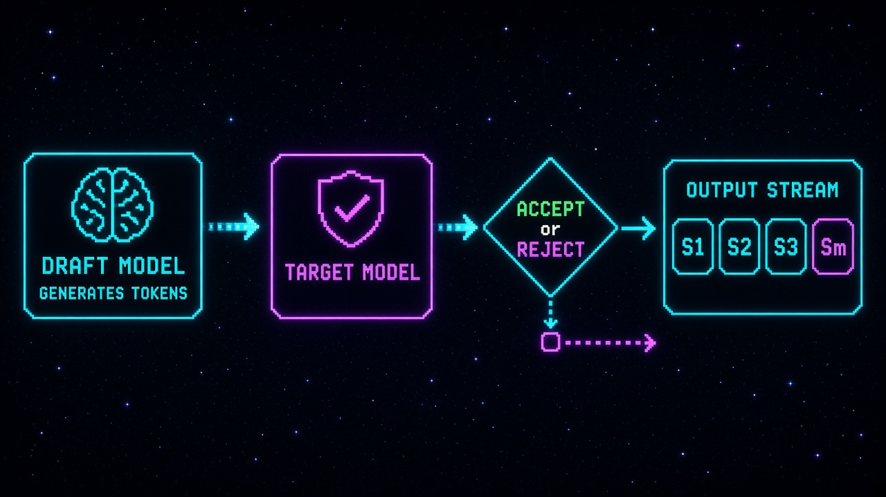

# Speculative Decoding & Serving Engines

> Generate tokens faster with draft-and-verify, then choose the serving engine whose strengths match your models, hardware, and traffic.

## TL;DR
- **Speculative decoding** is like an intern drafting a paragraph that a senior editor checks in one read - when the draft is good, you save many slow editing passes.
- **The draft model** is the quick intern; **the target model** is the editor whose approval defines the final text.
- **A serving engine** is like the kitchen's operating system - it schedules orders, manages memory, and keeps GPUs busy.
- **Engine choice** is like picking a car for the road: highway speed, off-road flexibility, or fuel economy are different trade-offs.

## Quickstart (Do this now)
1. **Profile first**: Measure time-to-first-token, inter-token latency, and throughput at your real batch sizes
2. **Pick a baseline engine**: Start with vLLM or your cloud's managed endpoint and record numbers
3. **Try speculative decoding**: Enable a draft model or n-gram/EAGLE-style speculation and compare latency and cost
4. **Benchmark with your traffic**: Replay production prompt and output length distributions, not synthetic ones
5. **Decide by constraint**: Choose on latency SLO, hardware fit, model support, and ops burden - not on peak benchmarks

## The Idea (Slightly deeper)
LLM decoding is **sequential and memory-bandwidth-bound**: each new token needs a full pass over the weights, so GPUs sit underused at small batch sizes. **Speculative decoding** exploits that slack. A cheap **draft** mechanism proposes *k* tokens; the **target** model scores all of them in a single parallel forward pass; tokens are accepted until the first disagreement, and the target supplies the corrected token. With the right acceptance rule, the **output distribution is identical** to normal decoding - you gain speed, not a different answer.

The speedup depends on the **acceptance rate** (how often drafts match) and on spare compute. It works best with **low to moderate batch sizes**, latency-sensitive interactive use, and predictable text such as code, structured output, or summarization of provided context. At high batch sizes the GPU is already busy and gains shrink or turn negative. Variants differ in where drafts come from: a **separate small model**, **extra heads** (Medusa), **feature-level drafting** (EAGLE), or **prompt lookup / n-gram** matching that needs no extra model.

**Serving engines** package these ideas along with continuous batching, paged KV cache, quantization, parallelism, and APIs. **vLLM** offers broad model support and a strong open ecosystem; **SGLang** emphasizes prefix reuse and structured generation; **TensorRT-LLM** extracts maximum performance on NVIDIA hardware with a heavier build step; **Hugging Face TGI** integrates tightly with the Hub; **llama.cpp** and Ollama target CPUs, laptops, and edge devices; **NVIDIA Dynamo** and **llm-d** orchestrate disaggregated, multi-node serving. Choose by **hardware, model family, latency SLO, feature needs, and team skills**; plan to re-benchmark often because engines change quickly.

## Diagram

## Key Concepts
- **Draft / Target Model**: Fast proposer and authoritative verifier of tokens
- **Acceptance Rate**: Fraction of drafted tokens the target accepts; drives realized speedup
- **Medusa / EAGLE**: Draft approaches using extra heads or feature prediction instead of a separate model
- **Prompt Lookup (n-gram) Speculation**: Drafting by copying spans from the prompt, with no extra model
- **Continuous Batching & Paged KV**: Core engine features that determine throughput
- **Disaggregated Serving**: Separating prefill and decode onto different workers
- **Time-to-First-Token vs Inter-Token Latency**: Separate metrics, helped by different optimizations

## When to Use This
- **Use when**: Interactive latency is a product requirement and batch sizes are modest
- **Use when**: Outputs are predictable (code edits, JSON, summaries of given text)
- **Use when**: You self-host and can choose or tune the serving stack
- **Don't use when**: Workloads are large offline batches where throughput, not latency, matters
- **Consider alternatives**: Hosted APIs or managed endpoints when you lack GPU operations expertise

## Real-World Examples
- **vLLM speculative decoding**: Draft model, n-gram, and EAGLE options → [vLLM spec decode](https://docs.vllm.ai/en/latest/features/spec_decode.html) (a practical open-source implementation to test on your own traffic)
- **SGLang**: Fast engine with RadixAttention → [SGLang](https://github.com/sgl-project/sglang) (strong for prefix-heavy and structured-output workloads)
- **TensorRT-LLM**: NVIDIA-optimized runtime → [TensorRT-LLM](https://github.com/NVIDIA/TensorRT-LLM) (peak performance on NVIDIA GPUs with speculative and quantization support)
- **Text Generation Inference**: Hugging Face serving toolkit → [TGI](https://github.com/huggingface/text-generation-inference) (production server integrated with the Hub and common model formats)
- **llama.cpp**: Lightweight CPU/edge inference → [llama.cpp](https://github.com/ggml-org/llama.cpp) (runs quantized models on laptops and small devices)
- **NVIDIA Dynamo**: Distributed, disaggregated inference → [ai-dynamo/dynamo](https://github.com/ai-dynamo/dynamo) (orchestration for multi-node serving at scale)

## Common Pitfalls
- **Benchmarking on batch size 1 only**: Speculation looks great, then fades under production concurrency
- **Weak draft model**: Low acceptance means extra work and no speedup
- **Picking an engine from leaderboard numbers**: Your prompt lengths, models, and SLOs differ
- **Ignoring operability**: A faster engine that your team cannot debug or upgrade becomes a liability
- **Version lock-in**: Compiled engine builds tie you to specific GPU and model versions

## Deep Dives & "Why it's awesome"
- **[Fast Inference from Transformers via Speculative Decoding](https://arxiv.org/abs/2211.17192)** - The original draft-and-verify algorithm with the exactness guarantee
- **[Accelerating LLM Decoding with Speculative Sampling](https://arxiv.org/abs/2302.01318)** - DeepMind's independent formulation and results
- **[Medusa](https://arxiv.org/abs/2401.10774)** - Multiple decoding heads instead of a separate draft model
- **[EAGLE](https://arxiv.org/abs/2401.15077)** - Feature-level drafting with high acceptance rates
- **[DistServe](https://arxiv.org/abs/2401.09670)** - Why separating prefill and decode improves goodput

## Next Steps
- **Learn more**: [LLM Efficiency Techniques](llm-efficiency-techniques.md) - Where speculation fits among other levers
- **Learn more**: [KV Cache & Memory Cost](kv-cache-and-memory-cost.md) - Memory behavior that engines manage differently
- **Dive deeper**: [Prompt & Semantic Caching](prompt-and-semantic-caching.md) - Prefix reuse features in engines
- **Dive deeper**: [Rate Limiting & Throughput](rate-limiting-and-throughput.md) - Capacity and concurrency planning
- **Connect**: [Serving & Scaling](../ai-architecture-topics/serving-and-scaling.md) - Inference server fundamentals
- **Connect**: [On-Device vs VM](../ai-architecture-topics/on-device-vs-vm.md) - Where lightweight engines like llama.cpp fit
