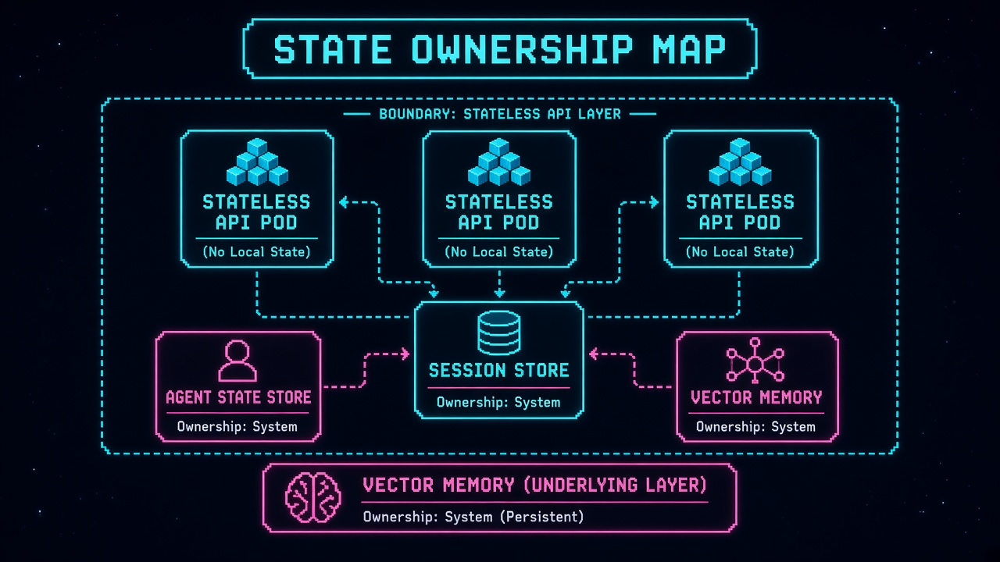

# State & Service Boundaries

> Keep the model stateless, put state in the right place, and draw boundaries around capabilities - so agents scale, recover, and evolve without a distributed tangle.

## TL;DR
- **Stateless model calls** are like a cashier with no memory - every request must carry everything needed, which is why your app has to remember for it.
- **Session and agent state** is like the order ticket in a kitchen - it tracks progress so any cook can pick up where another left off.
- **Modular boundaries** are like kitchen stations - grill, salad, and dessert each own their tools and talk through clear handoffs.
- **Premature microservices** are like hiring a separate chef for every ingredient - lots of coordination for very little cooking.

## Quickstart (Do this now)
1. **List your state types**: Conversation history, agent plan and scratchpad, tool results, user memory, and business data
2. **Externalize state**: Store it in a database or workflow engine keyed by session and run ID - not in process memory
3. **Make steps resumable**: Persist a checkpoint after each agent step so a crash replays from the last good point
4. **Draw boundaries by capability**: Separate retrieval, orchestration, tool execution, and model access behind interfaces
5. **Start modular, split later**: Keep a modular monolith until scale, team, or risk demands separate services

## The Idea (Slightly deeper)
LLM APIs are **stateless**: every call re-sends context. That pushes all continuity into your application, and agent systems quickly accumulate several kinds of state with different lifetimes. **Turn state** (the current prompt and tool results) lives for seconds. **Session state** (conversation history, plan, intermediate artifacts) lives for minutes to days. **Long-term memory** (preferences, learned facts) lives indefinitely. **Business state** (orders, tickets) belongs to systems of record that agents must not own.

The key design rule: **make compute replaceable by making state explicit**. Workers, inference replicas, and agent runners should be disposable; a checkpoint store or durable workflow records progress, so a retry or a different instance can resume. This also gives you human-in-the-loop pauses, time travel for debugging, and replay for evals. Beware of unbounded history: context windows and cost force you to **summarize, trim, or retrieve** state rather than replay it all.

On **boundaries**, align them with change rate, scaling profile, and trust. GPU-bound inference, I/O-bound tool calls, and CPU-bound parsing scale differently; untrusted tool execution needs sandboxing and its own permissions. Yet each network hop adds latency, failure modes, and versioning pain, so favor **modules with strict interfaces inside one deployable** first. Split a service out when it has a clear owner, a distinct scaling or security need, and a stable contract (for example, a tool server speaking MCP). Let **systems of record own business data**; agents propose changes through APIs with idempotency keys.

## Diagram

## Key Concepts
- **Stateless Inference**: Model calls carry all context; continuity is the app's job
- **Checkpointing**: Saving agent state after each step to enable resume, replay, and pause
- **Session vs Long-Term State**: Short-lived working context versus durable memory and business records
- **System of Record**: The authoritative store for business data that agents call, not copy
- **Bounded Context**: A module or service owning its data and vocabulary behind a clear interface
- **Modular Monolith**: One deployable with enforced internal boundaries, splittable later
- **Sandboxed Tool Execution**: Isolating code and tool runs from the orchestrator's privileges

## When to Use This
- **Use when**: Agents run multi-step tasks, long conversations, or need pause/resume and human approval
- **Use when**: Several teams build capabilities that must evolve independently
- **Use when**: Components have very different scaling or trust needs (GPU serving, code sandboxes)
- **Don't use when**: A single request-response call with a short prompt needs no persistence
- **Consider alternatives**: A modular monolith before splitting into services

## Real-World Examples
- **LangGraph persistence**: Checkpointers for agent graphs → [Persistence](https://langchain-ai.github.io/langgraph/concepts/persistence/) (thread state, resume, and time travel built into the agent loop)
- **Temporal**: Durable execution for long-running logic → [Temporal docs](https://docs.temporal.io/) (workflow history makes agent steps retryable and resumable)
- **OpenAI conversation state**: Managing multi-turn context → [Conversation state](https://platform.openai.com/docs/guides/conversation-state) (compares client-managed history and server-held state tradeoffs)
- **Model Context Protocol**: Standard tool-server boundary → [MCP](https://modelcontextprotocol.io/) (a stable contract that decouples tools from agent runtimes)
- **Twelve-Factor App**: Stateless processes principle → [Processes](https://12factor.net/processes) (the classic rationale for externalizing state)

## Common Pitfalls
- **State in process memory**: A restart or autoscale event wipes the conversation
- **Unbounded history**: Replaying every turn blows up cost and degrades answer quality
- **Agents owning business data**: Duplicated records diverge from the system of record
- **Microservices too early**: Network hops, versioning, and debugging overhead outweigh benefits
- **Shared database coupling**: Services reaching into each other's tables erase real boundaries

## Deep Dives & "Why it's awesome"
- **[Martin Fowler: Monolith First](https://martinfowler.com/bliki/MonolithFirst.html)** - Why to discover boundaries before distributing them
- **[Martin Fowler: Bounded Context](https://martinfowler.com/bliki/BoundedContext.html)** - A practical lens for drawing service boundaries
- **[Anthropic: Building Effective Agents](https://www.anthropic.com/engineering/building-effective-agents)** - Simple, composable agent patterns over heavy frameworks
- **[Microsoft: Saga pattern](https://learn.microsoft.com/en-us/azure/architecture/patterns/saga)** - Coordinating multi-step changes across services with compensation
- **[Azure: Anti-corruption layer](https://learn.microsoft.com/en-us/azure/architecture/patterns/anti-corruption-layer)** - Protect your domain from model- or vendor-specific shapes

## Next Steps
- **Learn more**: [Agent Memory Architecture](agent-memory-architecture.md) - Short-term, long-term, and retrieval-based memory
- **Learn more**: [Agent Loop & Harness](agent-loop-and-harness.md) - Where checkpoints and tool calls fit in the loop
- **Dive deeper**: [Background Jobs & Durable Workflows](background-jobs-and-durable-workflows.md) - Durable execution for long agent runs
- **Dive deeper**: [Idempotency, Retries & Delivery](idempotency-retries-delivery.md) - Safe retries when steps are resumed
- **Connect**: [Architectural Patterns & Styles](../solution-architecture/architectural-patterns-styles.md) - Monolith, modular, and service-based styles
- **Connect**: [AI Agents](../ai-architecture-topics/ai-agents.md) - Agent fundamentals and patterns
