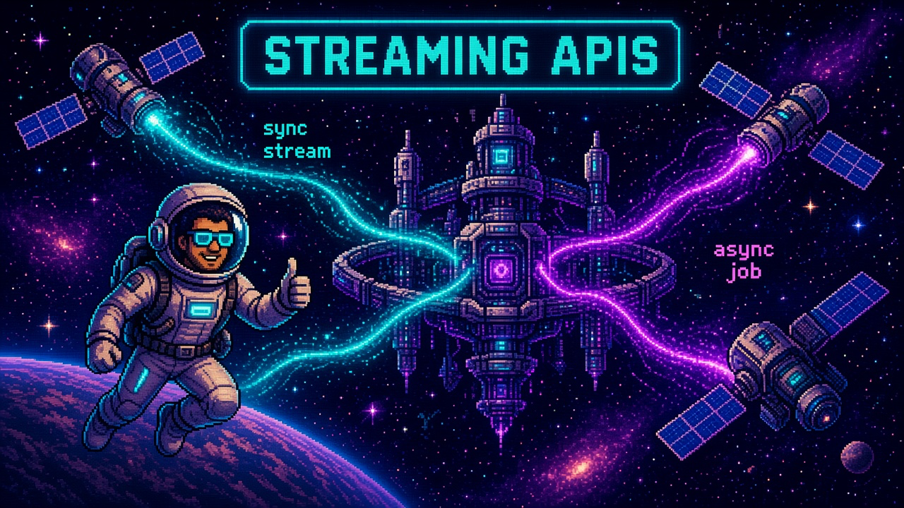
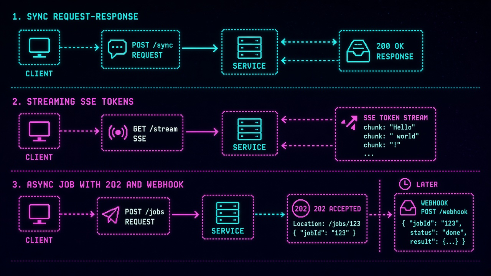

# Sync, Async & Streaming APIs

> Match the API style to how long the AI work takes and how the user experiences waiting.

## TL;DR
- **Synchronous APIs** are like ordering at a counter - you wait, and you get the result in the same interaction. Fine for short tasks.
- **Streaming (SSE)** is like watching a chef plate a dish live - you see progress immediately rather than waiting for the finished meal.
- **Async jobs with polling** are like dropping off dry cleaning - you get a ticket now and come back when it's ready.
- **Webhooks** are like a text message saying "your order is ready" - the server contacts you instead of you asking repeatedly.

## Quickstart (Do this now)
1. **Estimate duration per endpoint**: Under ~2 s → sync; seconds to a minute of generation → stream; minutes or more → async job
2. **Stream chat and generation**: Use Server-Sent Events so the first tokens appear within a second
3. **Return `202 Accepted` + job ID** for long tasks (deep research, batch, long agent runs) with a status URL
4. **Offer webhooks for completion**: Sign payloads, retry with backoff, and allow polling as a fallback
5. **Handle cancel and disconnect**: Stop generation when the client leaves to avoid paying for unseen tokens

## The Idea (Slightly deeper)
LLM latency is unusual: **time to first token** may be 300 ms, but the **full response** can take 30 seconds, and an agent run can take many minutes. A plain synchronous request-response ties up connections and hits gateway, proxy, and browser timeouts. The right pattern depends on duration and who is waiting.

**Streaming** returns tokens as they are generated. **Server-Sent Events (SSE)** are the common choice: one-way, text-based, over plain HTTP, with built-in reconnection semantics. **WebSockets** and gRPC streams are better for bidirectional, low-latency cases such as voice and realtime agents. Streaming improves perceived latency but adds complexity: partial output can't be fully validated by guardrails until finished, error handling must work mid-stream (send an error event), and proxies must not buffer the response.

For long-running work, use the **asynchronous request-reply** pattern: the client submits a job, gets `202 Accepted` with a job ID, and then **polls** a status endpoint or receives a **webhook** or push notification. Jobs need clear state (queued, running, succeeded, failed, canceled), durable results, and expiry. This pairs naturally with [background jobs and durable workflows](background-jobs-and-durable-workflows.md) and message queues. Provider batch APIs and "background mode" follow this exact pattern, often at lower cost.

**Webhooks** invert the flow, but make you responsible for security and reliability: **sign** payloads, verify timestamps against replay, deliver **at-least-once** with retries, and include event IDs so consumers can deduplicate (see [Idempotency, Retries & Delivery](idempotency-retries-delivery.md)). Always provide a polling endpoint as a safety net for missed webhooks.

## Diagram

## Key Concepts
- **Server-Sent Events (SSE)**: One-way event stream over HTTP, ideal for token streaming
- **WebSocket / gRPC Streaming**: Bidirectional channels for realtime and voice experiences
- **Async Request-Reply**: Submit work, receive a job handle, retrieve results later
- **`202 Accepted` + Status Resource**: Standard HTTP signal and polling endpoint for jobs
- **Webhook**: Server-initiated HTTP callback with signed payloads and retries
- **Backpressure**: Slowing producers when consumers can't keep up - important for streams
- **Cancellation Propagation**: Client disconnect or cancel request aborts generation and downstream work

## When to Use This
- **Use when**: Responses take longer than a few seconds or vary widely in length
- **Use when**: Users watch output appear (chat, copilots, code generation)
- **Use when**: Work runs minutes to hours (research agents, document processing, evaluation runs)
- **Don't use when**: Quick lookups or classifications that return in under a second - plain sync is simpler
- **Consider alternatives**: Provider batch APIs for non-urgent bulk jobs at reduced cost

## Real-World Examples
- **OpenAI streaming**: Token streaming over SSE → [Streaming responses](https://platform.openai.com/docs/guides/streaming-responses) (typed events make it simple to handle deltas, tool calls, and completion)
- **OpenAI background mode & webhooks**: Async long-running responses → [Background mode](https://platform.openai.com/docs/guides/background) (poll or get notified for jobs that exceed normal request timeouts)
- **Anthropic streaming**: Messages stream events → [Streaming messages](https://docs.anthropic.com/en/api/messages-streaming) (documents event types and mid-stream error handling)
- **Anthropic Message Batches**: Bulk async processing → [Batch processing](https://docs.anthropic.com/en/docs/build-with-claude/batch-processing) (cost-reduced asynchronous workloads with results retrieval)
- **Google AIP-151**: Long-running operation design → [Long-running operations](https://google.aip.dev/151) (a rigorous resource model for job status, cancellation, and results)

## Common Pitfalls
- **Proxy buffering**: Nginx or CDN buffers SSE, so users see nothing until the end
- **No cancellation**: Closed browser tabs keep generating and billing tokens
- **Idle timeouts mid-stream**: Load balancers close quiet connections; send heartbeats
- **Unsigned or non-idempotent webhooks**: Spoofed or duplicated events trigger wrong actions
- **No polling fallback**: Missed webhooks leave jobs "stuck" from the client's point of view

## Deep Dives & "Why it's awesome"
- **[Server-Sent Events (WHATWG spec)](https://html.spec.whatwg.org/multipage/server-sent-events.html)** - The authoritative definition of the SSE protocol
- **[Using server-sent events (MDN)](https://developer.mozilla.org/en-US/docs/Web/API/Server-sent_events/Using_server-sent_events)** - Practical client usage and reconnection behavior
- **[Asynchronous Request-Reply pattern (Azure)](https://learn.microsoft.com/en-us/azure/architecture/patterns/async-request-reply)** - Detailed pattern with polling and status endpoints
- **[Standard Webhooks](https://www.standardwebhooks.com/)** - Open specification for signing and delivering webhooks securely
- **[Stripe webhooks](https://docs.stripe.com/webhooks)** - Production-grade guidance on signature checks and retries
- **[gRPC core concepts](https://grpc.io/docs/what-is-grpc/core-concepts/)** - Unary, server, client, and bidirectional streaming explained

## Next Steps
- **Learn more**: [AI Request Path & Gateways](ai-request-path-and-gateways.md) - Make sure the whole path supports streaming
- **Learn more**: [Background Jobs & Durable Workflows](background-jobs-and-durable-workflows.md) - The engine behind async jobs
- **Dive deeper**: [Event-Driven AI Pipelines](event-driven-ai-pipelines.md) - Publish job completion events to many consumers
- **Connect**: [Serving & Scaling](../ai-architecture-topics/serving-and-scaling.md) - Inference-side batching and TTFT
- **Connect**: [AI Agents](../ai-architecture-topics/ai-agents.md) - Long-running agent runs and progress reporting
